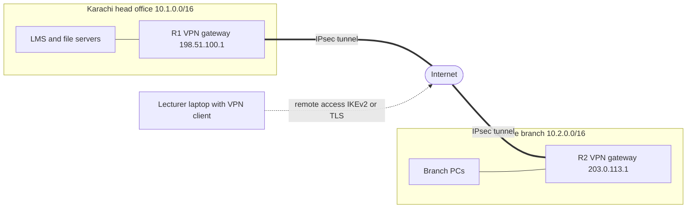
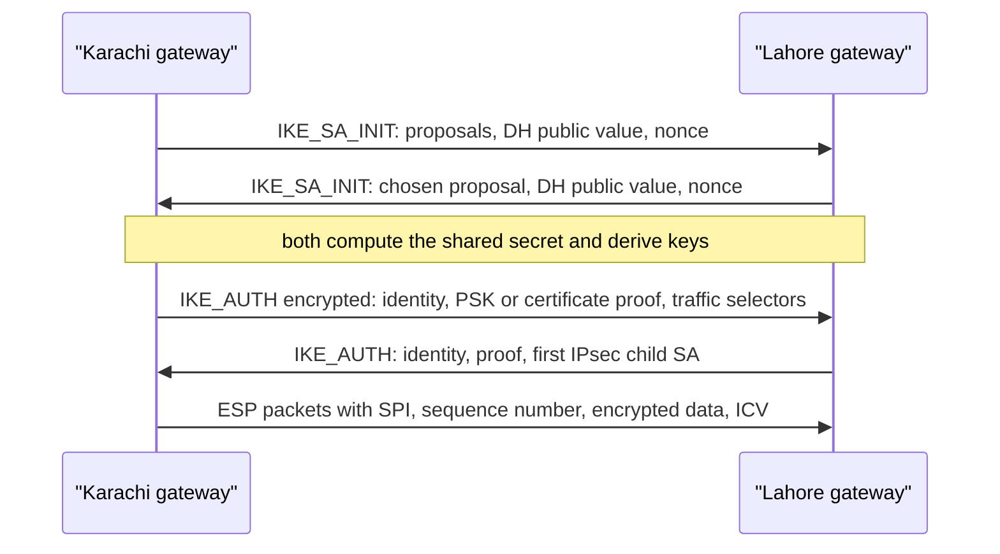
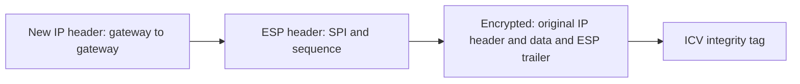
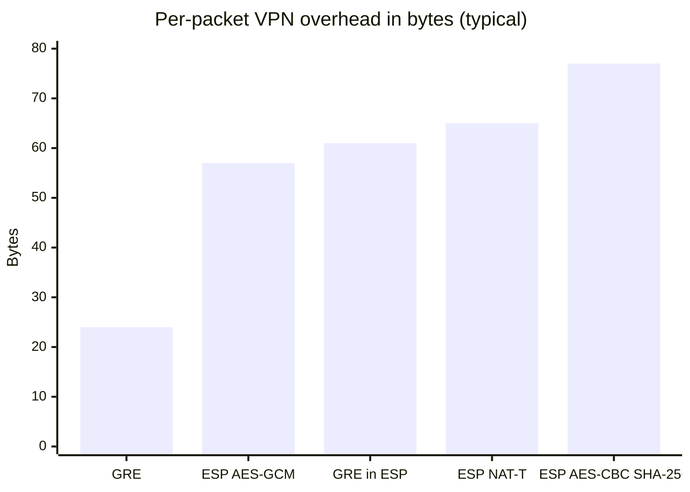

# Session 13: Virtual Private Networks

> [Cybersecurity and Digital Forensics](../../README.md) › [Term 1](../README.md) › [Module 4: Configuring Network Infrastructure](README.md) › **Session 13**

| ⏱ Estimated time | 📋 Prerequisites |
|---|---|
| 3 hours | Session 7 (routing), Session 10 (certificates, security terms) |

| ⬅ [Previous: Session 12](session-12-layer-3-switching.md) | [Next: Session 14](session-14-wireless-lan-configuration.md) ➡ |
|:---|---:|

[](https://colab.research.google.com/github/Hamnakhan123/Cybersecurity-and-Digital-Forensics/blob/main/term-1/04-configuring-network-infrastructure/code/session-13-virtual-private-networks.ipynb) &nbsp;Run every Python example of this session in the notebook [`code/session-13-virtual-private-networks.ipynb`](code/session-13-virtual-private-networks.ipynb).

---

## 🎯 Learning objectives

- Define a **VPN** and explain its purpose in network communication.
- Describe the **aspects of a secure VPN system**: confidentiality, integrity, authentication, anti-replay, key exchange.
- Explain the **advantages** (and limits) of using a VPN.
- Describe the **types of VPN**: site-to-site, remote access, IPsec, SSL/TLS, GRE over IPsec, DMVPN, MPLS VPN, SD-WAN.
- Explain **IPsec** building blocks (IKE, ESP, AH, tunnel/transport mode) and size tunnels correctly (MTU/MSS).

## 📖 Concepts

### 1. What is a VPN?

A **Virtual Private Network** creates a **private, protected path across a shared or public network** (usually the internet). Packets are **encapsulated** inside new packets and (normally) **encrypted**, so the network in between sees only gateway-to-gateway traffic.

> **Analogy – an armoured courier van on a public road.** The motorway (internet) is shared by everyone, but your documents travel locked inside a van that only the sending and receiving branches can open. Outsiders see a van moving between two addresses – not what is inside.

**Why organisations use VPNs**

- Connect **branch offices** to head office without expensive leased lines.
- Let **staff and lecturers work remotely** with access to internal systems.
- Protect traffic on **untrusted networks** (hotel or café Wi-Fi).
- Connect to **cloud** networks (VPC/VNet gateways) and partners (extranets).

### 2. Aspects of a secure VPN system

| Requirement | Meaning | Provided by (IPsec example) |
|---|---|---|
| **Confidentiality** | Nobody can read the data | Encryption: **AES-GCM / AES-CBC** |
| **Integrity** | Data was not changed in transit | **HMAC-SHA-256** or the GCM authentication tag (ICV) |
| **Authentication** | Each end proves who it is | **Pre-shared keys** or **digital certificates** (Session 10), EAP for users |
| **Anti-replay** | Old captured packets cannot be re-sent | Sequence numbers + sliding window |
| **Secure key exchange** | Keys agreed without sending them | **Diffie-Hellman** (groups 14, 19, 20, 21) in **IKE** |
| **Perfect forward secrecy (PFS)** | Stealing today's long-term key cannot decrypt yesterday's traffic | Fresh DH exchange for each new set of keys |

### 3. IPsec in brief

IPsec is a **framework** of protocols at **Layer 3**:

- **IKE** (Internet Key Exchange, UDP **500**; **4500** with NAT traversal) negotiates algorithms, authenticates peers and creates keys.
  - **IKEv1**: Phase 1 (main/aggressive mode → IKE SA) + Phase 2 (quick mode → IPsec SAs).
  - **IKEv2** (preferred): fewer messages, built-in NAT traversal, EAP, better resilience.
- **ESP** (Encapsulating Security Payload, IP protocol **50**): encryption + integrity + anti-replay. Used almost everywhere.
- **AH** (Authentication Header, IP protocol **51**): integrity only, no encryption, breaks with NAT – rarely used.
- **Security Association (SA)**: one-way agreement (algorithms, keys, lifetime) identified by an **SPI**.
- **Modes:** **tunnel mode** – encrypts the whole original packet and adds a new IP header (site-to-site); **transport mode** – protects only the payload (host-to-host, or GRE over IPsec).

**Policy-based vs route-based:** a **crypto map** with an ACL ("interesting traffic") vs a **virtual tunnel interface (VTI)** or **GRE tunnel** protected by IPsec, which can run routing protocols (OSPF over the tunnel) – route-based designs are easier to grow.

### 4. Types of VPN

| Type | Who connects | Technology | Typical use |
|---|---|---|---|
| **Site-to-site** | Network ↔ network (gateways) | IPsec (VTI or crypto map), GRE over IPsec | Branch to head office |
| **Remote access** | User device ↔ network | IPsec/IKEv2 client, **SSL/TLS VPN** (AnyConnect-style), WireGuard | Lecturer working from home |
| **Clientless SSL VPN** | Browser ↔ portal | HTTPS | Access to a few web apps without installing a client |
| **GRE** | Router ↔ router | Generic Routing Encapsulation (IP protocol 47) – **no encryption** | Carry multicast/routing protocols; combine with IPsec |
| **DMVPN** | Hub + many spokes, spoke-to-spoke on demand | mGRE + NHRP + IPsec | Large branch networks |
| **MPLS L3VPN** | Provider-managed | Labels, VRFs (private, **not encrypted**) | Carrier WAN service |
| **SD-WAN** | Many sites over many links | Overlay of IPsec tunnels with central policy | Modern multi-link branch WAN |

**Split tunnelling:** only corporate traffic goes through the VPN; internet traffic goes direct. It saves bandwidth but the device is exposed to the internet while connected to the corporate network – many organisations use **full tunnel** for higher-risk users.

### 5. Advantages and limits

| Advantages | Limits |
|---|---|
| Cheaper than leased lines | Adds overhead and latency |
| Strong encryption over any network | Throughput limited by gateway crypto capacity |
| Remote work and mobility | A compromised laptop with VPN access is inside the network |
| Fast to add new sites | Misconfigured MTU breaks some applications |
| Works with any application (Layer 3) | Pre-shared keys are hard to manage at scale (use certificates) |
| Central access control and logging | Needs MFA and patching (VPN gateways are high-value targets) |

## 🧭 Diagrams

**Site-to-site and remote-access VPNs**



**IKEv2 tunnel set-up**



**ESP tunnel mode packet**



## 🪜 Step-by-step: GRE over IPsec (route-based) site-to-site lab

1. Topology: R1 (Karachi) and R2 (Lahore) each connect to an "ISP" router with public lab addresses; each has a LAN.
2. Confirm **underlay** reachability: R1 can ping R2's public address.
3. Create the IKEv2 proposal (AES-256, SHA-256, DH group 14), policy, keyring with a long random PSK, and profile.
4. Create the IPsec transform set (ESP-GCM-256) in **transport mode** and an IPsec profile.
5. Create `Tunnel0` on both: tunnel source/destination, `172.16.0.0/30` addresses, `ip mtu 1400`, `ip tcp adjust-mss 1360`, `tunnel protection ipsec profile`.
6. Route LAN traffic into the tunnel (static, or OSPF over `Tunnel0`).
7. Verify: `show crypto ikev2 sa` (READY), `show crypto ipsec sa` (encaps/decaps counters increase when you ping LAN to LAN), `show interfaces tunnel0`.

📄 **`code/session-13_site_to_site.ios`**

```text
! Session 13 - Site-to-site VPN: GRE tunnel protected by IPsec (IKEv2), lab addresses only
! Karachi R1: LAN 10.1.0.0/16, internet 198.51.100.1  |  Lahore R2: LAN 10.2.0.0/16, internet 203.0.113.1

! ===== R1 (Karachi) =====
crypto ikev2 proposal PROP-AES
 encryption aes-cbc-256
 integrity sha256
 group 14                                     ! 2048-bit Diffie-Hellman
crypto ikev2 policy POL-1
 proposal PROP-AES
crypto ikev2 keyring KR
 peer LAHORE
  address 203.0.113.1
  pre-shared-key Vpn@Lab-Use-A-Long-Random-Key-26
crypto ikev2 profile PROF-LAHORE
 match identity remote address 203.0.113.1 255.255.255.255
 authentication remote pre-share
 authentication local pre-share
 keyring local KR
crypto ipsec transform-set TS esp-gcm 256      ! ESP with AES-GCM: encryption + integrity
 mode transport                               ! GRE already adds the outer header
crypto ipsec profile VPN-PROF
 set transform-set TS
 set ikev2-profile PROF-LAHORE

interface Tunnel0
 ip address 172.16.0.1 255.255.255.252
 ip mtu 1400                                  ! leave room for GRE + ESP headers
 ip tcp adjust-mss 1360
 tunnel source GigabitEthernet0/1
 tunnel destination 203.0.113.1
 tunnel protection ipsec profile VPN-PROF      ! encrypt everything entering the tunnel

ip route 10.2.0.0 255.255.0.0 172.16.0.2      ! or run OSPF over Tunnel0

! R2 mirrors this: peer 198.51.100.1, tunnel 172.16.0.2, destination 198.51.100.1, route to 10.1.0.0/16

! verify: show crypto ikev2 sa | show crypto ipsec sa (encaps/decaps counters rise)
!         show interfaces tunnel0 | ping 10.2.0.1 source 10.1.0.1
```
**Expected output excerpts:**

```text
R1#show crypto ikev2 sa
 Tunnel-id Local                 Remote                fvrf/ivrf      Status
1          198.51.100.1/500      203.0.113.1/500       none/none      READY
      Encr: AES-CBC, keysize: 256, PRF: SHA256, Hash: SHA256, DH Grp:14, Auth sign: PSK

R1#show crypto ipsec sa | include pkts
    #pkts encaps: 120, #pkts encrypt: 120, #pkts digest: 120
    #pkts decaps: 118, #pkts decrypt: 118, #pkts verify: 118
```

(Packet Tracer supports a subset of these commands; the crypto-map form with IKEv1 is the safest choice there. The concepts are identical.)

## 💻 Worked examples

### Example 1 – The security building blocks with real primitives

📄 **`code/session-13_ipsec_concepts.py`**

```python
"""Session 13 - The security building blocks of a VPN, shown with real primitives.

1. Diffie-Hellman: two gateways agree on a shared secret over an open network
   (IKE does this with standard groups; here the 2048-bit RFC 3526 group 14).
2. Key derivation: turn the shared secret into separate keys (HKDF-style, HMAC-SHA256).
3. Integrity and authenticity: an HMAC tag proves a packet was not changed.
4. Anti-replay: a sequence-number window rejects copied packets.
Educational only: real VPNs use vetted implementations (IOS, strongSwan, WireGuard).
Run:  python session-13_ipsec_concepts.py
"""
import hashlib
import hmac
import secrets

P = int("FFFFFFFFFFFFFFFFC90FDAA22168C234C4C6628B80DC1CD129024E088A67CC74020BBEA63B139B22514A08798E3404DD"
        "EF9519B3CD3A431B302B0A6DF25F14374FE1356D6D51C245E485B576625E7EC6F44C42E9A637ED6B0BFF5CB6F406B7ED"
        "EE386BFB5A899FA5AE9F24117C4B1FE649286651ECE45B3DC2007CB8A163BF0598DA48361C55D39A69163FA8FD24CF5F"
        "83655D23DCA3AD961C62F356208552BB9ED529077096966D670C354E4ABC9804F1746C08CA18217C32905E462E36CE3B"
        "E39E772C180E86039B2783A2EC07A28FB5C55DF06F4C52C9DE2BCBF6955817183995497CEA956AE515D2261898FA0510"
        "15728E5A8AACAA68FFFFFFFFFFFFFFFF", 16)          # RFC 3526 MODP group 14 (2048-bit)
G = 2


def hkdf(secret: bytes, info: bytes, length=32) -> bytes:
    prk = hmac.new(b"lab-salt", secret, hashlib.sha256).digest()
    return hmac.new(prk, info + b"\x01", hashlib.sha256).digest()[:length]


class ReplayWindow:
    def __init__(self, size=64):
        self.size, self.highest, self.seen = size, 0, set()

    def accept(self, seq):
        if seq in self.seen or seq <= self.highest - self.size:
            return False
        self.seen.add(seq); self.highest = max(self.highest, seq)
        return True


if __name__ == "__main__":
    a_priv, b_priv = secrets.randbelow(P - 3) + 2, secrets.randbelow(P - 3) + 2
    a_pub, b_pub = pow(G, a_priv, P), pow(G, b_priv, P)
    print("1) Diffie-Hellman over an untrusted network (group 14, 2048-bit)")
    print(f"   Karachi gateway sends public value ({a_pub.bit_length()} bits)  {hex(a_pub)[:22]}...")
    print(f"   Lahore  gateway sends public value ({b_pub.bit_length()} bits)  {hex(b_pub)[:22]}...")
    s_a, s_b = pow(b_pub, a_priv, P), pow(a_pub, b_priv, P)
    print(f"   both computed the same secret: {s_a == s_b} (an eavesdropper saw only the public values)")

    shared = s_a.to_bytes(256, "big")
    k_enc, k_auth = hkdf(shared, b"encryption"), hkdf(shared, b"integrity")
    print("\n2) Separate keys derived from the shared secret")
    print(f"   encryption key length {len(k_enc) * 8} bits, integrity key length {len(k_auth) * 8} bits, "
          f"different: {k_enc != k_auth}")

    print("\n3) Integrity: HMAC-SHA256 tag on each packet")
    pkt = b"seq=1001|src=10.1.0.5|dst=10.2.0.9|payload=grade-sheet.xlsx"
    tag = hmac.new(k_auth, pkt, hashlib.sha256).digest()
    tampered = pkt.replace(b"10.2.0.9", b"10.66.6.6")
    for label, p in (("original", pkt), ("tampered in transit", tampered)):
        ok = hmac.compare_digest(tag, hmac.new(k_auth, p, hashlib.sha256).digest())
        print(f"   {label:20} -> {'ACCEPT' if ok else 'DROP (ICV mismatch)'}")

    print("\n4) Anti-replay window (64 packets)")
    w = ReplayWindow()
    for seq in (1001, 1002, 1004, 1003, 1002, 900):
        print(f"   seq {seq}: {'accept' if w.accept(seq) else 'REJECT (replayed or too old)'}")
```

**Output**

```text
1) Diffie-Hellman over an untrusted network (group 14, 2048-bit)
   Karachi gateway sends public value (2046 bits)  0x2e08f02af1ed3c7d97e2...
   Lahore  gateway sends public value (2048 bits)  0xd74d9f3497652abaadad...
   both computed the same secret: True (an eavesdropper saw only the public values)

2) Separate keys derived from the shared secret
   encryption key length 256 bits, integrity key length 256 bits, different: True

3) Integrity: HMAC-SHA256 tag on each packet
   original             -> ACCEPT
   tampered in transit  -> DROP (ICV mismatch)

4) Anti-replay window (64 packets)
   seq 1001: accept
   seq 1002: accept
   seq 1004: accept
   seq 1003: accept
   seq 1002: REJECT (replayed or too old)
   seq 900: REJECT (replayed or too old)
```
**Observe:**
- Both gateways compute the **same 2048-bit secret** although only public values crossed the network – the essence of IKE's key exchange.
- Separate keys are derived for encryption and integrity from one shared secret.
- Changing one address in the packet makes the HMAC check fail, so the receiver drops it.
- A replayed sequence number (1002) and a very old one (900) are rejected.

### Example 2 – Overhead, MTU and MSS

📄 **`code/session-13_vpn_overhead.py`**

```python
"""Session 13 - VPN tunnels cost bytes: overhead, MTU and TCP MSS.

Every tunnel wraps the original packet in new headers. If the result is
bigger than the link MTU (1500 on Ethernet) it must be fragmented or dropped,
which is the classic "VPN is up but some websites hang" problem. The fix is
to lower the tunnel MTU and clamp the TCP MSS. Header sizes below are typical
values for the listed options.
Run:  python session-13_vpn_overhead.py
"""

TUNNELS = {
    # name: list of (header, bytes)
    "GRE over IPv4": [("new IPv4 header", 20), ("GRE header", 4)],
    "IPsec ESP tunnel, AES-CBC + SHA-256": [("new IPv4 header", 20), ("ESP header (SPI+seq)", 8),
                                            ("IV", 16), ("padding (worst case)", 15),
                                            ("pad length + next header", 2), ("ICV (integrity tag)", 16)],
    "IPsec ESP tunnel, AES-GCM": [("new IPv4 header", 20), ("ESP header", 8), ("IV", 8),
                                  ("padding (worst case)", 3), ("pad length + next header", 2),
                                  ("ICV", 16)],
    "GRE inside IPsec (transport mode), AES-GCM": [("IPv4 header", 20), ("ESP header", 8), ("IV", 8),
                                                   ("padding", 3), ("pad length + next header", 2),
                                                   ("ICV", 16), ("GRE", 4)],
    "IPsec NAT-T (UDP 4500), AES-GCM": [("new IPv4 header", 20), ("UDP header", 8), ("ESP header", 8),
                                        ("IV", 8), ("padding", 3), ("pad length + next header", 2),
                                        ("ICV", 16)],
}

if __name__ == "__main__":
    LINK_MTU = 1500
    print(f"Link MTU {LINK_MTU} bytes. Inner TCP/IPv4 headers = 40 bytes.\n")
    print(f"{'Tunnel type':45} {'Overhead':>8} {'Tunnel MTU':>11} {'TCP MSS':>8}")
    for name, hdrs in TUNNELS.items():
        ovh = sum(b for _, b in hdrs)
        mtu = LINK_MTU - ovh
        print(f"{name:45} {ovh:>7}B {mtu:>10}B {mtu - 40:>7}B")
    print("\nWhat happens to a full-size 1500-byte packet in an AES-GCM ESP tunnel:")
    size = 1500 + sum(b for _, b in TUNNELS["IPsec ESP tunnel, AES-GCM"])
    print(f"  encrypted size {size} B > {LINK_MTU} B -> fragmented (slow) or dropped if DF bit is set")
    print("  Fix on the tunnel interface:  ip mtu 1400   and   ip tcp adjust-mss 1360")
    print("\nEfficiency for small VoIP packets (60 bytes) vs large file packets (1400 bytes):")
    for payload in (60, 1400):
        ovh = sum(b for _, b in TUNNELS["IPsec ESP tunnel, AES-GCM"])
        print(f"  {payload:>5} B payload: {payload / (payload + ovh) * 100:5.1f}% of the bytes on the wire are useful")
```

**Output**

```text
Link MTU 1500 bytes. Inner TCP/IPv4 headers = 40 bytes.

Tunnel type                                   Overhead  Tunnel MTU  TCP MSS
GRE over IPv4                                      24B       1476B    1436B
IPsec ESP tunnel, AES-CBC + SHA-256                77B       1423B    1383B
IPsec ESP tunnel, AES-GCM                          57B       1443B    1403B
GRE inside IPsec (transport mode), AES-GCM         61B       1439B    1399B
IPsec NAT-T (UDP 4500), AES-GCM                    65B       1435B    1395B

What happens to a full-size 1500-byte packet in an AES-GCM ESP tunnel:
  encrypted size 1557 B > 1500 B -> fragmented (slow) or dropped if DF bit is set
  Fix on the tunnel interface:  ip mtu 1400   and   ip tcp adjust-mss 1360

Efficiency for small VoIP packets (60 bytes) vs large file packets (1400 bytes):
     60 B payload:  51.3% of the bytes on the wire are useful
   1400 B payload:  96.1% of the bytes on the wire are useful
```
**Observe:** a full 1 500-byte packet grows to 1 557 bytes in an ESP tunnel. With the DF bit set (as TCP normally does), it cannot be fragmented, so it is dropped – "the VPN is up, ping works, but some web pages and file transfers hang". Lowering the tunnel MTU and clamping the TCP MSS fixes it. Small VoIP packets pay a heavy relative overhead (only about half of the bytes are voice).

## 📊 Chart



| | IPsec VPN | SSL/TLS VPN |
|---|---|---|
| Layer | 3 | 4–7 (runs over TLS/HTTPS) |
| Client | Built into OS or dedicated client | Dedicated client or browser |
| Ports | UDP 500/4500, ESP (protocol 50) | TCP/UDP 443 (passes most firewalls) |
| Best for | Site-to-site, managed devices | Remote users, BYOD, clientless portals |
| Granularity | Networks/subnets | Can be per application |

## 🏢 Real-life problem with full solution

**Scenario.** A university opens a Lahore campus. It must reach the Karachi student information system, library and LMS; 30 lecturers also need to work from home. Budget does not allow an MPLS circuit. After the first test tunnel was built, staff report that the LMS loads but file uploads fail and some pages never finish loading.

**Solution.**

1. **Site-to-site:** route-based **GRE over IPsec** (or a VTI) with IKEv2, AES-256-GCM, DH group 14+ (or 19/20 elliptic-curve), **certificate authentication** from the university's internal CA (Session 10), PFS enabled.
2. **Routing:** OSPF over the tunnel so new subnets are learned automatically; a second ISP at Lahore with a second tunnel (higher OSPF cost) for resilience.
3. **The upload problem:** classic MTU black hole. Set `ip mtu 1400` and `ip tcp adjust-mss 1360` on the tunnel interfaces; confirm with `ping 10.1.0.10 size 1472 df-bit` (fails before, works for size ≤ 1372 after).
4. **Remote access:** IKEv2 or TLS VPN for lecturers with **MFA**, device posture checks (patched, antivirus on), **full tunnel** for administrative staff, split tunnel for general teaching staff, and ACLs that allow each group only the systems it needs.
5. **Monitoring:** log tunnel up/down, failed authentications and VPN logins to syslog/SIEM; alert on logins from unusual countries.
6. **Verify:** `show crypto ipsec sa` counters rise; file uploads succeed; failover test by disconnecting the primary ISP at Lahore.

## ⚠️ Common mistakes

- Mismatched proposals (encryption, hash, DH group, lifetime) between peers → Phase 1/IKE_SA_INIT fails.
- Mirrored "interesting traffic" ACLs that do not match exactly on both sides (policy-based VPNs).
- Forgetting NAT exemption, so traffic is NATed instead of entering the tunnel.
- Ignoring MTU/MSS.
- Short, reused pre-shared keys; no MFA for remote users.
- Assuming GRE or MPLS alone is encrypted – they are not.

## ✅ Best practices

- IKEv2, AES-GCM, SHA-256 or better, DH group 14 minimum (19/20 preferred), PFS on.
- Certificates instead of PSKs at scale; MFA for every remote user.
- Route-based tunnels (VTI/GRE) with a dynamic routing protocol for growth.
- `ip mtu 1400` / `ip tcp adjust-mss 1360` as a safe starting point.
- Patch VPN gateways promptly – they are internet-facing and frequently targeted.
- Least-privilege ACLs for VPN users; log and review VPN access.

## 🧪 Lab / practice tasks

1. **Easy –** Which IPsec protocol provides encryption, and what is its IP protocol number?
2. **Easy –** Give one example each of a site-to-site and a remote-access VPN in a university.
3. **Medium –** Build the lab (crypto-map form in Packet Tracer if VTIs are not available). Show that `#pkts encaps` stays at 0 until you ping from LAN to LAN.
4. **Medium –** In `session-13_vpn_overhead.py`, add an **IPv6 outer header** (40 bytes instead of 20) for AES-GCM ESP. What tunnel MTU and MSS should you use?
5. **Challenge –** Extend `ReplayWindow` in `session-13_ipsec_concepts.py` so it keeps only the last `size` sequence numbers in memory (a real bitmap window), and test it with 200 packets including a few duplicates.

<details>
<summary>💡 Hints</summary>

- Task 4: overhead becomes 57 + 20 = 77 bytes.
- Task 5: after updating `highest`, discard every stored number `<= highest - size`.
</details>

<details>
<summary>✅ Solutions</summary>

**Task 1:** ESP, IP protocol 50.

**Task 2:** site-to-site: city campus ↔ main campus; remote access: lecturer at home ↔ LMS admin panel.

**Task 3:** IPsec SAs are created only when interesting traffic appears; counters rise with each LAN-to-LAN ping.

**Task 4:** 77 bytes → tunnel MTU 1 423, TCP MSS 1 423 − 60 = **1 363** for IPv6 inner traffic (40-byte IPv6 + 20-byte TCP) or 1 383 for IPv4 inner traffic.

```python
"IPsec ESP tunnel over IPv6, AES-GCM": [("new IPv6 header", 40), ("ESP header", 8), ("IV", 8),
                                        ("padding", 3), ("pad length + next header", 2), ("ICV", 16)],
```

**Task 5:**

```python
def accept(self, seq):
    if seq in self.seen or seq <= self.highest - self.size:
        return False
    self.seen.add(seq)
    self.highest = max(self.highest, seq)
    self.seen = {s for s in self.seen if s > self.highest - self.size}
    return True
```
</details>

## ✅ Quick quiz

1. Which IPsec component negotiates keys? a) ESP b) AH c) IKE d) GRE
2. Which mode encrypts the entire original IP packet? a) transport b) tunnel c) aggressive d) main
3. GRE on its own provides: a) encryption b) encapsulation only c) authentication d) anti-replay
4. Which VPN type is easiest to use through restrictive firewalls for remote users? a) IPsec with AH b) SSL/TLS VPN on 443 c) GRE d) MPLS
5. "VPN is up but large transfers hang" usually points to: a) wrong PSK b) MTU/MSS problem c) DNS failure d) expired certificate

<details>
<summary>Show answers</summary>

1 – c · 2 – b · 3 – b · 4 – b · 5 – b
</details>

## 📝 Summary / cheat-sheet

- VPN = private, protected tunnel over a shared network.
- Secure VPN: confidentiality (AES), integrity (HMAC/GCM), authentication (PSK/certificates), anti-replay, DH key exchange, PFS.
- IPsec: IKE (UDP 500/4500), ESP (50, encrypts), AH (51, no encryption); tunnel vs transport mode; SAs with SPIs.
- Types: site-to-site, remote access (IPsec/TLS), clientless, GRE (+IPsec), DMVPN, MPLS VPN, SD-WAN.
- Tunnel overhead 24–80 bytes → `ip mtu 1400`, `ip tcp adjust-mss 1360`.

**Interview / viva questions**

1. What is a VPN and why would a business use one?
2. Explain the difference between ESP and AH.
3. Compare tunnel mode and transport mode.
4. How does Diffie-Hellman let two gateways agree on a key over the internet?
5. What is split tunnelling, and what are its risks?
6. Why do MTU problems appear after building a VPN, and how are they fixed?

---

| ⬅ [Previous: Session 12](session-12-layer-3-switching.md) | [Next: Session 14](session-14-wireless-lan-configuration.md) ➡ |
|:---|---:|

<sub>Prepared by **Hamna Zahid Khan**, Junior Lecturer · Cybersecurity and Digital Forensics</sub>
