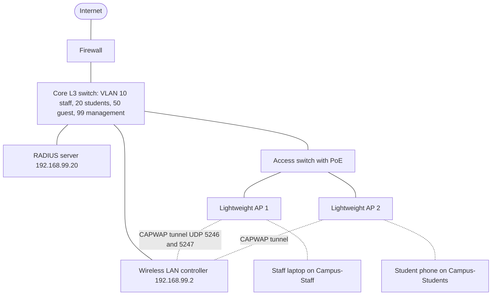
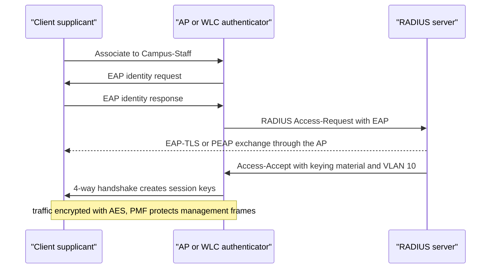
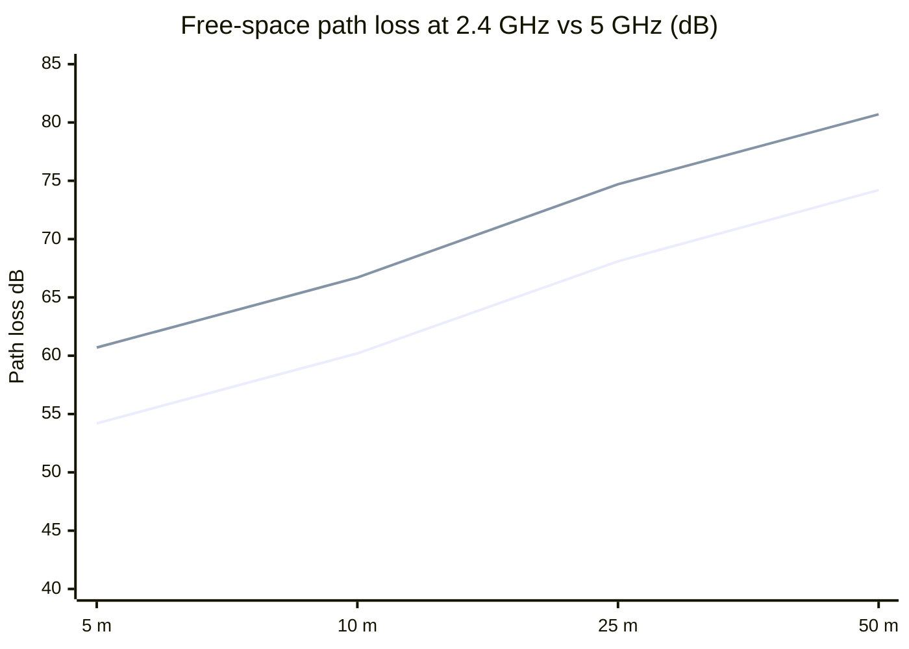

# Session 14: Wireless Technologies and WLAN Configuration

> [Cybersecurity and Digital Forensics](../../README.md) › [Term 1](../README.md) › [Module 4: Configuring Network Infrastructure](README.md) › **Session 14**

| ⏱ Estimated time | 📋 Prerequisites |
|---|---|
| 3 hours | Session 5 (VLANs and trunks), Session 9 (DHCP), Session 10 (security terms, RADIUS) |

| ⬅ [Previous: Session 13](session-13-virtual-private-networks.md) | [Next: Session 15](session-15-automation-and-programmability.md) ➡ |
|:---|---:|

[](https://colab.research.google.com/github/Hamnakhan123/Cybersecurity-and-Digital-Forensics/blob/main/term-1/04-configuring-network-infrastructure/code/session-14-wireless-lan-configuration.ipynb) &nbsp;Run every Python example of this session in the notebook [`code/session-14-wireless-lan-configuration.ipynb`](code/session-14-wireless-lan-configuration.ipynb).

---

## 🎯 Learning objectives

- Identify the **key components and elements** of wireless networks: radios, antennas, SSIDs, BSS/ESS, channels and bands.
- Define the roles of **access points (APs)** and **wireless LAN controllers (WLCs)**, and compare autonomous, lightweight (CAPWAP), FlexConnect and cloud-managed designs.
- Explain **wireless security protocols** and authentication methods (Personal/PSK vs Enterprise/802.1X).
- Define **WEP, WPA, WPA2 and WPA3** and explain each one's role and weaknesses.
- Illustrate the **configuration of a WLAN** end to end, and estimate signal strength with an RF link budget.

## 📖 Concepts

### 1. Elements of a wireless network

| Element | Meaning |
|---|---|
| **Wireless client (STA)** | Laptop, phone, tablet, IoT device with a Wi-Fi radio |
| **Access point (AP)** | Bridges wireless clients to the wired LAN (Layer 2) |
| **SSID** | The network name clients see (e.g. `Campus-Staff`); one AP can broadcast several SSIDs, each mapped to a VLAN |
| **BSS / BSSID** | One AP radio and its clients; BSSID = the radio's MAC address |
| **ESS** | Several APs with the same SSID so clients can **roam** |
| **Ad hoc (IBSS)** | Devices connect directly without an AP |
| **Bands** | **2.4 GHz** (longer range, only 3 non-overlapping channels **1, 6, 11**, crowded); **5 GHz** (many channels, faster, shorter range); **6 GHz** (Wi-Fi 6E/7, very clean spectrum, WPA3 required) |
| **Channel width** | 20/40/80/160 MHz (wider = faster but fewer non-overlapping channels) |
| **Antennas** | **Omnidirectional** (all around, ceilings), **directional** (patch, Yagi, sector – corridors, outdoor links); gain in **dBi** |
| **Signal measures** | **RSSI** in dBm (−30 excellent … −67 good for voice/video … −80 unusable), **SNR** (signal − noise, aim ≥ 25 dB) |

**Wi-Fi generations**

| Name | Standard | Bands | Max theoretical rate |
|---|---|---|---|
| Wi-Fi 4 | 802.11n | 2.4 / 5 GHz | 600 Mbps |
| Wi-Fi 5 | 802.11ac | 5 GHz | ~3.5 Gbps |
| Wi-Fi 6 / 6E | 802.11ax | 2.4 / 5 / **6** GHz | ~9.6 Gbps (OFDMA, better in crowds) |
| Wi-Fi 7 | 802.11be | 2.4 / 5 / 6 GHz | ~46 Gbps (320 MHz, multi-link) |

Wi-Fi is **half duplex** and uses **CSMA/CA** (listen before talk, acknowledgements), so real throughput is usually well under half the advertised rate.

> **Analogy – a classroom discussion.** Only one person can speak at a time on a channel (half duplex); people wait for silence before talking (CSMA/CA). Putting two neighbouring classes on the same channel is like two teachers lecturing in one room – everyone slows down.

### 2. Access points and wireless LAN controllers

| Architecture | How it works | Best for |
|---|---|---|
| **Autonomous AP** | Each AP configured individually (SSIDs, security, VLANs) | Home, very small offices |
| **Lightweight AP + WLC** | APs are "thin"; a **WLC** holds the configuration. APs and WLC talk over **CAPWAP** (UDP **5246** control, **5247** data); client traffic is tunnelled to the WLC (**split-MAC**: AP handles real-time radio work, WLC handles management, security, roaming) | Campuses, hospitals, universities |
| **FlexConnect** | Lightweight APs at branches switch traffic locally but are managed by a central WLC | Branch offices |
| **Cloud-managed** | Configuration and monitoring from a cloud dashboard | Distributed organisations |

**WLC functions:** central SSID/security policy, **RRM** (radio resource management – automatic channel and power), seamless roaming, client load balancing, guest portals, **rogue AP detection / WIPS**, firmware management. Lightweight APs find the WLC through **DHCP option 43**, DNS (`CISCO-CAPWAP-CONTROLLER`) or a broadcast on the local subnet.

### 3. Wireless security protocols

| Protocol | Year | Encryption | Status |
|---|---|---|---|
| **Open** | – | None (Enhanced Open/**OWE** adds encryption without a password) | Use OWE for public hotspots |
| **WEP** | 1999 | RC4 with a static key and a 24-bit IV | **Broken** – the key can be recovered in minutes; never use |
| **WPA** | 2003 | TKIP (RC4 with per-packet keys) | Interim fix; **deprecated** |
| **WPA2** | 2004 | **AES-CCMP** | Still common; Personal mode vulnerable to offline guessing of weak passwords |
| **WPA3** | 2018 | AES-CCMP/GCMP; **SAE** handshake; **PMF mandatory**; 192-bit mode for Enterprise | **Recommended** |

**Personal vs Enterprise**

| | Personal (PSK / SAE) | Enterprise (802.1X) |
|---|---|---|
| Authentication | One shared passphrase | Each user/device with their own credentials or certificate |
| Server | None | **RADIUS** (UDP 1812/1813) with EAP methods: PEAP, EAP-TLS (certificates, strongest), EAP-TTLS |
| Revoking access | Change the password for everyone | Disable one account/certificate |
| Logging | Per device MAC only | Per user |
| Fit | Home, small office, students' IoT | Staff, faculty, corporate devices |

**Protected Management Frames (802.11w / PMF)** encrypt and authenticate management frames, blocking spoofed **deauthentication** attacks. **WPA3-SAE** replaces the PSK 4-way handshake guessing weakness with a password-authenticated key exchange that resists offline dictionary attacks.

**Other wireless threats:** rogue APs, **evil twin** APs (same SSID to capture logins), jamming/interference, war driving, weak IoT devices. Defences: WPA3/Enterprise, PMF, WIPS, rogue detection, client isolation on guest networks, and user awareness. Assess wireless security only on networks you own or are authorised to test.

### 4. Designing the RF

- **Free-space path loss (FSPL)** (dB) = 20·log₁₀(d in km) + 20·log₁₀(f in MHz) + 32.44 – higher frequency and longer distance lose more.
- **Received signal** = transmit power + antenna gains − path loss − obstacle losses (brick wall ≈ 6–12 dB, concrete ≈ 10–15 dB, glass ≈ 2–4 dB).
- Design target: **−67 dBm** or better for voice/video, ≥ 25 dB SNR, ~15–20% cell overlap for roaming, 2.4 GHz only on channels 1/6/11 with 20 MHz width.
- Always validate with a **site survey** (predictive before installation, active/passive after).

## 🧭 Diagrams

**Controller-based WLAN**



**WPA2/WPA3-Enterprise (802.1X) sign-in**



## 🪜 Step-by-step: configure a secure WLAN

The checklist below follows the order you would use in Cisco Packet Tracer (WLC-2504 with lightweight APs) or on a real controller.

📄 **`code/session-14_wlan_setup.txt`**

```text
Session 14 - WLAN configuration checklist (Cisco Packet Tracer: WLC-2504 + LAP-PT, or a home lab AP)

1. Wired side first
   - Switch: VLAN 10 Staff, VLAN 20 Students, VLAN 99 Management.
   - AP port: access port in VLAN 99 (lightweight AP) or trunk carrying 10,20,99 (FlexConnect/autonomous).
   - DHCP: pools for 10, 20, 99. Option 43 or DNS name CISCO-CAPWAP-CONTROLLER points APs to the WLC.
   - PoE on AP ports.

2. Controller (WLC) basics
   - Management interface 192.168.99.2/24, gateway 192.168.99.1, NTP server, syslog server.
   - Dynamic interfaces: staff -> VLAN 10, students -> VLAN 20.
   - APs join over CAPWAP (UDP 5246 control, 5247 data); check "All APs" shows them registered.

3. WLANs
   - Campus-Staff : WPA3-Enterprise (or WPA2-Enterprise), 802.1X, RADIUS server 192.168.99.20 (UDP 1812/1813), PMF required, interface staff.
   - Campus-Students : WPA2/WPA3-Personal transition, AES only, 16+ char random PSK, PMF optional, interface students, client isolation optional.
   - Guest : separate VLAN, internet only (ACL), captive portal, rate limit, no access to campus subnets.

4. RF
   - 2.4 GHz: channels 1, 6, 11 only, 20 MHz width.
   - 5 GHz: 20/40 MHz in dense areas, non-overlapping channels, DFS where allowed.
   - Let RRM adjust power/channels, then verify with a survey.

5. Verify
   - Client gets an IP in the right VLAN, correct gateway and DNS.
   - Signal at seats >= -67 dBm; roaming works between APs.
   - Old WEP/TKIP SSIDs removed; rogue AP detection on; logs reach syslog.
```
**What to check on the controller after set-up (typical output):**

```text
(WLC) >show ap summary
AP Name     Slots  AP Model     Ethernet MAC       Location   Country  IP Address
AP-Lib-01   2      AIR-AP1852I  00:a2:ee:11:22:33  Library    PK       192.168.99.51
AP-Lab-02   2      AIR-AP1852I  00:a2:ee:44:55:66  Lab 2      PK       192.168.99.52

(WLC) >show wlan summary
WLAN ID  WLAN Profile Name / SSID        Status    Interface Name
1        Campus-Staff / Campus-Staff     Enabled   staff
2        Campus-Students / Campus-Stu... Enabled   students
3        Guest / Guest                   Enabled   guest
```

## 💻 Worked examples

### Example 1 – Audit WLAN profiles and estimate signal at a desk

📄 **`code/session-14_wlan_audit.py`**

```python
"""Session 14 - Audit WLAN profiles and estimate signal strength at a desk.

Part 1 grades each SSID's security settings the way a wireless engineer would
(WEP and TKIP are broken, WPA2-AES is acceptable, WPA3 with PMF is best,
Enterprise 802.1X beats a shared password for staff).
Part 2 is an RF link budget: received signal = transmit power + antenna
gains - free-space path loss - wall losses, compared with what a client needs.
Run:  python session-14_wlan_audit.py
"""
import math

PROFILES = [
    {"ssid": "Campus-Staff", "security": "WPA3-Enterprise", "cipher": "AES-GCMP", "pmf": "required",
     "auth": "802.1X/RADIUS", "psk_len": 0, "band": "5 GHz", "vlan": 10},
    {"ssid": "Campus-Students", "security": "WPA2-Personal", "cipher": "AES-CCMP", "pmf": "optional",
     "auth": "PSK", "psk_len": 16, "band": "2.4+5 GHz", "vlan": 20},
    {"ssid": "Old-Lab-AP", "security": "WEP", "cipher": "RC4", "pmf": "off",
     "auth": "shared key", "psk_len": 10, "band": "2.4 GHz", "vlan": 1},
    {"ssid": "Cafe-Guest", "security": "WPA/WPA2-Mixed", "cipher": "TKIP+AES", "pmf": "off",
     "auth": "PSK", "psk_len": 8, "band": "2.4 GHz", "vlan": 1},
]


def grade(p):
    issues = []
    if p["security"] == "WEP":
        issues.append("WEP is broken (key recoverable in minutes) - replace with WPA2/WPA3")
    if "TKIP" in p["cipher"]:
        issues.append("TKIP allowed - use AES (CCMP/GCMP) only")
    if p["auth"] == "PSK" and p["psk_len"] < 12:
        issues.append(f"PSK only {p['psk_len']} chars - offline guessing is easy; use 16+ random chars")
    if p["pmf"] == "off":
        issues.append("PMF (802.11w) off - deauthentication frames can be spoofed")
    if p["vlan"] == 1:
        issues.append("mapped to VLAN 1 - put each SSID in its own VLAN")
    score = max(0, 100 - 25 * len(issues))
    return score, issues


def fspl_db(distance_m, freq_mhz):
    """Free-space path loss: 20log10(d km) + 20log10(f MHz) + 32.44"""
    return 20 * math.log10(distance_m / 1000) + 20 * math.log10(freq_mhz) + 32.44


def rx_dbm(tx_dbm, gain_tx, gain_rx, distance_m, freq_mhz, walls_db):
    return tx_dbm + gain_tx + gain_rx - fspl_db(distance_m, freq_mhz) - walls_db


if __name__ == "__main__":
    print("Part 1: WLAN security audit")
    for p in PROFILES:
        score, issues = grade(p)
        print(f"  {p['ssid']:16} {p['security']:16} score {score:3}/100")
        for i in issues:
            print(f"      - {i}")
    print("\nPart 2: signal at a classroom desk 25 m from the AP through 2 brick walls (2 x 6 dB)")
    for band, f in (("2.4 GHz ch 6", 2437), ("5 GHz ch 36", 5180)):
        r = rx_dbm(tx_dbm=17, gain_tx=4, gain_rx=0, distance_m=25, freq_mhz=f, walls_db=12)
        verdict = "good for video calls" if r >= -67 else ("usable for web" if r >= -75 else "too weak")
        print(f"  {band:13} path loss {fspl_db(25, f):5.1f} dB -> received {r:6.1f} dBm ({verdict})")
    print("  Rule of thumb: design for -67 dBm or better and at least 25 dB above the noise floor.")
```

**Output**

```text
Part 1: WLAN security audit
  Campus-Staff     WPA3-Enterprise  score 100/100
  Campus-Students  WPA2-Personal    score 100/100
  Old-Lab-AP       WEP              score  25/100
      - WEP is broken (key recoverable in minutes) - replace with WPA2/WPA3
      - PMF (802.11w) off - deauthentication frames can be spoofed
      - mapped to VLAN 1 - put each SSID in its own VLAN
  Cafe-Guest       WPA/WPA2-Mixed   score   0/100
      - TKIP allowed - use AES (CCMP/GCMP) only
      - PSK only 8 chars - offline guessing is easy; use 16+ random chars
      - PMF (802.11w) off - deauthentication frames can be spoofed
      - mapped to VLAN 1 - put each SSID in its own VLAN

Part 2: signal at a classroom desk 25 m from the AP through 2 brick walls (2 x 6 dB)
  2.4 GHz ch 6  path loss  68.1 dB -> received  -59.1 dBm (good for video calls)
  5 GHz ch 36   path loss  74.7 dB -> received  -65.7 dBm (good for video calls)
  Rule of thumb: design for -67 dBm or better and at least 25 dB above the noise floor.
```
**Observe:**
- The WEP network scores only 25/100: no setting can make WEP safe – the fix is replacement.
- The café SSID combines TKIP, an 8-character password, PMF off and VLAN 1 – every one of these is a separate weakness.
- At 25 m through two brick walls, 5 GHz arrives ~6.6 dB weaker than 2.4 GHz but is still above −67 dBm. One more wall would push 5 GHz below the target – that is why APs are mounted in rooms, not only in corridors.

### Example 2 – Channel plan for a floor with six APs (2.4 GHz)

| AP | Location | Channel | Reason |
|---|---|---|---|
| AP1 | West corridor | 1 | |
| AP2 | Lab 1 | 6 | Neighbour of AP1 |
| AP3 | Lab 2 | 11 | Neighbour of AP2 |
| AP4 | Staff room | 1 | Far from AP1 |
| AP5 | Library | 6 | Far from AP2 |
| AP6 | East corridor | 11 | Far from AP3 |

No AP shares a channel with an adjacent AP. On 5 GHz there are many more non-overlapping 20/40 MHz channels, so most capacity should be there; consider turning off some 2.4 GHz radios in dense areas to reduce co-channel interference.

## 📊 Chart



*Upper line: 5 GHz (channel 36); lower line: 2.4 GHz (channel 6). Real buildings add wall losses on top.*

| Security option | Use it for | Avoid |
|---|---|---|
| WPA3-Enterprise (EAP-TLS) | Staff, faculty, managed devices | – |
| WPA2/WPA3-Enterprise (PEAP) | Students with university accounts | Weak passwords without MFA |
| WPA3-Personal (SAE) / transition | Small offices, labs, IoT | Short shared passwords |
| Enhanced Open (OWE) + portal | Guests, public areas | Access to internal VLANs |
| WEP, WPA-TKIP, open with hidden SSID | Nothing | Everything |

## 🏢 Real-life problem with full solution

**Scenario.** A college library has four consumer routers acting as APs, each configured separately with WPA2-Personal and the same password, which is written on the wall. Students complain that Wi-Fi drops when they walk between floors; the IT team discovers an unknown AP named `Library-WiFi-Free` in the reading room capturing logins.

**Solution.**

1. **Replace** the consumer routers with lightweight APs managed by a **WLC** (or a cloud-managed system) for central configuration and roaming.
2. **Wired side:** access-switch ports with PoE; VLAN 99 for AP management, VLAN 20 students, VLAN 10 staff, VLAN 50 guest; DHCP pools and option 43 for the controller.
3. **SSIDs:** `Campus-Staff` (WPA3-Enterprise, EAP-TLS with device certificates), `Campus-Students` (WPA2/WPA3-Enterprise PEAP with university accounts and MFA), `Guest` (OWE + captive portal, internet only, rate-limited, client isolation).
4. **RF:** 2.4 GHz on 1/6/11 at 20 MHz, most clients steered to 5 GHz; RRM on; a post-installation survey confirms ≥ −67 dBm in reading areas.
5. **Roaming:** same SSID across all APs with 802.11r/k/v (fast roaming) enabled → no more drops between floors.
6. **Rogue / evil twin:** enable rogue detection and WIPS; the evil-twin AP is located by signal strength and removed; PMF is required so deauthentication spoofing does not push clients onto it; students are told to accept only the university certificate when signing in.
7. **Verify:** clients land in the right VLANs; roaming test while walking between floors with a continuous ping; logs of rogue detection reach syslog.

## ⚠️ Common mistakes

- Using channels other than 1, 6, 11 on 2.4 GHz, or 40 MHz width there.
- Turning AP power to maximum (clients still transmit weakly → one-way coverage, sticky clients).
- Hiding the SSID or using MAC filtering as "security" – both are trivial to bypass.
- One shared password for staff, students and guests.
- Mapping all SSIDs to VLAN 1 or to the same subnet.
- Leaving WEP/TKIP or WPA2/WPA mixed mode enabled for an old device.

## ✅ Best practices

- WPA3 (or WPA2/WPA3 transition), AES only, **PMF** required where clients support it.
- **802.1X Enterprise** for staff and students; PSK only for small or IoT networks with long random passphrases.
- Each SSID in its own VLAN; guest isolated and rate-limited; keep the number of SSIDs low (each adds airtime overhead).
- Central management (WLC or cloud), RRM, rogue detection/WIPS, logs to syslog/SIEM.
- Design for capacity and −67 dBm, then verify with a site survey.
- Keep AP and controller firmware patched.

## 🧪 Lab / practice tasks

1. **Easy –** Why are only channels 1, 6 and 11 used on 2.4 GHz?
2. **Easy –** List two differences between WPA2-Personal and WPA2-Enterprise.
3. **Medium –** In Packet Tracer, build a WLC with two lightweight APs and two WLANs (staff, students) mapped to different VLANs. Show that a laptop on each SSID receives an address from the correct VLAN.
4. **Medium –** Use `session-14_wlan_audit.py` to find the maximum distance (in whole metres) at which a 5 GHz client behind two brick walls still receives −67 dBm.
5. **Challenge –** Add a function to the audit script that recommends the **best security setting** for each profile based on its purpose (`staff`, `student`, `guest`, `iot`) and prints a migration plan.

<details>
<summary>💡 Hints</summary>

- Task 1: each 2.4 GHz channel is 22 MHz wide but channels are only 5 MHz apart.
- Task 4: loop distance from 1 to 100 and stop when `rx_dbm(...) < -67`.
- Task 5: use a dictionary purpose → recommended setting, and compare with the current `security` value.
</details>

<details>
<summary>✅ Solutions</summary>

**Task 1:** channels overlap; only 1, 6 and 11 are far enough apart (25 MHz) not to interfere with each other.

**Task 2:** Enterprise authenticates each user via 802.1X/RADIUS (individual credentials, per-user revocation and logging); Personal uses one shared passphrase for everyone.

**Task 3:** laptops show addresses from `192.168.10.0/24` (staff) and `192.168.20.0/24` (students); the WLC maps each WLAN to its dynamic interface/VLAN.

**Task 4:**

```python
d = 1
while rx_dbm(17, 4, 0, d + 1, 5180, 12) >= -67:
    d += 1
print(d)    # about 29 m
```

**Task 5 (core lines):**

```python
BEST = {"staff": "WPA3-Enterprise (EAP-TLS)", "student": "WPA2/WPA3-Enterprise (PEAP + MFA)",
        "guest": "Enhanced Open + captive portal, isolated VLAN", "iot": "WPA3-Personal, 20+ char PSK, own VLAN"}
for p in PROFILES:
    print(f"{p['ssid']}: {p['security']} -> {BEST[p['purpose']]}")
```
</details>

## ✅ Quick quiz

1. Which protocol do lightweight APs use to talk to a WLC? a) LWAPP only b) CAPWAP c) SNMP d) RADIUS
2. Which security protocol must never be used? a) WPA3 b) WPA2-AES c) WEP d) OWE
3. Which feature protects against spoofed deauthentication frames? a) SSID hiding b) MAC filtering c) PMF (802.11w) d) band steering
4. WPA2-Enterprise authenticates users through: a) a shared password b) 802.1X with a RADIUS server c) MAC addresses d) WPS
5. A signal of −67 dBm is generally: a) unusable b) good enough for voice and video c) too strong d) the noise floor

<details>
<summary>Show answers</summary>

1 – b · 2 – c · 3 – c · 4 – b · 5 – b
</details>

## 📝 Summary / cheat-sheet

- Elements: clients, APs, SSID, BSS/ESS, bands (2.4/5/6 GHz), channels (1/6/11), antennas, RSSI/SNR.
- Architectures: autonomous, lightweight + WLC (CAPWAP 5246/5247), FlexConnect, cloud.
- Security: WEP ✗, WPA-TKIP ✗, WPA2-AES ✓, **WPA3-SAE/Enterprise + PMF ✓✓**, OWE for open networks.
- Personal = shared passphrase; Enterprise = 802.1X + RADIUS + EAP (EAP-TLS strongest).
- FSPL grows with distance and frequency; design for −67 dBm, ≥ 25 dB SNR; survey to verify.
- One SSID ↔ one VLAN; guest isolated; rogue detection; logs.

**Interview / viva questions**

1. What is the difference between an autonomous AP and a lightweight AP?
2. What does a WLC do, and how do APs find it?
3. Why is WEP insecure, and what replaced it?
4. Compare WPA2-Personal, WPA2-Enterprise and WPA3.
5. What is an evil twin attack, and how do you defend against it?
6. Why might increasing AP transmit power make Wi-Fi worse?

---

| ⬅ [Previous: Session 13](session-13-virtual-private-networks.md) | [Next: Session 15](session-15-automation-and-programmability.md) ➡ |
|:---|---:|

<sub>Prepared by **Hamna Zahid Khan**, Junior Lecturer · Cybersecurity and Digital Forensics</sub>
