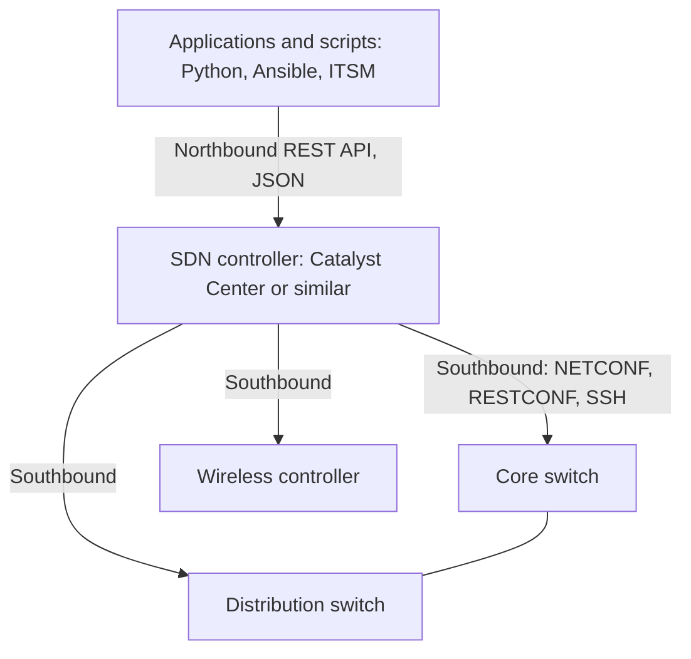
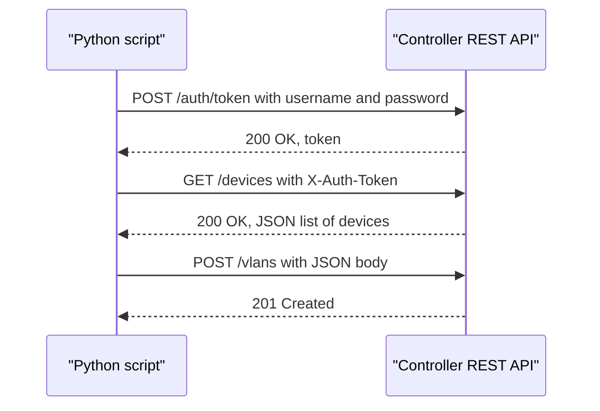
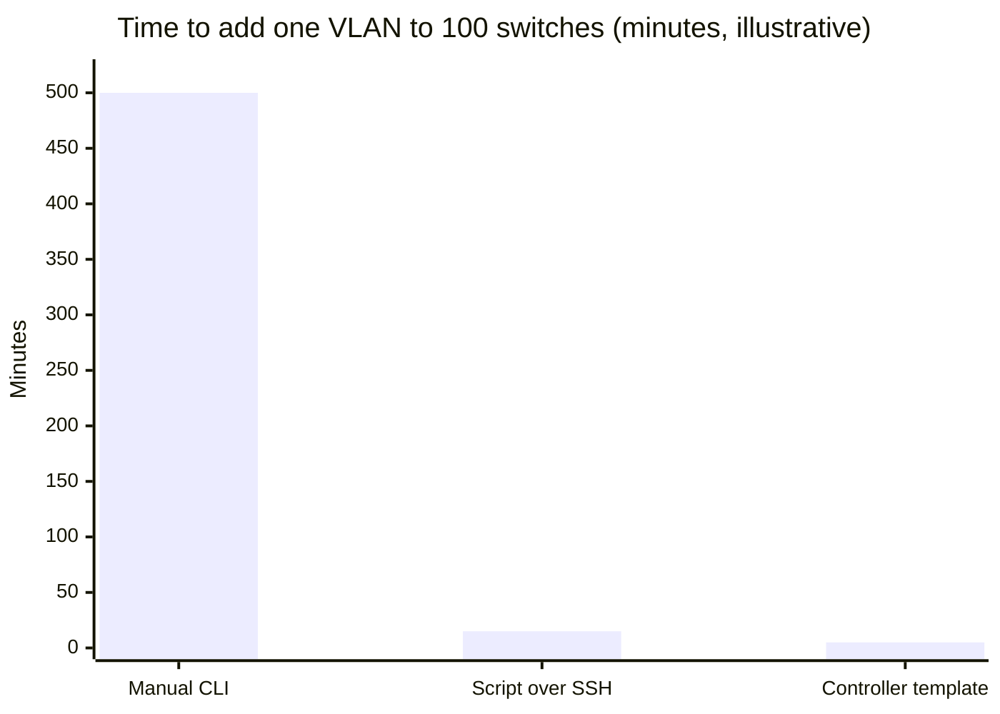

# Session 15: Automation and Network Programmability

> [Cybersecurity and Digital Forensics](../../README.md) › [Term 1](../README.md) › [Module 4: Configuring Network Infrastructure](README.md) › **Session 15**

| ⏱ Estimated time | 📋 Prerequisites |
|---|---|
| 3.5 hours | Sessions 4–14 (this session automates what you configured by hand); basic Python |

| ⬅ [Previous: Session 14](session-14-wireless-lan-configuration.md) | [Module practice test](practice-test.md) ➡ |
|:---|---:|

[](https://colab.research.google.com/github/Hamnakhan123/Cybersecurity-and-Digital-Forensics/blob/main/term-1/04-configuring-network-infrastructure/code/session-15-automation-and-programmability.ipynb) &nbsp;Run every Python example of this session in the notebook [`code/session-15-automation-and-programmability.ipynb`](code/session-15-automation-and-programmability.ipynb).

---

## 🎯 Learning objectives

- Explain how **automation** improves network **efficiency and reliability** compared with manual CLI work.
- Define **Software-Defined Networking (SDN)** concepts and **Software-Defined Access (SDA)**: underlay, overlay, fabric, control/data/management planes.
- Describe how **REST-based APIs** enable network automation: methods, URIs, status codes, authentication, JSON payloads.
- Explain **Cisco Digital Network Architecture (DNA)** and the role of a central controller (Catalyst Center).
- Describe the importance of effective **configuration management** (source of truth, templates, version control, drift detection) and tools such as Ansible.
- Explain the **advantages of JSON** in network automation, and complete the module **mini project**.

## 📖 Concepts

### 1. Why automate?

Configuring 200 switches by hand means 200 chances to mistype a VLAN, forget a command, or leave one device behind. Automation treats network configuration like software: written once, reviewed, tested, applied consistently.

| | Manual CLI | Automated |
|---|---|---|
| Speed | Minutes per device | Seconds for hundreds of devices |
| Consistency | Depends on the engineer | Same template everywhere |
| Errors | Typos, missed devices | Validated before deployment |
| Documentation | Often out of date | The code and data **are** the documentation |
| Rollback | Re-type old config | Revert to the previous version in Git |
| Compliance | Spot checks | Continuous automated audits |

> **Analogy – a bakery.** Decorating every cake by hand gives you a slightly different cake each time. A mould and a recipe (template + data) give you identical cakes, and when the recipe improves, every new cake improves.

Common automation tasks: device onboarding (zero-touch provisioning), VLAN and port changes, configuration backups, compliance checks, OS upgrades, collecting inventory and health data, and responding to events (e.g. shut a port when a threat is detected).

### 2. Planes and SDN

Every network device has three **planes**:

| Plane | Job | Example |
|---|---|---|
| **Management** | How we configure and monitor the device | SSH, SNMP, APIs |
| **Control** | Decides **where** traffic should go | OSPF, STP, ARP, building the RIB |
| **Data (forwarding)** | Actually moves packets | CEF/FIB lookups, MAC table forwarding |

**Software-Defined Networking (SDN)** centralises (part of) the control and management planes in a **controller** that programs devices through APIs:

- **Northbound APIs** – controller ↔ applications/scripts (usually **REST** with JSON).
- **Southbound APIs** – controller ↔ devices (NETCONF, RESTCONF, OpenFlow, SSH/CLI, gNMI).

**Underlay vs overlay:** the **underlay** is the physical IP network (links, routing); the **overlay** is the virtual network built on top with tunnels (e.g. VXLAN), letting the controller create logical segments without touching the physical design.

### 3. Software-Defined Access (SDA)

**SDA** is Cisco's intent-based campus **fabric** managed by a controller:

| Component | Role |
|---|---|
| **Underlay** | Routed (Layer 3) campus, typically IS-IS, no STP between switches |
| **Overlay data plane** | **VXLAN** carries user traffic between fabric switches |
| **Overlay control plane** | **LISP** maps endpoint identities to their current location |
| **Policy plane** | **Scalable Group Tags (SGTs)** – policy by *who you are* (group), not by IP address |
| **Fabric roles** | **Edge** nodes (users connect), **border** nodes (exit to other networks), **control-plane** nodes |
| **Controller** | **Catalyst Center** (formerly DNA Center) + **ISE** for identity and policy |

The administrator expresses **intent** ("students may reach the LMS, not the finance servers") and the controller translates it into configuration on every device, wherever the student plugs in.

### 4. REST APIs

**REST** (Representational State Transfer) APIs use plain **HTTP(S)**:

| HTTP method | CRUD action | Example |
|---|---|---|
| **GET** | Read | `GET /api/v1/devices` – list devices |
| **POST** | Create | `POST /api/v1/vlans` with a JSON body |
| **PUT** | Replace | `PUT /api/v1/vlans/30` – full update |
| **PATCH** | Modify part | `PATCH /api/v1/vlans/30` – change only the name |
| **DELETE** | Delete | `DELETE /api/v1/vlans/30` |

**Status codes:** `200 OK`, `201 Created`, `204 No Content`, `400 Bad Request`, `401 Unauthorized`, `403 Forbidden`, `404 Not Found`, `409 Conflict`, `500 Internal Server Error`.

A request has a **URI** (endpoint), **method**, **headers** (`Content-Type: application/json`, an auth token such as `X-Auth-Token` or `Authorization: Bearer …`) and an optional **body**. REST is **stateless**: every request carries its own authentication.

**Security of APIs:** always HTTPS, tokens with short lifetimes, least-privilege API accounts, no credentials in scripts (use environment variables or a vault), log API calls.

### 5. Cisco Digital Network Architecture (DNA)

**Cisco DNA** is an architecture for **intent-based networking** built around a controller (**Catalyst Center**, formerly **DNA Center**). Its pillars:

- **Automation** – templates, plug-and-play onboarding, SWIM (software image management), SDA fabric provisioning.
- **Assurance** – telemetry and analytics (health scores, client experience, path trace, root-cause suggestions).
- **Security** – segmentation with SGTs, encrypted traffic analytics, integration with ISE.
- **Open platform** – northbound **REST APIs** and integrations (ITSM tickets, IPAM, SIEM).

Similar ideas exist across vendors (cloud-managed networking, other SDN controllers); the concepts in this session are vendor-neutral.

### 6. Configuration management

Effective configuration management answers: *What should the network look like? What does it look like now? Who changed what, when and why?*

| Practice | Meaning |
|---|---|
| **Source of truth** | One trusted data store (YAML/JSON files, IPAM/NetBox) describing VLANs, subnets, devices |
| **Templates** | Configs generated from data (Jinja2, Python) – no copy-paste |
| **Version control** | Data and templates in **Git**: history, reviews, rollback |
| **Validation** | Check data before deployment (overlaps, undefined VLANs, naming) |
| **Idempotence** | Running the automation twice gives the same result (only changes what differs) |
| **Drift detection** | Regularly compare running configs with the intended config and alert on differences |
| **Backups** | Automatic, versioned configuration backups |

**Tools:** **Ansible** (agentless, YAML playbooks, connects over SSH/APIs), **Python** libraries (Netmiko, NAPALM, ncclient, requests), **Terraform** for cloud networks, **Puppet/Chef** (agent-based, more common for servers), **NetBox** as the source of truth, **Git** for versioning.

### 7. Why JSON?

**JSON** (JavaScript Object Notation) is the common data format of REST APIs:

```json
{"id": 30, "name": "LAB", "subnet": "192.168.30.0/24", "dhcp": true, "ports": ["Gi1/0/1", "Gi1/0/2"]}
```

Advantages: **human-readable** and **machine-parsable**; lightweight compared with XML; native types (string, number, boolean, null, array, object); supported by every programming language (`json` in Python's standard library); maps directly to Python dictionaries and lists; easy to validate with JSON Schema; and it is what controllers, cloud APIs and RESTCONF (in its JSON encoding) speak. **YAML** is often used for human-written source-of-truth files and is a superset of JSON; **XML** is used by NETCONF.

## 🧭 Diagrams

**SDN architecture**



**Configuration-management pipeline**


**A REST call in sequence**



## 🪜 Step-by-step: from manual change to automated change

1. **Write the intent as data** (`session-15_inventory.json`): site, NTP, syslog, VLANs, switches and their access ports.
2. **Validate** the data: unique VLAN IDs, no overlapping subnets, every port uses a defined VLAN.
3. **Render** each switch's configuration from one template.
4. **Review** the generated config (pull request) and approve it under change management.
5. **Deploy** through the controller's REST API (or Ansible/Netmiko over SSH).
6. **Verify** with `show` commands or API reads; store the result.
7. **Detect drift** on a schedule: compare running and intended configuration; alert on differences.

The data file used by the examples:

📄 **`code/session-15_inventory.json`**

```json
{
  "site": "Karachi-Campus",
  "ntp": "192.168.99.1",
  "syslog": "192.168.99.30",
  "vlans": [
    {"id": 10, "name": "LECTURERS", "subnet": "192.168.10.0/24"},
    {"id": 20, "name": "STUDENTS", "subnet": "192.168.20.0/23"},
    {"id": 99, "name": "MANAGEMENT", "subnet": "192.168.99.0/24"}
  ],
  "switches": [
    {"hostname": "ACC-SW1", "mgmt_ip": "192.168.99.11", "access": {"10": "Fa0/1-12", "20": "Fa0/13-24"}},
    {"hostname": "ACC-SW2", "mgmt_ip": "192.168.99.12", "access": {"20": "Fa0/1-24"}}
  ]
}
```
## 💻 Worked examples

### Example 1 – Source of truth, templates, validation and drift detection

📄 **`code/session-15_automation.py`**

```python
"""Session 15 - Network automation with JSON, templates and configuration drift checks.

1. Load the "source of truth" (session-15_inventory.json) and validate it.
2. Generate each switch's configuration from one template (no copy-paste errors).
3. Compare an intended config with what is running and report drift.
4. Convert data between JSON and Python to show why APIs use JSON.
Run:  python session-15_automation.py
"""
import difflib
import ipaddress
import json


def load_text(name):
    """Read a data file next to this script; on Colab, fetch it from the course repo."""
    try:
        return open(name).read()
    except FileNotFoundError:
        import urllib.request
        url = ("https://raw.githubusercontent.com/Hamnakhan123/Cybersecurity-and-Digital-Forensics/"
               "main/term-1/04-configuring-network-infrastructure/code/" + name)
        return urllib.request.urlopen(url).read().decode()


INV = json.loads(load_text("session-15_inventory.json"))


def validate(inv):
    errors = []
    ids = [v["id"] for v in inv["vlans"]]
    if len(ids) != len(set(ids)):
        errors.append("duplicate VLAN id")
    nets = [ipaddress.ip_network(v["subnet"]) for v in inv["vlans"]]
    for i, a in enumerate(nets):
        for b in nets[i + 1:]:
            if a.overlaps(b):
                errors.append(f"{a} overlaps {b}")
    for sw in inv["switches"]:
        for vid in sw["access"]:
            if int(vid) not in ids:
                errors.append(f"{sw['hostname']} uses undefined VLAN {vid}")
    return errors


def render(inv, sw):
    lines = [f"hostname {sw['hostname']}", f"ntp server {inv['ntp']}", f"logging host {inv['syslog']}"]
    for v in inv["vlans"]:
        lines += [f"vlan {v['id']}", f" name {v['name']}"]
    for vid, ports in sw["access"].items():
        prefix, rng = ports.split("/")
        lines += [f"interface range {prefix}/{rng.replace('-', ' - ')}",
                  " switchport mode access", f" switchport access vlan {vid}",
                  " switchport nonegotiate", " spanning-tree portfast"]
    lines += ["interface vlan 99", f" ip address {sw['mgmt_ip']} 255.255.255.0"]
    return lines


if __name__ == "__main__":
    print(f"Source of truth for {INV['site']}: {len(INV['vlans'])} VLANs, {len(INV['switches'])} switches")
    print("Validation:", validate(INV) or "OK")

    configs = {sw["hostname"]: render(INV, sw) for sw in INV["switches"]}
    print("\nGenerated config for ACC-SW1:")
    print("\n".join("  " + l for l in configs["ACC-SW1"]))

    running = configs["ACC-SW2"].copy()
    running[1] = "ntp server 10.0.0.1"                         # someone changed it by hand
    running.insert(5, " name TEMP-TEST")                       # and added an untracked name
    print("\nDrift check on ACC-SW2 (intended vs running):")
    diff = list(difflib.unified_diff(configs["ACC-SW2"], running, "intended", "running", lineterm="", n=0))
    print("\n".join("  " + d for d in diff))

    bad = json.loads(json.dumps(INV))
    bad["vlans"].append({"id": 30, "name": "LAB", "subnet": "192.168.21.0/24"})
    bad["switches"][1]["access"]["40"] = "Fa0/20-24"
    print("\nValidation of a bad change request:", validate(bad))
    print("\nJSON is just text: first 80 characters of the inventory ->", json.dumps(INV)[:80] + "...")
```

**Output**

```text
Source of truth for Karachi-Campus: 3 VLANs, 2 switches
Validation: OK

Generated config for ACC-SW1:
  hostname ACC-SW1
  ntp server 192.168.99.1
  logging host 192.168.99.30
  vlan 10
   name LECTURERS
  vlan 20
   name STUDENTS
  vlan 99
   name MANAGEMENT
  interface range Fa0/1 - 12
   switchport mode access
   switchport access vlan 10
   switchport nonegotiate
   spanning-tree portfast
  interface range Fa0/13 - 24
   switchport mode access
   switchport access vlan 20
   switchport nonegotiate
   spanning-tree portfast
  interface vlan 99
   ip address 192.168.99.11 255.255.255.0

Drift check on ACC-SW2 (intended vs running):
  --- intended
  +++ running
  @@ -2 +2 @@
  -ntp server 192.168.99.1
  +ntp server 10.0.0.1
  @@ -5,0 +6 @@
  + name TEMP-TEST

Validation of a bad change request: ['192.168.20.0/23 overlaps 192.168.21.0/24', 'ACC-SW2 uses undefined VLAN 40']

JSON is just text: first 80 characters of the inventory -> {"site": "Karachi-Campus", "ntp": "192.168.99.1", "syslog": "192.168.99.30", "vl...
```
**Observe:**
- One template produced a complete, consistent configuration from a few lines of JSON.
- The drift check spotted a hand-changed NTP server and an untracked VLAN name – the kind of change that otherwise stays hidden until an incident.
- The validator rejected a change request that would have created an **overlapping subnet** and used an **undefined VLAN**, before it reached any device.

### Example 2 – Talking to a REST API (local mock controller)

📄 **`code/session-15_rest_controller.py`**

```python
"""Session 15 - A REST API like a network controller's, running only on 127.0.0.1.

Starts a tiny mock controller with Python's http.server, then acts as a client:
- POST /api/v1/auth/token        -> get a token (like a controller login)
- GET  /api/v1/devices           -> inventory as JSON
- GET  /api/v1/devices/<name>    -> one device
- POST /api/v1/vlans             -> create a VLAN (validated, 201 Created)
- requests without a token get 401 Unauthorized
Nothing leaves your computer.
Run:  python session-15_rest_controller.py
"""
import json
import threading
import urllib.error
import urllib.request
from http.server import BaseHTTPRequestHandler, HTTPServer

TOKEN = "lab-token-123"
DEVICES = [{"hostname": "CORE-SW1", "role": "distribution", "ip": "192.168.99.2", "os": "IOS-XE 17.9", "reachable": True},
           {"hostname": "ACC-SW1", "role": "access", "ip": "192.168.99.11", "os": "IOS 15.2", "reachable": True},
           {"hostname": "EDGE-R1", "role": "border", "ip": "192.168.99.1", "os": "IOS-XE 17.6", "reachable": False}]
VLANS = {10: "LECTURERS", 20: "STUDENTS"}


class Controller(BaseHTTPRequestHandler):
    def log_message(self, *a):             # keep the output tidy
        pass

    def send(self, code, body):
        data = json.dumps(body).encode()
        self.send_response(code)
        self.send_header("Content-Type", "application/json")
        self.send_header("Content-Length", str(len(data)))
        self.end_headers(); self.wfile.write(data)

    def authorised(self):
        return self.headers.get("X-Auth-Token") == TOKEN

    def do_GET(self):
        if not self.authorised():
            return self.send(401, {"error": "missing or invalid token"})
        if self.path == "/api/v1/devices":
            return self.send(200, {"response": DEVICES})
        if self.path.startswith("/api/v1/devices/"):
            name = self.path.rsplit("/", 1)[1]
            d = next((x for x in DEVICES if x["hostname"] == name), None)
            return self.send(200, {"response": d}) if d else self.send(404, {"error": "not found"})
        self.send(404, {"error": "no such endpoint"})

    def do_POST(self):
        body = json.loads(self.rfile.read(int(self.headers.get("Content-Length", 0))) or b"{}")
        if self.path == "/api/v1/auth/token":
            ok = body == {"username": "netops", "password": "lab-only"}
            return self.send(200, {"token": TOKEN}) if ok else self.send(401, {"error": "bad credentials"})
        if not self.authorised():
            return self.send(401, {"error": "missing or invalid token"})
        if self.path == "/api/v1/vlans":
            vid = body.get("id")
            if not isinstance(vid, int) or not 1 <= vid <= 4094:
                return self.send(400, {"error": "id must be 1-4094"})
            if vid in VLANS:
                return self.send(409, {"error": f"VLAN {vid} exists"})
            VLANS[vid] = body.get("name", f"VLAN{vid:04d}")
            return self.send(201, {"created": {"id": vid, "name": VLANS[vid]}})
        self.send(404, {"error": "no such endpoint"})


LOCAL = urllib.request.build_opener(urllib.request.ProxyHandler({}))   # never route 127.0.0.1 via a proxy


def call(method, url, body=None, token=None):
    req = urllib.request.Request(url, method=method, data=json.dumps(body).encode() if body is not None else None,
                                 headers={"Content-Type": "application/json", **({"X-Auth-Token": token} if token else {})})
    try:
        with LOCAL.open(req, timeout=5) as r:
            return r.status, json.loads(r.read())
    except urllib.error.HTTPError as e:
        return e.code, json.loads(e.read())


if __name__ == "__main__":
    srv = HTTPServer(("127.0.0.1", 0), Controller)
    base = f"http://127.0.0.1:{srv.server_address[1]}/api/v1"
    threading.Thread(target=srv.serve_forever, daemon=True).start()

    print("GET /devices without a token  ->", call("GET", base + "/devices"))
    code, tok = call("POST", base + "/auth/token", {"username": "netops", "password": "lab-only"})
    token = tok["token"]
    print("POST /auth/token              ->", code, "token received")
    code, data = call("GET", base + "/devices", token=token)
    print(f"GET /devices                  -> {code}, {len(data['response'])} devices")
    for d in data["response"]:
        print(f"   {d['hostname']:9} {d['role']:12} {d['ip']:14} {d['os']:12} {'UP' if d['reachable'] else 'UNREACHABLE'}")
    print("GET /devices/ACC-SW1          ->", call("GET", base + "/devices/ACC-SW1", token=token))
    print("POST /vlans {id: 30, LAB}     ->", call("POST", base + "/vlans", {"id": 30, "name": "LAB"}, token))
    print("POST /vlans {id: 30} again    ->", call("POST", base + "/vlans", {"id": 30, "name": "LAB"}, token))
    print("POST /vlans {id: 5000}        ->", call("POST", base + "/vlans", {"id": 5000}, token))
    srv.shutdown()
```

**Output**

```text
GET /devices without a token  -> (401, {'error': 'missing or invalid token'})
POST /auth/token              -> 200 token received
GET /devices                  -> 200, 3 devices
   CORE-SW1  distribution 192.168.99.2   IOS-XE 17.9  UP
   ACC-SW1   access       192.168.99.11  IOS 15.2     UP
   EDGE-R1   border       192.168.99.1   IOS-XE 17.6  UNREACHABLE
GET /devices/ACC-SW1          -> (200, {'response': {'hostname': 'ACC-SW1', 'role': 'access', 'ip': '192.168.99.11', 'os': 'IOS 15.2', 'reachable': True}})
POST /vlans {id: 30, LAB}     -> (201, {'created': {'id': 30, 'name': 'LAB'}})
POST /vlans {id: 30} again    -> (409, {'error': 'VLAN 30 exists'})
POST /vlans {id: 5000}        -> (400, {'error': 'id must be 1-4094'})
```
**Observe:** the API refuses requests without a token (**401**), creates a VLAN (**201**), refuses a duplicate (**409**) and an invalid ID (**400**). Real controllers behave the same way; only the URLs and authentication details differ. The mock runs entirely on `127.0.0.1`.

### Example 3 – Module mini project: campus network builder

The mini project turns everything from this module into one automated workflow: **VLSM addressing (Session 3) → VLANs (5) → STP root alignment (6) → SVIs and inter-VLAN routing (12) → HSRP (8) → DHCP (9) → ACLs and DHCP snooping (10)**, all generated from a short intent list and audited before deployment.

📄 **`code/mini_project_campus_builder.py`**

```python
"""Module 4 mini project - Campus network builder: from intent to device configs.

Input: what the campus needs (departments, host counts, which ones are guests).
Output, all generated and checked automatically:
  1. A VLSM address plan with VLAN IDs, gateways and DHCP ranges.
  2. Two distribution switches (DIST-1, DIST-2) with SVIs and HSRP, where the
     HSRP Active router and the STP root are the SAME switch for each VLAN
     (odd VLANs on DIST-1, even VLANs on DIST-2) so load is shared.
  3. DHCP pools, a guest-isolation ACL, and DHCP snooping/edge-port settings.
  4. A pre-deployment audit (overlaps, gateway inside subnet, sizing headroom).
Run:  python mini_project_campus_builder.py
"""
import ipaddress
import math

CAMPUS_BLOCK = "10.60.0.0/21"
DNS = None                # set by plan(): 4th address of the SERVERS subnet
INTENT = [  # name, expected hosts, guest network?
    ("LECTURERS", 120, False),
    ("STUDENT-LAB", 300, False),
    ("ADMIN", 40, False),
    ("GUEST-WIFI", 200, True),
    ("PRINTERS-IOT", 20, False),
    ("SERVERS", 12, False),
]
GROWTH = 1.25            # leave 25% room for growth


def plan(block, intent):
    free = [ipaddress.ip_network(block)]
    rows = []
    for i, (name, hosts, guest) in enumerate(sorted(intent, key=lambda x: -x[1])):
        need = math.ceil(hosts * GROWTH) + 3          # + gateway, DIST-1, DIST-2
        prefix = 32 - math.ceil(math.log2(need + 2))
        cand = sorted((f for f in free if f.prefixlen <= prefix), key=lambda n: int(n.network_address))
        if not cand:
            raise SystemExit(f"Address block too small for {name}")
        parent = cand[0]
        net = next(parent.subnets(new_prefix=prefix))
        free.remove(parent); free.extend(parent.address_exclude(net))
        rows.append({"name": name, "hosts": hosts, "guest": guest, "net": net})
    for vid, r in zip(range(10, 10 * (len(rows) + 1), 10), sorted(rows, key=lambda r: int(r["net"].network_address))):
        r["vlan"] = vid
        h = list(r["net"].hosts())
        r["vip"], r["d1"], r["d2"] = h[0], h[1], h[2]
        r["dhcp_from"], r["dhcp_to"] = h[3], h[-1]
        if r["name"] == "SERVERS":                    # first 10 server addresses stay static (DNS = first)
            global DNS
            DNS = h[3]
            r["dhcp_from"] = h[13]
    return sorted(rows, key=lambda r: r["vlan"]), sorted(free, key=lambda n: int(n.network_address))


def dist_config(rows, me):
    out = [f"hostname DIST-{me}", "ip routing", "spanning-tree mode rapid-pvst"]
    mine = [r["vlan"] for r in rows if (r["vlan"] // 10) % 2 == (1 if me == 1 else 0)]
    other = [r["vlan"] for r in rows if r["vlan"] not in mine]
    out.append(f"spanning-tree vlan {','.join(map(str, mine))} root primary")
    out.append(f"spanning-tree vlan {','.join(map(str, other))} root secondary")
    for r in rows:
        active = r["vlan"] in mine
        out += [f"vlan {r['vlan']}", f" name {r['name']}",
                f"interface Vlan{r['vlan']}",
                f" ip address {r['d1'] if me == 1 else r['d2']} {r['net'].netmask}",
                " standby version 2",
                f" standby {r['vlan']} ip {r['vip']}",
                f" standby {r['vlan']} priority {110 if active else 100}",
                f" standby {r['vlan']} preempt"]
        if r["guest"]:
            out.append(" ip access-group GUEST-IN in")
        out.append(" no shutdown")
    return out


def services(rows):
    out = []
    for r in rows:
        out += [f"ip dhcp excluded-address {r['net'].network_address + 1} {r['dhcp_from'] - 1}",
                f"ip dhcp pool {r['name']}", f" network {r['net'].network_address} {r['net'].netmask}",
                f" default-router {r['vip']}", f" dns-server {DNS}"]
    internal = [r for r in rows if not r["guest"]]
    guest = next(r for r in rows if r["guest"])
    gw = guest["net"].hostmask
    out += ["ip access-list extended GUEST-IN",
            f" permit udp {guest['net'].network_address} {gw} host {DNS} eq 53"]
    out += [f" deny ip {guest['net'].network_address} {gw} {r['net'].network_address} {r['net'].hostmask}" for r in internal]
    out += [f" permit ip {guest['net'].network_address} {gw} any",
            "! access switches", f"ip dhcp snooping vlan {','.join(str(r['vlan']) for r in rows)}",
            "interface range Gi1/0/1 - 46", " switchport mode access", " switchport nonegotiate",
            " spanning-tree portfast", " spanning-tree bpduguard enable", " ip dhcp snooping limit rate 15",
            "interface range Gi1/0/47 - 48", " ip dhcp snooping trust"]
    return out


def audit(rows):
    issues = []
    nets = [r["net"] for r in rows]
    for i, a in enumerate(nets):
        issues += [f"overlap {a} {b}" for b in nets[i + 1:] if a.overlaps(b)]
    for r in rows:
        if r["vip"] not in r["net"]:
            issues.append(f"{r['name']}: gateway outside subnet")
        usable = r["net"].num_addresses - 2 - 3
        if usable < r["hosts"] * GROWTH:
            issues.append(f"{r['name']}: not enough room for growth")
    return issues


if __name__ == "__main__":
    rows, free = plan(CAMPUS_BLOCK, INTENT)
    print(f"Campus block {CAMPUS_BLOCK}  (growth allowance {int((GROWTH - 1) * 100)}%)\n")
    print(f"{'VLAN':>4}  {'Name':13} {'Hosts':>5}  {'Subnet':16} {'Gateway (VIP)':14} {'DHCP range':29} Active")
    for r in rows:
        act = "DIST-1" if (r["vlan"] // 10) % 2 == 1 else "DIST-2"
        print(f"{r['vlan']:>4}  {r['name']:13} {r['hosts']:>5}  {str(r['net']):16} {str(r['vip']):14} "
              f"{str(r['dhcp_from']) + ' - ' + str(r['dhcp_to']):29} {act}")
    print("Spare space:", ", ".join(map(str, free)) or "none")
    print("\nAudit:", audit(rows) or "PASS - no overlaps, gateways valid, growth room OK")
    d1 = dist_config(rows, 1)
    print(f"\nDIST-1 configuration ({len(d1)} lines), first VLAN shown:")
    print("\n".join("  " + l for l in d1[:13]))
    svc = services(rows)
    print(f"\nShared services ({len(svc)} lines), guest ACL shown:")
    start = svc.index("ip access-list extended GUEST-IN")
    print("\n".join("  " + l for l in svc[start:start + 8]))
```

**Output**

```text
Campus block 10.60.0.0/21  (growth allowance 25%)

VLAN  Name          Hosts  Subnet           Gateway (VIP)  DHCP range                    Active
  10  STUDENT-LAB     300  10.60.0.0/23     10.60.0.1      10.60.0.4 - 10.60.1.254       DIST-1
  20  GUEST-WIFI      200  10.60.2.0/24     10.60.2.1      10.60.2.4 - 10.60.2.254       DIST-2
  30  LECTURERS       120  10.60.3.0/24     10.60.3.1      10.60.3.4 - 10.60.3.254       DIST-1
  40  ADMIN            40  10.60.4.0/26     10.60.4.1      10.60.4.4 - 10.60.4.62        DIST-2
  50  PRINTERS-IOT     20  10.60.4.64/27    10.60.4.65     10.60.4.68 - 10.60.4.94       DIST-1
  60  SERVERS          12  10.60.4.96/27    10.60.4.97     10.60.4.110 - 10.60.4.126     DIST-2
Spare space: 10.60.4.128/25, 10.60.5.0/24, 10.60.6.0/23

Audit: PASS - no overlaps, gateways valid, growth room OK

DIST-1 configuration (60 lines), first VLAN shown:
  hostname DIST-1
  ip routing
  spanning-tree mode rapid-pvst
  spanning-tree vlan 10,30,50 root primary
  spanning-tree vlan 20,40,60 root secondary
  vlan 10
   name STUDENT-LAB
  interface Vlan10
   ip address 10.60.0.2 255.255.254.0
   standby version 2
   standby 10 ip 10.60.0.1
   standby 10 priority 110
   standby 10 preempt

Shared services (48 lines), guest ACL shown:
  ip access-list extended GUEST-IN
   permit udp 10.60.2.0 0.0.0.255 host 10.60.4.100 eq 53
   deny ip 10.60.2.0 0.0.0.255 10.60.0.0 0.0.1.255
   deny ip 10.60.2.0 0.0.0.255 10.60.3.0 0.0.0.255
   deny ip 10.60.2.0 0.0.0.255 10.60.4.0 0.0.0.63
   deny ip 10.60.2.0 0.0.0.255 10.60.4.64 0.0.0.31
   deny ip 10.60.2.0 0.0.0.255 10.60.4.96 0.0.0.31
   permit ip 10.60.2.0 0.0.0.255 any
```
**Observe:**
- Odd VLANs are active on DIST-1 and even VLANs on DIST-2, and each switch is **STP root for the same VLANs** for which it is **HSRP active** – the alignment rule from Session 8.
- Every subnet keeps 25% growth room plus three addresses for the virtual and real gateways.
- The guest ACL permits DNS, denies every internal subnet, then permits the internet – first match wins, so order matters (Session 10).

**Extend it (mini-project tasks):** add a `VOICE` VLAN with `switchport voice vlan` on access ports; output IPv6 SVIs with `/64` subnets from a `/48` (Session 11); write each device's config to its own file and save a JSON summary for the documentation.

## 📊 Chart



| Data format | Readability | Typical use in networking |
|---|---|---|
| JSON | Good | REST APIs, RESTCONF, controller exports |
| YAML | Best for humans | Ansible playbooks, source-of-truth files |
| XML | Verbose | NETCONF, older APIs |
| CSV | Simple tables | Bulk imports (device lists, IP plans) |

## 🏢 Real-life problem with full solution

**Scenario.** A university network team of three manages 180 access switches across 6 campuses. Every semester, new lab VLANs must be added and ports moved. Last semester a typo (`switchport access vlan 210` instead of `201`) put an exam lab on the wrong network, and nobody noticed for two days. Configuration backups are taken manually "when someone remembers".

**Solution.**

1. **Source of truth:** move VLANs, subnets, devices and port assignments into a structured data store (JSON/YAML in Git, or NetBox) – one record per thing.
2. **Validation rules in code:** VLAN must exist, subnet must not overlap, port ranges must be valid, naming standard enforced. The typo above would have failed validation because VLAN 210 does not exist at that campus.
3. **Templates:** a single access-switch template (baseline security from Sessions 4–10 included) renders every switch configuration.
4. **Change workflow:** changes are proposed as pull requests, reviewed by a second engineer, and deployed by Ansible or through the controller's API during an approved window.
5. **Backups and drift:** a nightly job saves every running configuration to Git and compares it with the intended configuration; differences raise a ticket.
6. **Assurance:** controller health scores and alerts (or SNMP/syslog monitoring) for the labs during exam weeks.
7. **Security:** API accounts with least privilege, tokens stored in a secrets vault, all API calls over HTTPS and logged.
8. **Result to measure:** semester changes drop from two days to under an hour, with zero manual typing on devices and a full history of every change.

## ⚠️ Common mistakes

- Automating a messy, undocumented network – clean up and define the source of truth first.
- Hard-coding passwords and tokens in scripts or Git repositories.
- Running untested scripts against production (always use a lab or a single pilot device).
- No validation step, so automation spreads a mistake to every device at once.
- Treating automation as "one big script" instead of reusable, versioned pieces.
- Ignoring API status codes and assuming every call succeeded.

## ✅ Best practices

- Start small: backups and read-only inventory, then templated changes.
- Keep data, templates and scripts in Git; review every change.
- Validate data, use dry-run/check modes, and make automation idempotent.
- Use HTTPS, short-lived tokens, least-privilege accounts and a secrets vault.
- Detect drift continuously and investigate every unexplained difference (it may be a security incident).
- Document the automation itself: what it changes, how to roll back.

## 🧪 Lab / practice tasks

1. **Easy –** Match each HTTP method to its CRUD action and give a networking example for each.
2. **Easy –** Name the three planes of a network device with one protocol or process for each.
3. **Medium –** Add a third switch `ACC-SW3` to `session-15_inventory.json` with VLAN 10 on `Fa0/1-24`, rerun `session-15_automation.py`, and show its generated config.
4. **Medium –** In `session-15_rest_controller.py`, add a `DELETE /api/v1/vlans/<id>` endpoint that returns `204` when the VLAN existed and `404` when it did not. Call it from the client.
5. **Challenge –** Extend the mini project: add a `VOICE` VLAN (40 phones) that is mapped as `switchport voice vlan` on the access ports, and make the audit fail if any subnet is more than 80% allocated by DHCP.

<details>
<summary>💡 Hints</summary>

- Task 3: the script reads every switch in the `switches` list; the `render()` function handles the new one automatically.
- Task 4: implement `do_DELETE`, parse the VLAN number from `self.path`, and use `self.send_response(204)` without a body.
- Task 5: add `("VOICE", 40, False)` to `INTENT`, then add `" switchport voice vlan <id>"` in `services()` for the access-port range.
</details>

<details>
<summary>✅ Solutions</summary>

**Task 1:** GET = read (list devices), POST = create (new VLAN), PUT = replace (full interface config), PATCH = modify (change only a description), DELETE = delete (remove a VLAN).

**Task 2:** management (SSH, SNMP, REST APIs), control (OSPF, STP, ARP), data (CEF forwarding, MAC-table switching).

**Task 3:**

```json
{"hostname": "ACC-SW3", "mgmt_ip": "192.168.99.13", "access": {"10": "Fa0/1-24"}}
```

**Task 4:**

```python
def do_DELETE(self):
    if not self.authorised():
        return self.send(401, {"error": "missing or invalid token"})
    if self.path.startswith("/api/v1/vlans/"):
        vid = int(self.path.rsplit("/", 1)[1])
        if VLANS.pop(vid, None) is None:
            return self.send(404, {"error": f"VLAN {vid} not found"})
        self.send_response(204); self.end_headers(); return
    self.send(404, {"error": "no such endpoint"})
```

On the client side, `call()` must not parse an empty body: return `(r.status, None)` when `r.status == 204`.

**Task 5 (core lines):**

```python
INTENT.append(("VOICE", 40, False))
voice = next(r for r in rows if r["name"] == "VOICE")
out.append(f" switchport voice vlan {voice['vlan']}")
...
if r["hosts"] / (r["net"].num_addresses - 2) > 0.8:
    issues.append(f"{r['name']}: more than 80% allocated")
```
</details>

## ✅ Quick quiz

1. Which plane decides where traffic should go? a) management b) control c) data d) overlay
2. Which HTTP status code means a resource was created? a) 200 b) 201 c) 204 d) 409
3. In SDA, user traffic between fabric switches is carried by: a) GRE b) VXLAN c) MPLS d) 802.1Q only
4. A "source of truth" is: a) the running configuration of the core switch b) one trusted data store describing the intended network c) the syslog server d) a backup tape
5. Which is an advantage of JSON? a) it needs a special parser in every language b) it is human-readable and maps directly to data structures c) it is encrypted d) it can only store strings

<details>
<summary>Show answers</summary>

1 – b · 2 – b · 3 – b · 4 – b · 5 – b
</details>

## 📝 Summary / cheat-sheet

- Automation = speed, consistency, fewer errors, documentation, compliance.
- Planes: management, control, data. SDN = central controller with northbound (REST) and southbound (NETCONF/RESTCONF/SSH) APIs.
- SDA: routed underlay, VXLAN data plane, LISP control plane, SGT policy, Catalyst Center + ISE.
- REST: GET/POST/PUT/PATCH/DELETE, JSON bodies, tokens, status codes 2xx/4xx/5xx.
- Cisco DNA: automation, assurance, security, open APIs (intent-based networking).
- Config management: source of truth, templates, Git, validation, idempotence, drift detection, backups. Tools: Ansible, Python, NetBox.
- JSON: readable, lightweight, typed, universal – the language of network APIs.

**Interview / viva questions**

1. How does automation improve network reliability?
2. Explain the control, data and management planes.
3. What are northbound and southbound APIs?
4. Describe the components of Cisco SDA.
5. What is configuration drift and how do you detect it?
6. Why is JSON preferred for REST APIs over XML?

---

| ⬅ [Previous: Session 14](session-14-wireless-lan-configuration.md) | [Module practice test](practice-test.md) ➡ |
|:---|---:|

<sub>Prepared by **Hamna Zahid Khan**, Junior Lecturer · Cybersecurity and Digital Forensics</sub>
