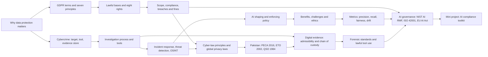

# Module 5: Introduction to Cyber Security Frameworks

> [Cybersecurity and Digital Forensics](../../README.md) › [Term 1](../README.md) › **Module 5**

| ⬅ [Previous module](../04-configuring-network-infrastructure/README.md) | [Term 1 overview](../README.md) ➡ |
|:---|---:|

---

## 🎯 Module objectives

By the end of this module you will be able to:

- Explain why the GDPR exists, use its key terms, apply the seven principles and choose a lawful basis for any processing activity.
- Uphold the eight data-subject rights within their deadlines, decide who must comply (including Pakistani firms with EU clients) and respond to a breach within 72 hours.
- Classify cybercrimes by the role the computer plays (target, tool, evidence store) and recognise the major categories with real cases.
- Describe the digital-investigation process and match forensic, incident-response, threat-detection and OSINT tools to each stage.
- Explain the principles of cyber law (legality, authorisation, jurisdiction, due process, proportionality) and compare data-protection laws in the EU, UK, USA, India, China and Pakistan.
- Apply Pakistan's legal framework: PECA 2016 offences and powers, the Electronic Transactions Ordinance 2002 and the Qanun-e-Shahadat Order 1984.
- Collect digital evidence that is admissible in court, using the order of volatility, hashing, write blockers and a documented chain of custody (ISO/IEC 27037, NIST SP 800-86, RFC 3227, ACPO principles).
- Explain how AI shapes and enforces cybersecurity policies, and weigh its benefits against bias, the black-box problem, adversarial attacks and privacy risks.
- Measure an AI security model with precision, recall, false-positive rate, fairness and drift (PSI), and govern it with the NIST AI RMF, ISO/IEC 42001, the EU AI Act and GDPR Article 22.

## 🗂 Sessions

| # | Session | Topic file |
|---|---|---|
| 1 | General Data Protection Regulation (GDPR) | [session-01-gdpr.md](session-01-gdpr.md) |
| 2 | Types of Cybercrimes and Investigation Tools | [session-02-cybercrimes-and-investigation-tools.md](session-02-cybercrimes-and-investigation-tools.md) |
| 3 | Cyber Laws, Data Protection and Digital Evidence | [session-03-cyber-laws-and-digital-evidence.md](session-03-cyber-laws-and-digital-evidence.md) |
| 4 | AI in Cybersecurity Policies | [session-04-ai-in-cybersecurity-policies.md](session-04-ai-in-cybersecurity-policies.md) |
| 📝 | Module practice test (20 MCQs + 3 scenarios) | [practice-test.md](practice-test.md) |

## ▶️ Running the examples

- All runnable files live in [`code/`](code/README.md). Every example is a single Python file that uses only the standard library: run it with Python 3.10 or newer from inside the `code/` folder, e.g. `python session-03_custody_ledger.py`.
- Each session has an executed Jupyter notebook in `code/` with an **Open in Colab** badge, so you can run everything in the browser.
- All people, companies, e-mails, IP addresses, hashes and cases in the code are fictional or use documentation ranges. The evidence-hashing script works in a temporary folder and deletes it afterwards.
- The legal content is a teaching summary, not legal advice. Laws change: check the current official text before relying on a section number in real work.
- **Ethics:** investigate, collect or analyse only systems and data you own or are authorised in writing to examine. OSINT means public sources, a lawful purpose and careful records.

## 🧭 Concept map

## 🧩 Mini project

**AI Security Compliance Toolkit** – [`code/mini_project_ai_compliance_toolkit.py`](code/mini_project_ai_compliance_toolkit.py), walked through in [Session 4](session-04-ai-in-cybersecurity-policies.md). It keeps a register of an organisation's AI systems (a login anomaly model, a phishing filter, an exam-proctoring AI and a helpdesk chatbot), assigns each a risk tier inspired by the EU AI Act, scores it against 11 controls mapped to the NIST AI RMF functions (Govern, Map, Measure, Manage) and to GDPR, EU AI Act and ISO/IEC 42001 ideas, then prints a compliance percentage, a RAG rating and a prioritised action plan. A high-risk system that is not ready may only recommend; a trained human makes the decision. Extend it as described in the Session 4 lab challenge: register a CV-screening assistant for lab-engineer hiring and decide whether it may go live.

## 📌 One-page cheat-sheet

| Topic | Remember |
|---|---|
| GDPR basics | Regulation (EU) 2016/679, applies since 25 May 2018 · personal data = identified **or identifiable** living person · special categories need an Article 9 condition |
| Roles | Controller decides why and how · processor acts on instructions (Article 28 contract) · data subject = the person |
| Seven principles | Lawfulness, fairness, transparency · purpose limitation · data minimisation · accuracy · storage limitation · integrity and confidentiality · accountability |
| Lawful bases | Consent · contract · legal obligation · vital interests · public task · legitimate interests |
| Eight rights | Informed · access · rectification · erasure · restriction · portability · object · human review of automated decisions · reply within 1 month (+2 for complex cases) |
| Scope | EU establishment, **or** offering goods/services to, or monitoring, people in the EU (a Karachi software house can be in scope) |
| Compliance kit | ROPA · privacy by design and default · security · DPIA (Art 35) · DPO · processor contracts · transfer safeguards · breach notice to regulator within **72 hours** |
| Fines | Up to EUR 10 m / 2% or EUR 20 m / 4% of worldwide annual turnover, whichever is higher |
| Pseudonymised vs anonymised | Pseudonymised is still personal data (key exists) · truly anonymised data is outside GDPR |
| Cybercrime roles | Computer as **target** (ransomware, DDoS) · **tool** (fraud, harassment) · **evidence store** |
| Categories | Phishing · fraud · BEC · ransomware · hacking · identity theft · cyberstalking · DDoS · insider · IP theft · supply chain · espionage |
| Investigation | Identification → preservation → collection → examination → analysis → presentation |
| Tools | Write blocker · FTK Imager/dd · Autopsy/EnCase/AXIOM · Volatility (memory) · Wireshark/Zeek · Cellebrite/ALEAPP · Plaso · SIEM · EDR · Snort/Suricata · YARA · TheHive/MISP |
| Incident response | NIST SP 800-61: preparation → detection and analysis → containment, eradication, recovery → post-incident activity |
| Detection | Signature · anomaly · behaviour/TTP · threat intel · hunting · Pyramid of Pain: TTPs hurt attackers most |
| OSINT | Public sources only · lawful purpose · record URL + time + hash · corroborate |
| Cyber-law principles | Legality · authorisation · jurisdiction (territorial, nationality, effects) · due process · proportionality · technology neutrality · accountability |
| Global privacy laws | GDPR · UK GDPR · CCPA/CPRA and HIPAA (USA) · DPDP Act 2023 (India) · PIPL (China) · cross-border help: Budapest Convention, MLATs |
| Pakistan | **PECA 2016** (offences, powers; NCCIA investigates after the 2025 amendments) · **ETO 2002** (electronic records and signatures valid) · **Qanun-e-Shahadat 1984** (evidence) · data-protection bill still a draft |
| Good evidence | Admissible · authentic · complete · reliable · believable |
| Standards | ISO/IEC 27037 · NIST SP 800-86 · RFC 3227 (order of volatility) · four ACPO principles · NIST CFTT (tool testing) |
| Order of volatility | Registers/cache → RAM, ARP, processes, connections → temp files → disk → remote logs → backups and archives |
| Handling evidence | Authority → plan → isolate (do not switch off) → volatile first → image with write blocker → hash (SHA-256) → seal → custody record → work on copies → report |
| AI and policy | AI **shapes** (threat trends, risk ranking, compliance mapping, simulation) and **enforces** (detection, UBA, adaptive access, automated response, monitoring) |
| AI challenges | Bias · black box · adversarial AI (evasion, poisoning, prompt injection) · over-reliance · privacy · accountability · drift |
| Metrics | Precision = TP ÷ (TP + FP) · recall = TP ÷ (TP + FN) · FPR = FP ÷ (FP + TN) · fairness: flag-rate ratio ≥ 0.80 · PSI < 0.10 stable, 0.10–0.25 watch, > 0.25 retrain |
| AI governance | NIST AI RMF (Govern, Map, Measure, Manage) · ISO/IEC 42001 · EU AI Act risk tiers · GDPR Art 22 and Art 35 · MITRE ATLAS · OWASP LLM Top 10 · Pakistan National AI Policy 2025 |
| Golden rule | AI recommends, written policy decides the action, humans own high-impact decisions, logs prove it |

## 📝 Assessment

Finish with the [module practice test](practice-test.md): 20 multiple-choice questions and 3 scenario questions, answers hidden.

---

Prepared by **Hamna Zahid Khan**, Junior Lecturer · Cybersecurity and Digital Forensics
