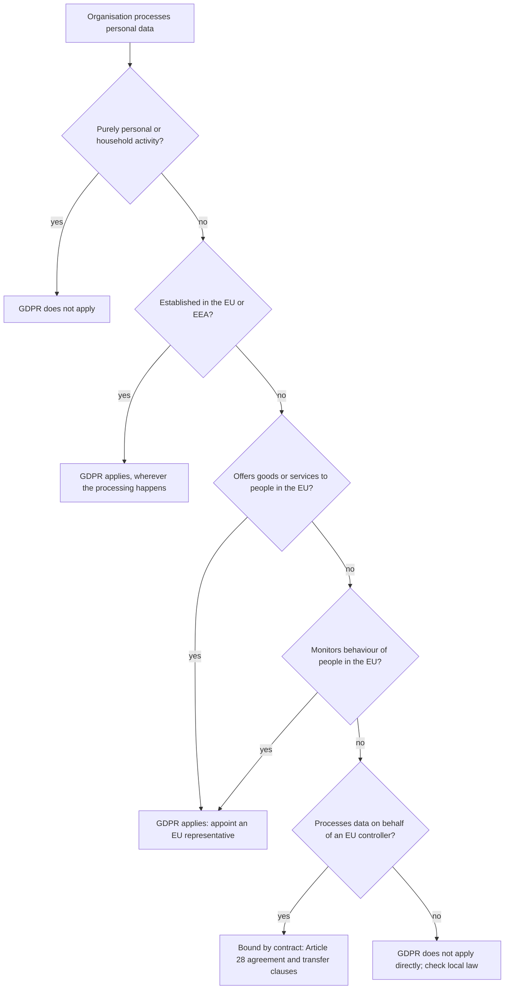
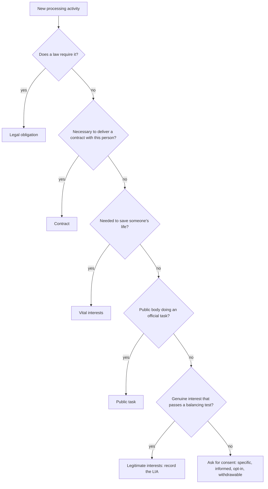
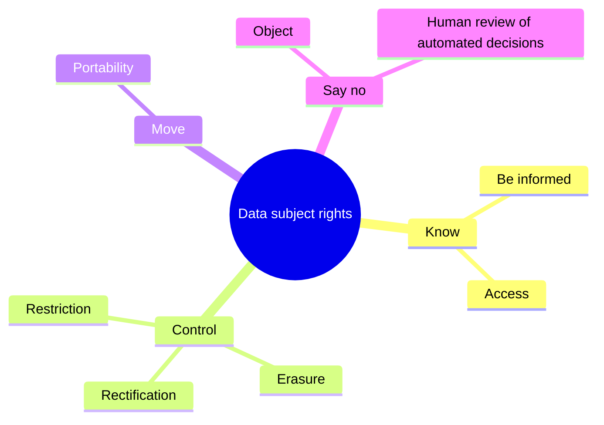
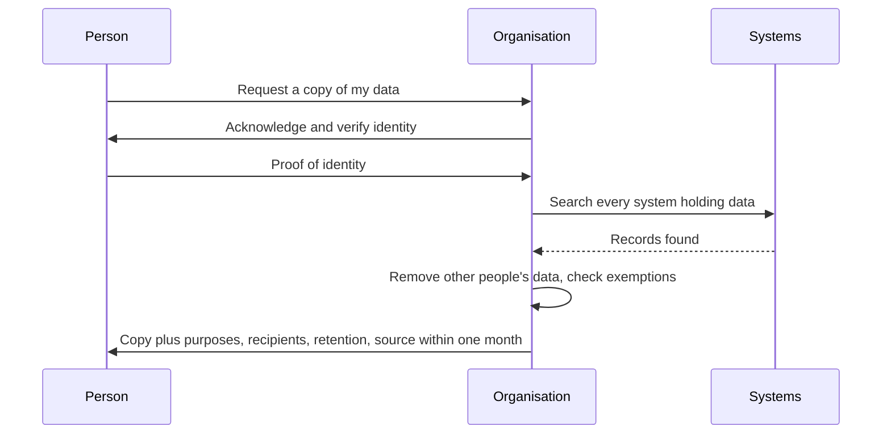
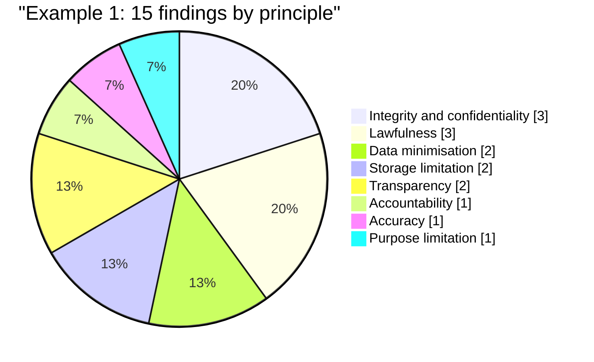

# Session 1: General Data Protection Regulation (GDPR)

> [Cybersecurity and Digital Forensics](../../README.md) › [Term 1](../README.md) › [Module 5: Introduction to Cyber Security Frameworks](README.md) › **Session 1**

| ⏱ Estimated time | 📋 Prerequisites |
|---|---|
| 6 hours (three 2-hour classes: principles · rights and compliance · Try It Yourself lab) | None. Helpful: Module 4 Session 10 (CIA triad, access control, certificates) |

| ⬅ [Module overview](README.md) | [Next: Session 2](session-02-cybercrimes-and-investigation-tools.md) ➡ |
|:---|---:|

[](https://colab.research.google.com/github/Hamnakhan123/Cybersecurity-and-Digital-Forensics/blob/main/term-1/05-cyber-security-frameworks/code/session-01-gdpr.ipynb) &nbsp;Run every Python example of this session in the notebook [`code/session-01-gdpr.ipynb`](code/session-01-gdpr.ipynb).

---

## 🎯 Learning objectives

- Explain **why the GDPR exists**, what it protects and the key terms it uses (personal data, processing, controller, processor, data subject).
- Apply the **seven principles** of lawful and fair processing and choose the right **lawful basis** for a processing activity.
- Identify the **eight rights** individuals have and describe how an organisation must uphold each one, including deadlines.
- Decide **who must comply** (including organisations outside Europe, such as a Karachi software house with EU clients) and what compliance involves in practice.
- Describe the **global impact** of the GDPR, its enforcement, the two tiers of fines and real enforcement cases.

> **Note.** This session teaches the regulation for study purposes. It is not legal advice; real compliance decisions are taken with a qualified data-protection professional.

## 📖 Concepts

### 1. Why the GDPR exists

Before 2018, Europe had a 1995 *directive* that every country translated into its own law, so rules differed from country to country. Meanwhile smartphones, social media, cloud storage and online advertising turned personal data into one of the most valuable things a company can hold. The **General Data Protection Regulation** (Regulation (EU) 2016/679) was adopted in April 2016 and has applied since **25 May 2018**. Because it is a *regulation*, it applies directly and in the same way in every EU member state (and in Iceland, Liechtenstein and Norway through the EEA). The UK kept an almost identical copy after leaving the EU, known as the **UK GDPR**, alongside its Data Protection Act 2018.

Its two goals pull in different directions, and the law balances them:

1. **Protect people's fundamental right** to the protection of their personal data.
2. **Let data flow freely** inside the single market, so businesses face one rulebook instead of 30.

> **Analogy – a library book.** Your personal data is like a book you lend to an organisation. The GDPR is the library card on the inside cover: it says who borrowed it, what they may use it for, when they must give it back, that they must keep it safe, and that you can ask to see it at any time.

### 2. Key terms (Article 4)

| Term | Plain meaning | Example |
|---|---|---|
| **Personal data** | Any information relating to an identified or **identifiable** living person | Name, email, CNIC number, IP address, cookie ID, location, a photo, a voice recording |
| **Special category data** (Art. 9) | Sensitive data that needs extra protection and an extra legal condition | Health, religion, ethnicity, biometrics used to identify, genetic data, political opinions, trade-union membership, sex life or orientation |
| **Processing** | *Anything* done with personal data, automated or not | Collecting, storing, reading, sorting, sharing, deleting |
| **Data subject** | The person the data is about | A customer, student, employee, patient |
| **Controller** | Decides **why** and **how** data is processed | An online shop deciding to send newsletters |
| **Processor** | Processes data **on behalf of** a controller, following its instructions | The email-marketing platform, a cloud host, an outsourced call centre |
| **Personal data breach** | A security incident leading to accidental or unlawful destruction, loss, alteration, unauthorised disclosure of or access to personal data | A lost unencrypted laptop, ransomware, an email sent to the wrong list |
| **Pseudonymisation** | Replacing identifiers so the data cannot be linked to a person *without extra information kept separately* | Student ID `S-1042` instead of a name; the lookup table is locked away |
| **Anonymous data** | Data where people can no longer be identified by any reasonably likely means | Aggregated statistics: "62% of students passed" |

Two points students often miss:

- **Identifiable** is enough. A record with no name but with a phone number, a precise location trail or a combination of birth date + postcode + gender often identifies one person.
- **Pseudonymised data is still personal data**; only properly anonymised data falls outside the GDPR.

### 3. The seven principles (Article 5)

Think of these as the "golden rules". Every processing activity must satisfy all seven.

| # | Principle | What it means | Typical question an auditor asks |
|---|---|---|---|
| 1 | **Lawfulness, fairness and transparency** | Have a lawful basis, do not mislead or harm people, and tell them clearly what you do | "Where is the privacy notice, and what is the lawful basis?" |
| 2 | **Purpose limitation** | Collect for specified, explicit, legitimate purposes; do not reuse for incompatible purposes | "You collected phone numbers for delivery. Why are you using them for sales calls?" |
| 3 | **Data minimisation** | Adequate, relevant and limited to what is necessary | "Why does a newsletter sign-up ask for date of birth?" |
| 4 | **Accuracy** | Keep data accurate and up to date; fix or delete wrong data quickly | "How do customers correct their address?" |
| 5 | **Storage limitation** | Keep identifiable data no longer than necessary | "What is the retention period and who deletes the data?" |
| 6 | **Integrity and confidentiality (security)** | Appropriate security: encryption, access control, backups, testing | "Is the database encrypted, and who can read it?" |
| 7 | **Accountability** | The controller must be able to **prove** compliance | "Show me your records, policies, training logs and DPIAs." |

> **Analogy – a restaurant kitchen inspection.** It is not enough for the food to be safe; the kitchen must show the inspector temperature logs, cleaning schedules and staff training records. Accountability is the GDPR's version of those logs.

### 4. The six lawful bases (Article 6)

Processing is lawful only if **at least one** basis applies. Pick it **before** processing starts and record it; you cannot swap bases later to suit yourself.

| Lawful basis | Use it when… | Example | Watch out |
|---|---|---|---|
| **Consent** | The person freely gives a specific, informed, unambiguous, affirmative "yes" | Newsletter tick box (unticked by default) | Must be as easy to withdraw as to give; keep proof; no "consent or no service" for unrelated extras |
| **Contract** | Necessary to perform a contract with the person, or steps they asked for before one | Using the address to deliver an order | Only what is *necessary* for the contract |
| **Legal obligation** | A law requires the processing | Keeping invoices for tax law | Name the law |
| **Vital interests** | Necessary to protect someone's life | Sharing allergy details with paramedics | Narrow, emergencies only |
| **Public task** | Performing a task in the public interest or official authority | A public university processing exam results | Mainly public bodies |
| **Legitimate interests** | Necessary for a genuine interest of yours or a third party, and not overridden by the person's rights | Fraud prevention, CCTV for theft, network security | Do and record a **legitimate interests assessment** (purpose, necessity, balancing test) |

**Valid consent** (Articles 4(11) and 7): freely given, specific, informed, unambiguous, a clear affirmative action, separate from other terms, provable and withdrawable. Pre-ticked boxes, silence and "by using this site you agree" are **not** consent. For online services offered directly to children, parental consent is needed under 16 (countries may lower this to 13).

**Special category data** needs a lawful basis **and** an Article 9 condition, for example explicit consent, employment law obligations, vital interests, or substantial public interest.

### 5. The rights of individuals (Articles 12–22)

| Right | Article | What the person can ask | What the organisation must do |
|---|---|---|---|
| **Be informed** | 13–14 | "Tell me what you do with my data" | Give a clear privacy notice at collection (or within a month if data came from elsewhere): identity, purposes, basis, recipients, transfers, retention, rights, right to complain |
| **Access** | 15 | "Give me a copy of my data" (a **DSAR**) | Confirm processing and provide a copy plus purposes, recipients, retention, source; first copy free |
| **Rectification** | 16 | "Correct my wrong data" | Correct or complete it; tell recipients |
| **Erasure** ("right to be forgotten") | 17 | "Delete my data" | Delete when, for example, the data is no longer needed, consent is withdrawn or processing was unlawful; **exceptions** include legal obligations, legal claims, freedom of expression, public health |
| **Restriction** | 18 | "Stop using my data for now" | Store but do not otherwise use it, e.g. while accuracy is disputed |
| **Data portability** | 20 | "Give my data to me (or another provider) in a usable format" | Provide data the person supplied, processed by automated means on consent or contract, in a **structured, commonly used, machine-readable** format (JSON, CSV) |
| **Object** | 21 | "Stop processing based on legitimate interests or public task", "Stop direct marketing" | For direct marketing: stop, always, no questions. Otherwise stop unless compelling legitimate grounds override |
| **Not be subject to solely automated decisions** | 22 | "I want a human to review the decision" | For decisions with legal or similarly significant effects made solely by algorithms (loan refusals, automatic rejection of job applications): give human intervention, the right to express a view and to contest |

**Article 12 rules for all rights:** respond **without undue delay and within one month** of receipt; extend by **two further months** for complex or numerous requests (telling the person within the first month and why); free of charge unless requests are manifestly unfounded or excessive; **verify identity** proportionately before disclosing anything. Article 19 also requires telling recipients about any rectification, erasure or restriction.

> **Analogy – a bank statement.** Access is like asking for your statement. Rectification is reporting a wrong transaction. Erasure is closing the account (the bank still keeps records the law requires). Portability is moving your account to another bank and taking your transaction history with you.

### 6. Who must comply (Article 3 – territorial scope)

The GDPR follows **the people and the data**, not just the company's address. It applies to:

1. Controllers and processors **established in the EU**, wherever the processing happens (an EU company using servers in Singapore is covered).
2. Organisations **outside the EU** that
   - **offer goods or services** to people in the EU (prices in euros, EU shipping, an EU-language website aimed at EU customers), or
   - **monitor the behaviour** of people in the EU (tracking cookies, profiling, location tracking).

Such non-EU organisations usually must appoint an **EU representative** (Article 27). A Pakistani **processor** working for an EU client (a software house maintaining an EU app, a BPO answering EU customers' calls) is bound through a **data processing agreement** (Article 28) and, because personal data leaves the EU, through **transfer safeguards** such as the European Commission's **Standard Contractual Clauses** (Pakistan does not have an EU "adequacy decision").

Not covered: purely personal or household activity (your family WhatsApp group), anonymous data, and areas outside EU law such as national security.

### 7. What compliance involves

| Area | What to do | Article |
|---|---|---|
| **Record of processing activities (ROPA)** | List each activity: purpose, categories of data and people, recipients, transfers, retention, security | 30 |
| **Privacy by design and by default** | Build protection in from the start; default settings collect the minimum | 25 |
| **Security of processing** | Risk-based measures: encryption, pseudonymisation, access control, backups, testing | 32 |
| **Processor contracts** | Written agreement: instructions only, confidentiality, security, sub-processors, deletion at the end, audits | 28 |
| **Breach handling** | Notify the supervisory authority within **72 hours** of becoming aware (unless unlikely to result in risk); tell affected people without undue delay if **high risk**; record **all** breaches | 33–34 |
| **Data Protection Impact Assessment (DPIA)** | Required for likely high-risk processing: large-scale special data, systematic monitoring of public areas, profiling with significant effects, new technology | 35 |
| **Data Protection Officer (DPO)** | Required for public authorities and organisations whose core activities involve large-scale regular monitoring or large-scale special-category data | 37–39 |
| **International transfers** | Only with an adequacy decision, appropriate safeguards (SCCs, binding corporate rules) or narrow exceptions | 44–49 |
| **Policies and training** | Data-protection policy, retention schedule, staff awareness, request-handling procedure | 24 |

### 8. Enforcement, fines and global impact

Each country has an independent **supervisory authority** (the **DPA**: e.g. CNIL in France, the Data Protection Commission in Ireland; the ICO in the UK). For cross-border processing, the authority of the main establishment acts as **lead authority** (the "one-stop shop"), coordinated by the **European Data Protection Board (EDPB)**.

Authorities can warn, reprimand, order changes, ban processing and fine. **Fines** (Article 83) have two ceilings, whichever amount is **higher**:

| Tier | Ceiling | Typical infringements |
|---|---|---|
| Lower | **EUR 10 million or 2%** of worldwide annual turnover | Controller/processor obligations: records, security, breach notification, DPIA, DPO |
| Upper | **EUR 20 million or 4%** of worldwide annual turnover | Principles, lawful basis, consent, data subject rights, international transfers |

People can also claim **compensation** for material or non-material damage (Article 82), and complain to an authority or go to court.

**Well-known enforcement cases (all publicly reported):**

| Year | Organisation | Authority | Fine | Core issue |
|---|---|---|---|---|
| 2019 | Google | CNIL (France) | EUR 50 million | Ad personalisation: transparency and invalid consent |
| 2020 | British Airways | ICO (UK) | GBP 20 million | Weak security allowed attackers to steal data of around 400,000 customers |
| 2020 | Marriott International | ICO (UK) | GBP 18.4 million | Security failures exposed millions of guest records |
| 2020 | H&M | Hamburg DPA (Germany) | EUR 35.3 million | Excessive monitoring and profiling of employees |
| 2021 | Amazon | CNPD (Luxembourg) | EUR 746 million | Processing for targeted advertising without a valid basis |
| 2023 | Meta (Facebook) | DPC (Ireland) | EUR 1.2 billion | Transfers of EU users' data to the US without adequate safeguards |
| 2023 | TikTok | DPC (Ireland) | EUR 345 million | Children's privacy settings and transparency |

**Global impact.** The GDPR became the template for many later laws: Brazil's LGPD, California's CCPA/CPRA, China's PIPL, India's Digital Personal Data Protection Act 2023, and draft data-protection legislation in Pakistan (Session 3 compares them). Multinationals often apply GDPR-level protection worldwide because one high standard is cheaper than many different ones (sometimes called the "Brussels effect"). For students in Pakistan this matters directly: freelancing, software export and BPO work for EU and UK clients all come with GDPR clauses in the contract.

## 🧭 Diagrams

**Does the GDPR apply to this organisation?**



**Choosing a lawful basis**



**The eight rights at a glance**



**Handling a subject access request**



## 🪜 Step-by-step: a GDPR readiness walkthrough for a small company

Imagine **ByteBazaar**, a Karachi start-up selling software subscriptions to customers in Pakistan, the UAE and Germany.

1. **Scope check.** It offers services to people in Germany (prices in euros, German shipping of licence keys) → GDPR applies to that processing. Appoint an EU representative.
2. **Data map.** Interview each team (sales, support, marketing, HR, IT) and list every system holding personal data: website forms, payment gateway, CRM, support desk, email marketing tool, backups.
3. **ROPA.** For each activity record purpose, lawful basis, data fields, recipients, transfers, retention and security. Run an audit like Example 1 below.
4. **Fix the gaps.** Remove unneeded fields (date of birth from the newsletter form), set retention periods, encrypt databases, restrict access, and collect provable consent for marketing.
5. **Privacy notice.** Publish a short, layered notice in plain language on the website and in the app.
6. **Processor contracts.** Sign Article 28 agreements with the cloud host, the payment gateway and the email tool; check where they store data.
7. **Rights procedure.** Create one inbox or form for requests, an identity-verification step, a search checklist, templates and a deadline tracker (Example 2).
8. **Breach plan.** Define who decides, the 72-hour clock, notification templates and a breach register (Example 3).
9. **DPIA** for any high-risk processing (e.g. a new AI churn-prediction model).
10. **Train and review.** Annual staff training, quarterly access reviews, a yearly audit; keep the evidence (accountability).

## 💻 Worked examples

### Example 1 – Audit a record of processing activities against the principles

📄 **`code/session-01_principles_audit.py`**

```python
"""Session 1 - Audit a record of processing activities against the GDPR principles.

A "record of processing activities" (ROPA) is the list every organisation keeps of
WHAT personal data it processes, WHY, on WHICH lawful basis, for HOW LONG and HOW it
is protected. This script checks each activity against the seven principles of
Article 5 and the six lawful bases of Article 6, then prints a findings report.

All organisations, people and data below are fictional teaching examples.
Run:  python session-01_principles_audit.py
"""

LAWFUL_BASES = {"consent", "contract", "legal_obligation",
                "vital_interests", "public_task", "legitimate_interests"}

# Each activity is one row of the ROPA of a fictional online bookshop.
ROPA = [
    {"name": "Order fulfilment", "purpose": "deliver books to customers",
     "basis": "contract", "fields": ["name", "address", "phone", "email"],
     "needed": ["name", "address", "phone", "email"],
     "retention_days": 2190, "retention_reason": "tax law requires 6 years",
     "encrypted": True, "access_roles": ["warehouse", "support"],
     "privacy_notice": True, "last_accuracy_check_days": 30, "dpia_done": True},
    {"name": "Marketing newsletter", "purpose": "send offers by email",
     "basis": "consent", "consent_recorded": False, "fields": ["email", "name", "date_of_birth"],
     "needed": ["email", "name"], "retention_days": None, "retention_reason": "",
     "encrypted": True, "access_roles": ["marketing"],
     "privacy_notice": True, "last_accuracy_check_days": 400, "dpia_done": False},
    {"name": "CCTV in warehouse", "purpose": "prevent theft",
     "basis": "legitimate_interests", "lia_done": True, "fields": ["video_image"],
     "needed": ["video_image"], "retention_days": 30, "retention_reason": "investigate incidents",
     "encrypted": False, "access_roles": ["security", "everyone"],
     "privacy_notice": False, "last_accuracy_check_days": 0, "dpia_done": True},
    {"name": "Customer profiling", "purpose": "",
     "basis": "unknown", "fields": ["browsing_history", "location", "email", "religion"],
     "needed": ["browsing_history"], "retention_days": 3650, "retention_reason": "might be useful",
     "encrypted": False, "access_roles": ["analytics"],
     "privacy_notice": False, "last_accuracy_check_days": 90, "dpia_done": False},
]

SPECIAL_CATEGORY = {"religion", "health", "ethnicity", "biometric", "sexual_orientation",
                    "political_opinion", "trade_union", "genetic"}


def audit(act):
    """Return a list of (principle, finding) tuples for one activity."""
    f = []
    # 1. Lawfulness, fairness and transparency
    if act["basis"] not in LAWFUL_BASES:
        f.append(("Lawfulness", "no valid Article 6 lawful basis recorded"))
    if act["basis"] == "consent" and not act.get("consent_recorded"):
        f.append(("Lawfulness", "consent is the basis but no proof of consent is stored"))
    if act["basis"] == "legitimate_interests" and not act.get("lia_done"):
        f.append(("Lawfulness", "legitimate interests used without a balancing test (LIA)"))
    if not act["privacy_notice"]:
        f.append(("Transparency", "people are not told about this processing"))
    # 2. Purpose limitation
    if not act["purpose"].strip():
        f.append(("Purpose limitation", "purpose is blank or vague"))
    # 3. Data minimisation
    extra = sorted(set(act["fields"]) - set(act["needed"]))
    if extra:
        f.append(("Data minimisation", "collects fields not needed: " + ", ".join(extra)))
    special = sorted(set(act["fields"]) & SPECIAL_CATEGORY)
    if special:
        f.append(("Lawfulness", "special-category data (" + ", ".join(special) + ") needs an Article 9 condition"))
    # 4. Accuracy
    if act["last_accuracy_check_days"] > 365:
        f.append(("Accuracy", f"data not reviewed for {act['last_accuracy_check_days']} days"))
    # 5. Storage limitation
    if act["retention_days"] is None:
        f.append(("Storage limitation", "no retention period defined"))
    elif "might" in act["retention_reason"] or not act["retention_reason"]:
        f.append(("Storage limitation", f"{act['retention_days']} days kept without a real reason"))
    # 6. Integrity and confidentiality (security)
    if not act["encrypted"]:
        f.append(("Integrity & confidentiality", "data is not encrypted at rest"))
    if "everyone" in act["access_roles"]:
        f.append(("Integrity & confidentiality", "access not restricted (role 'everyone')"))
    # 7. Accountability
    if not act["dpia_done"] and (special or "profiling" in act["name"].lower()):
        f.append(("Accountability", "high-risk processing without a DPIA"))
    return f


def main():
    total = 0
    print("GDPR principles audit - fictional online bookshop")
    print("=" * 62)
    for act in ROPA:
        findings = audit(act)
        total += len(findings)
        status = "PASS" if not findings else f"{len(findings)} issue(s)"
        print(f"\n[{status}] {act['name']}  (basis: {act['basis']})")
        for principle, text in findings:
            print(f"   - {principle:<28} {text}")
    print("\n" + "=" * 62)
    by_principle = {}
    for act in ROPA:
        for p, _ in audit(act):
            by_principle[p] = by_principle.get(p, 0) + 1
    print(f"Total findings: {total}")
    for p, n in sorted(by_principle.items(), key=lambda x: (-x[1], x[0])):
        print(f"   {p:<28} {'#' * n} {n}")


if __name__ == "__main__":
    main()
```

**Output**

```text
GDPR principles audit - fictional online bookshop
==============================================================

[PASS] Order fulfilment  (basis: contract)

[4 issue(s)] Marketing newsletter  (basis: consent)
   - Lawfulness                   consent is the basis but no proof of consent is stored
   - Data minimisation            collects fields not needed: date_of_birth
   - Accuracy                     data not reviewed for 400 days
   - Storage limitation           no retention period defined

[3 issue(s)] CCTV in warehouse  (basis: legitimate_interests)
   - Transparency                 people are not told about this processing
   - Integrity & confidentiality  data is not encrypted at rest
   - Integrity & confidentiality  access not restricted (role 'everyone')

[8 issue(s)] Customer profiling  (basis: unknown)
   - Lawfulness                   no valid Article 6 lawful basis recorded
   - Transparency                 people are not told about this processing
   - Purpose limitation           purpose is blank or vague
   - Data minimisation            collects fields not needed: email, location, religion
   - Lawfulness                   special-category data (religion) needs an Article 9 condition
   - Storage limitation           3650 days kept without a real reason
   - Integrity & confidentiality  data is not encrypted at rest
   - Accountability               high-risk processing without a DPIA

==============================================================
Total findings: 15
   Integrity & confidentiality  ### 3
   Lawfulness                   ### 3
   Data minimisation            ## 2
   Storage limitation           ## 2
   Transparency                 ## 2
   Accountability               # 1
   Accuracy                     # 1
   Purpose limitation           # 1
```
**Observe:**
- *Order fulfilment* passes: contract basis, only necessary fields, retention justified by tax law, encrypted, restricted access.
- *Marketing newsletter* relies on consent but stores no **proof**, so it cannot show consent was given (accountability).
- *Customer profiling* fails almost everything; collecting **religion** turns it into special-category processing, which needs an Article 9 condition and a DPIA.

### Example 2 – Answering data subject requests with deadlines

📄 **`code/session-01_dsar_handler.py`**

```python
"""Session 1 - Handle data subject requests (access, rectification, erasure, portability).

A small SQLite database stands in for a company's customer system. The handler:
  * verifies the requester's identity before doing anything,
  * calculates the legal deadline (one month, extendable by two more for complex cases),
  * answers ACCESS and PORTABILITY requests with a machine-readable JSON export,
  * applies RECTIFICATION,
  * applies ERASURE but keeps records that a law obliges us to retain (invoices),
  * writes every action to an audit log (accountability).
All people and data are fictional. Everything runs in memory.
Run:  python session-01_dsar_handler.py
"""
import calendar
import json
import sqlite3
from datetime import date


def add_months(d, months):
    """Same day N months later; clamp to the month's last day (31 Jan + 1 month = 28/29 Feb)."""
    m = d.month - 1 + months
    y, m = d.year + m // 12, m % 12 + 1
    return date(y, m, min(d.day, calendar.monthrange(y, m)[1]))


def setup():
    db = sqlite3.connect(":memory:")
    db.executescript("""
    CREATE TABLE customers(id INTEGER PRIMARY KEY, name TEXT, email TEXT, city TEXT, phone TEXT);
    CREATE TABLE orders(id INTEGER PRIMARY KEY, customer_id INT, item TEXT, amount REAL, odate TEXT);
    CREATE TABLE invoices(id INTEGER PRIMARY KEY, customer_id INT, order_id INT, total REAL);
    CREATE TABLE marketing(customer_id INT, consent INT, segment TEXT);
    CREATE TABLE audit_log(at TEXT, request TEXT, customer_id INT, action TEXT);
    INSERT INTO customers VALUES (1,'Sara Ahmed','sara@example.com','Karachi','0300-0000001'),
                                 (2,'Bilal Khan','bilal@example.com','Lahore','0300-0000002');
    INSERT INTO orders VALUES (10,1,'Networking Basics',2500,'2026-03-02'),
                              (11,1,'Python for Security',3200,'2026-07-15'),
                              (12,2,'Digital Forensics 101',4100,'2026-05-20');
    INSERT INTO invoices VALUES (100,1,10,2500),(101,1,11,3200),(102,2,12,4100);
    INSERT INTO marketing VALUES (1,1,'tech-books'),(2,0,'none');
    """)
    return db


def log(db, today, req, cid, action):
    db.execute("INSERT INTO audit_log VALUES (?,?,?,?)", (today.isoformat(), req, cid, action))


def verify_identity(db, email, otp_ok):
    row = db.execute("SELECT id FROM customers WHERE email=?", (email,)).fetchone()
    return row[0] if row and otp_ok else None


def export(db, cid):
    """Everything we hold about one person, in a structured, commonly used format (JSON)."""
    cur = db.execute("SELECT name,email,city,phone FROM customers WHERE id=?", (cid,))
    profile = dict(zip([c[0] for c in cur.description], cur.fetchone()))
    orders = [dict(zip(["item", "amount", "date"], r)) for r in
              db.execute("SELECT item,amount,odate FROM orders WHERE customer_id=?", (cid,))]
    mk = db.execute("SELECT consent,segment FROM marketing WHERE customer_id=?", (cid,)).fetchone()
    return {"profile": profile, "orders": orders,
            "marketing": {"consent": bool(mk[0]), "segment": mk[1]} if mk else None,
            "purposes": ["order fulfilment (contract)", "newsletter (consent)"],
            "retention": "orders and invoices 6 years (tax law); marketing until consent withdrawn"}


def handle(db, req, email, otp_ok, received, complex_case=False, **kw):
    cid = verify_identity(db, email, otp_ok)
    due = add_months(received, 3 if complex_case else 1)
    print(f"\n>> {req.upper()} request from {email} received {received}  (respond by {due})")
    if cid is None:
        print("   Identity NOT verified -> ask for more proof; the clock waits. No data disclosed.")
        return
    if req in ("access", "portability"):
        data = export(db, cid)
        print(json.dumps(data, indent=2) if req == "access" else
              "   Portability file (JSON, " + str(len(json.dumps(data))) + " bytes) ready for the user to download")
    elif req == "rectification":
        db.execute("UPDATE customers SET city=? WHERE id=?", (kw["city"], cid))
        print(f"   City corrected to {kw['city']}")
    elif req == "erasure":
        db.execute("DELETE FROM marketing WHERE customer_id=?", (cid,))
        db.execute("UPDATE customers SET name='[erased]', email=NULL, phone=NULL, city=NULL WHERE id=?", (cid,))
        db.execute("UPDATE orders SET item='[erased]' WHERE customer_id=?", (cid,))
        kept = db.execute("SELECT COUNT(*) FROM invoices WHERE customer_id=?", (cid,)).fetchone()[0]
        print(f"   Profile, marketing data and order details erased.")
        print(f"   {kept} invoice(s) RETAINED: legal obligation (tax records) overrides erasure.")
    log(db, received, req, cid, "completed")


def main():
    db = setup()
    handle(db, "access", "sara@example.com", True, date(2026, 10, 1))
    handle(db, "rectification", "sara@example.com", True, date(2026, 10, 2), city="Hyderabad")
    handle(db, "portability", "bilal@example.com", True, date(2026, 1, 31))
    handle(db, "erasure", "bilal@example.com", False, date(2026, 10, 5))
    handle(db, "erasure", "bilal@example.com", True, date(2026, 10, 6), complex_case=True)
    print("\nCustomers table now:")
    for row in db.execute("SELECT * FROM customers"):
        print("  ", row)
    print("Audit log:")
    for row in db.execute("SELECT * FROM audit_log"):
        print("  ", row)


if __name__ == "__main__":
    main()
```

**Output**

```text

>> ACCESS request from sara@example.com received 2026-10-01  (respond by 2026-11-01)
{
  "profile": {
    "name": "Sara Ahmed",
    "email": "sara@example.com",
    "city": "Karachi",
    "phone": "0300-0000001"
  },
  "orders": [
    {
      "item": "Networking Basics",
      "amount": 2500.0,
      "date": "2026-03-02"
    },
    {
      "item": "Python for Security",
      "amount": 3200.0,
      "date": "2026-07-15"
    }
  ],
  "marketing": {
    "consent": true,
    "segment": "tech-books"
  },
  "purposes": [
    "order fulfilment (contract)",
    "newsletter (consent)"
  ],
  "retention": "orders and invoices 6 years (tax law); marketing until consent withdrawn"
}

>> RECTIFICATION request from sara@example.com received 2026-10-02  (respond by 2026-11-02)
   City corrected to Hyderabad

>> PORTABILITY request from bilal@example.com received 2026-01-31  (respond by 2026-02-28)
   Portability file (JSON, 405 bytes) ready for the user to download

>> ERASURE request from bilal@example.com received 2026-10-05  (respond by 2026-11-05)
   Identity NOT verified -> ask for more proof; the clock waits. No data disclosed.

>> ERASURE request from bilal@example.com received 2026-10-06  (respond by 2027-01-06)
   Profile, marketing data and order details erased.
   1 invoice(s) RETAINED: legal obligation (tax records) overrides erasure.

Customers table now:
   (1, 'Sara Ahmed', 'sara@example.com', 'Hyderabad', '0300-0000001')
   (2, '[erased]', None, None, None)
Audit log:
   ('2026-10-01', 'access', 1, 'completed')
   ('2026-10-02', 'rectification', 1, 'completed')
   ('2026-01-31', 'portability', 2, 'completed')
   ('2026-10-06', 'erasure', 2, 'completed')
```
**Observe:**
- The deadline for a request received on **31 January** is **28 February** (one calendar month, clamped to the end of February).
- An unverified erasure request is **paused**, and nothing is disclosed: handing data to an impostor would itself be a breach.
- Erasure removes the profile and marketing data, but **invoices are retained** because a tax law obliges it, an Article 17(3) exception.
- Every action is written to an audit log, which is evidence for accountability.

### Example 3 – The 72-hour clock and the fine ceilings

📄 **`code/session-01_breach_and_fines.py`**

```python
"""Session 1 - The 72-hour breach clock and the two tiers of GDPR fines.

Part A: a controller must notify the supervisory authority "without undue delay and,
where feasible, not later than 72 hours after having become aware" of a personal-data
breach (Article 33), unless the breach is unlikely to result in a risk to people.
High-risk breaches must ALSO be communicated to the affected people (Article 34).
Times are handled with real time zones, because the lead authority may be in a
different country from the team that finds the breach.

Part B: fines (Article 83) have two ceilings, whichever is HIGHER:
  lower tier: EUR 10 million or 2% of worldwide annual turnover of the previous year
  upper tier: EUR 20 million or 4% of worldwide annual turnover of the previous year
The ceiling is a maximum, not a price list: authorities weigh many factors.
Run:  python session-01_breach_and_fines.py
"""
from datetime import datetime, timedelta
from zoneinfo import ZoneInfo

KHI, DUB = ZoneInfo("Asia/Karachi"), ZoneInfo("Europe/Dublin")


def breach_plan(name, aware_local, records, risk):
    deadline = aware_local + timedelta(hours=72)
    print(f"\n{name}")
    print(f"  Became aware : {aware_local:%a %d %b %Y %H:%M} Karachi")
    if risk == "none":
        print("  Risk to people unlikely -> record it in the internal breach register; no notification")
        return
    print(f"  Notify DPA by: {deadline:%a %d %b %Y %H:%M} Karachi  = "
          f"{deadline.astimezone(DUB):%a %d %b %H:%M} Dublin time")
    if risk == "high":
        print(f"  High risk to {records:,} people -> ALSO tell the affected people without undue delay")


def fine_ceiling(turnover_eur, tier):
    fixed, pct = (10_000_000, 0.02) if tier == "lower" else (20_000_000, 0.04)
    return max(fixed, pct * turnover_eur)


def main():
    print("PART A - Breach notification clock")
    breach_plan("Case 1: laptop with encrypted disk stolen (key not stolen)",
                datetime(2026, 10, 23, 16, 30, tzinfo=KHI), 4_000, "none")
    breach_plan("Case 2: misconfigured cloud bucket exposed order history",
                datetime(2026, 10, 23, 16, 30, tzinfo=KHI), 12_500, "medium")
    breach_plan("Case 3: ransomware encrypted and leaked passport scans",
                datetime(2026, 10, 30, 22, 0, tzinfo=KHI), 48_000, "high")

    print("\nPART B - Maximum fine (whichever is higher)")
    print(f"  {'Company':<26}{'Turnover (EUR)':>18}{'Lower tier max':>18}{'Upper tier max':>18}")
    for name, t in [("Small online shop", 2_000_000), ("Regional bank", 900_000_000),
                    ("Global platform", 120_000_000_000)]:
        lo, hi = fine_ceiling(t, "lower"), fine_ceiling(t, "upper")
        print(f"  {name:<26}{t:>18,.0f}{lo:>18,.0f}{hi:>18,.0f}")
    print("\n  Break-even: 4% beats the EUR 20m floor when turnover > EUR "
          f"{20_000_000 / 0.04:,.0f}")


if __name__ == "__main__":
    main()
```

**Output**

```text
PART A - Breach notification clock

Case 1: laptop with encrypted disk stolen (key not stolen)
  Became aware : Fri 23 Oct 2026 16:30 Karachi
  Risk to people unlikely -> record it in the internal breach register; no notification

Case 2: misconfigured cloud bucket exposed order history
  Became aware : Fri 23 Oct 2026 16:30 Karachi
  Notify DPA by: Mon 26 Oct 2026 16:30 Karachi  = Mon 26 Oct 11:30 Dublin time

Case 3: ransomware encrypted and leaked passport scans
  Became aware : Fri 30 Oct 2026 22:00 Karachi
  Notify DPA by: Mon 02 Nov 2026 22:00 Karachi  = Mon 02 Nov 17:00 Dublin time
  High risk to 48,000 people -> ALSO tell the affected people without undue delay

PART B - Maximum fine (whichever is higher)
  Company                       Turnover (EUR)    Lower tier max    Upper tier max
  Small online shop                  2,000,000        10,000,000        20,000,000
  Regional bank                    900,000,000        18,000,000        36,000,000
  Global platform              120,000,000,000     2,400,000,000     4,800,000,000

  Break-even: 4% beats the EUR 20m floor when turnover > EUR 500,000,000
```
**Observe:**
- The clock starts when the organisation **becomes aware**, not when the attack happened, and weekends count.
- Converting to the lead authority's time zone avoids a classic mistake: Karachi is 5 hours ahead of Dublin in winter time.
- A stolen laptop with **full-disk encryption** (key not compromised) is usually unlikely to result in risk: record it, but notification is not required. This is why encryption is such a strong control.
- For a company with turnover above EUR 500 million, the percentage ceiling is the one that bites.

### Example 4 – Pseudonymisation done right (and wrong)

📄 **`code/session-01_pseudonymise.py`**

```python
"""Session 1 - Masking, hashing, keyed pseudonymisation and k-anonymity.

GDPR encourages "pseudonymisation": replacing identifiers so data can no longer be
linked to a person WITHOUT extra information that is kept separately and securely.
Pseudonymised data is STILL personal data. Truly anonymous data is not.

This script compares four techniques on fictional student records and shows why a
plain unsalted hash of a phone number is weak (it can be reversed by trying every
possible number), while a keyed HMAC with a secret key is much stronger.
Run:  python session-01_pseudonymise.py
"""
import hashlib
import hmac
import secrets
from collections import Counter

RECORDS = [  # fictional
    {"name": "Ayesha Raza", "phone": "03001234567", "age": 21, "city": "Karachi", "grade": "A"},
    {"name": "Hamza Ali",   "phone": "03001234568", "age": 22, "city": "Karachi", "grade": "B"},
    {"name": "Zara Shah",   "phone": "03111234569", "age": 21, "city": "Karachi", "grade": "A"},
    {"name": "Omar Siddiqui", "phone": "03211234570", "age": 34, "city": "Quetta", "grade": "C"},
    {"name": "Fatima Noor", "phone": "03001234571", "age": 23, "city": "Karachi", "grade": "B"},
]


def mask(phone):
    return phone[:4] + "*****" + phone[-2:]


def plain_hash(phone):
    return hashlib.sha256(phone.encode()).hexdigest()[:16]


def keyed(phone, key):
    return hmac.new(key, phone.encode(), hashlib.sha256).hexdigest()[:16]


def brute_force_plain(target, prefix="0300123", digits=4):
    """Try every number with a known prefix - shows why unsalted hashes of phones are weak."""
    for n in range(10 ** digits):
        guess = f"{prefix}{n:0{digits}d}"
        if plain_hash(guess) == target:
            return guess, n + 1
    return None, 10 ** digits


def generalise(r):
    """Coarsen quasi-identifiers: exact age -> age band, keep city."""
    lo = r["age"] // 10 * 10
    return (f"{lo}-{lo + 9}", r["city"])


def main():
    # TEACHING ONLY: a fixed key so the output is repeatable. In real life generate it with
    # secrets.token_bytes(32) and keep it in a key vault, away from the pseudonymised data.
    key = b"demo-key-0123456789abcdef-0123456"
    print(f"{'Name':<15}{'Masked':<14}{'SHA-256 (plain)':<18}{'HMAC (keyed)':<18}")
    for r in RECORDS:
        print(f"{r['name']:<15}{mask(r['phone']):<14}{plain_hash(r['phone']):<18}{keyed(r['phone'], key):<18}")
    same = keyed(RECORDS[0]["phone"], key) == keyed(RECORDS[0]["phone"], key)
    print(f"\nHMAC is consistent with the same key (records can still be joined): {same}")
    print("HMAC with a different key gives a different pseudonym:",
          keyed(RECORDS[0]["phone"], key) != keyed(RECORDS[0]["phone"], secrets.token_bytes(32)))

    target = plain_hash(RECORDS[4]["phone"])
    found, tries = brute_force_plain(target)
    print(f"\nAttack on the plain hash {target}: recovered {found} after {tries:,} guesses")
    print("Same attack on the HMAC is not possible without the secret key.")

    print("\nk-anonymity after generalising (age band, city):")
    groups = Counter(generalise(r) for r in RECORDS)
    for g, k in sorted(groups.items()):
        flag = "  <- unique: person can be singled out" if k == 1 else ""
        print(f"   {g[0]:<7} {g[1]:<8} k={k}{flag}")
    print(f"Dataset k = {min(groups.values())}  (want k >= 2, ideally much higher, before sharing)")


if __name__ == "__main__":
    main()
```

**Output**

```text
Name           Masked        SHA-256 (plain)   HMAC (keyed)      
Ayesha Raza    0300*****67   f81b06138a382c85  f199178130750c86  
Hamza Ali      0300*****68   eda002d67093674c  9f6e1aa2e59ca2f1  
Zara Shah      0311*****69   6f025643f7aa77d5  7dcb2b1eacbd6cf4  
Omar Siddiqui  0321*****70   444b40c4492f461e  13e9a5c1a3760a31  
Fatima Noor    0300*****71   97177fe8bfc08294  c47e3c0f7ea947ec  

HMAC is consistent with the same key (records can still be joined): True
HMAC with a different key gives a different pseudonym: True

Attack on the plain hash 97177fe8bfc08294: recovered 03001234571 after 4,572 guesses
Same attack on the HMAC is not possible without the secret key.

k-anonymity after generalising (age band, city):
   20-29   Karachi  k=4
   30-39   Quetta   k=1  <- unique: person can be singled out
Dataset k = 1  (want k >= 2, ideally much higher, before sharing)
```
**Observe:**
- A plain SHA-256 of a phone number was reversed in a few thousand guesses, because phone numbers come from a small, predictable space. A hash alone is **not** anonymisation.
- A **keyed HMAC** gives stable pseudonyms that still let analysts join tables, but nobody can reverse them without the secret key, which must be stored separately.
- The 34-year-old in Quetta is **unique** (k = 1), so even without names this dataset could single that student out. Generalise further (wider age bands, region instead of city) or suppress the record before sharing.

## 📊 Chart

Where the issues in Example 1 came from:



Deadlines every practitioner should know:

| Obligation | Deadline |
|---|---|
| Respond to a rights request | 1 month (+2 months if complex, with notice) |
| Notify the supervisory authority of a breach | 72 hours after becoming aware |
| Tell affected people of a high-risk breach | Without undue delay |
| Privacy notice when data is obtained from someone else | Within 1 month, or at first contact |
| Stop direct marketing after an objection | Immediately (no exceptions) |

## 🏢 Real-life problem with full solution

**Scenario.** *CodeCrest*, a 40-person software house in Karachi, builds and maintains a patient-booking app for a chain of clinics in Germany. One Monday morning a developer notices that a test database copied from production last month, containing patient names, phone numbers and appointment types, was left in a cloud storage bucket with public read access for 9 days. Access logs show downloads from two unknown IP addresses. The clinic chain's contract says CodeCrest must report incidents "without undue delay".

**Solution.**

1. **Roles.** The clinic chain is the **controller**; CodeCrest is the **processor**. A processor must notify the **controller** without undue delay (Article 33(2)); the controller decides about notifying the German authority and patients.
2. **Contain (first hour).** Make the bucket private, rotate any keys found in it, preserve logs (do not delete the bucket; keep evidence), and record the exact time the team became aware.
3. **Assess.** Appointment types can reveal **health** information, which is special-category data, and downloads by unknown parties are confirmed. Risk to patients is therefore **high**.
4. **Notify the controller immediately** with: what happened, data categories, approximate number of patients, likely consequences, measures taken and a contact person.
5. **Support the controller**: it notifies its supervisory authority within 72 hours and informs patients in clear language (what happened, what to watch for, such as phishing calls pretending to be the clinic, and whom to contact).
6. **Root cause.** Production data was copied into a test environment (violates data minimisation and security), with no guardrail against public buckets.
7. **Fix permanently.** Use **synthetic or pseudonymised test data**; enforce "block public access" policies; add automated configuration scans; encrypt storage; give least-privilege access; update the DPIA; train developers.
8. **Document** everything in the breach register (Article 33(5)) and review the Article 28 contract and the transfer clauses.

## ⚠️ Common mistakes

- Believing the GDPR applies only to European companies.
- Treating **consent** as the default basis. It is often the *weakest*, because it can be withdrawn at any time.
- Pre-ticked boxes, bundled consent or "consent walls" for unrelated processing.
- Thinking a hashed email or phone number is anonymous.
- Copying production personal data into test or training environments.
- Starting the 72-hour clock from the attack date, or waiting for the investigation to finish before notifying (you can notify in phases).
- Ignoring backups, spreadsheets and email attachments when answering an access request.
- Keeping data "because it might be useful someday".

## ✅ Best practices

- Map your data first; you cannot protect what you do not know you have.
- Choose and record the lawful basis **before** processing; do a legitimate interests assessment when you use that basis.
- Collect the minimum, set retention periods, and automate deletion.
- Encrypt at rest and in transit, pseudonymise where possible, and apply least privilege.
- Run DPIAs early for new systems, especially AI, monitoring or health data.
- Keep a single, tested procedure for rights requests and breaches, with templates and owners.
- Train staff every year and keep the attendance record as evidence.
- Check processors: contracts, locations, security certifications and sub-processors.

## 🧪 Lab / practice tasks (Try It Yourself)

1. **Easy –** Classify each item as personal data, special-category data or not personal data: (a) a student's CNIC number, (b) "45% of the class passed", (c) a fingerprint template used for attendance, (d) a car number plate seen on CCTV, (e) a company's office phone number.
2. **Easy –** For each processing activity pick the lawful basis: (a) payroll tax deductions, (b) shipping an order, (c) a newsletter, (d) CCTV in a warehouse, (e) telling paramedics about a diabetic employee who collapsed.
3. **Medium –** A customer emails on 15 March asking for "everything you hold about me". The request is complex because data sits in six systems. What is the latest response date, and what must you do within the first month?
4. **Medium –** Add a new activity to `ROPA` in `session-01_principles_audit.py`: *Job applications* with basis `legitimate_interests`, no `lia_done` key, fields `name, email, cv, health`, needed `name, email, cv`, retention 180 days with reason `recruitment disputes`. Predict the findings before you run it.
5. **Medium –** In `session-01_dsar_handler.py`, implement an **objection to direct marketing**: set `consent = 0` for the customer and log it. What deadline applies?
6. **Challenge –** Write a breach risk-scoring function that takes the data types, number of people, whether the data was encrypted and whether it was accessed by unknown parties, and returns `none`, `medium` or `high`. Plug it into `breach_plan()` instead of the hard-coded risk.

<details>
<summary>💡 Hints</summary>

- Task 1: "identifiable" includes indirect identification. Biometric data used *to identify* someone is special-category.
- Task 3: one month, then up to two further months, but you must tell the person about the extension within the first month.
- Task 4: every ROPA row needs all the keys the audit reads (add `dpia_done`). Four findings fire, from three different principles.
- Task 6: start from a score, add points for special-category data and unknown access, subtract for strong encryption with a safe key.
</details>

<details>
<summary>✅ Solutions</summary>

**Task 1:** (a) personal, (b) not personal (aggregated/anonymous), (c) special-category (biometric for identification), (d) personal (it can identify the owner), (e) not personal if it is a general switchboard number; personal if it is a named employee's direct line.

**Task 2:** (a) legal obligation, (b) contract, (c) consent, (d) legitimate interests (with an LIA and signs), (e) vital interests.

**Task 3:** First deadline 15 April; with the extension, **15 June**. Within the first month you must tell the person that you are extending and why.

**Task 4:** four findings: Lawfulness (legitimate interests without a balancing test), Data minimisation (`health` not needed), Lawfulness (special-category `health` needs an Article 9 condition) and Accountability (special-category data without a DPIA).

```python
ROPA.append({"name": "Job applications", "purpose": "hire staff", "basis": "legitimate_interests",
             "fields": ["name", "email", "cv", "health"], "needed": ["name", "email", "cv"],
             "retention_days": 180, "retention_reason": "recruitment disputes", "encrypted": True,
             "access_roles": ["hr"], "privacy_notice": True, "last_accuracy_check_days": 10,
             "dpia_done": False})
```

**Task 5:** Objection to direct marketing must be honoured **immediately and always** (Article 21(3)).

```python
elif req == "object_marketing":
    db.execute("UPDATE marketing SET consent=0 WHERE customer_id=?", (cid,))
    print("   Direct marketing stopped immediately")
```

**Task 6:**

```python
def risk(types, people, encrypted_safe_key, unknown_access):
    if encrypted_safe_key and not unknown_access:
        return "none"
    score = 1
    score += 2 if set(types) & {"health", "passport", "biometric", "financial"} else 0
    score += 2 if unknown_access else 0
    score += 1 if people > 1000 else 0
    return "high" if score >= 4 else "medium"
```
</details>

## ✅ Quick quiz

1. Since when has the GDPR applied? a) 1995 b) 25 May 2018 c) 1 January 2020 d) April 2016
2. Which of these is **not** one of the seven principles? a) Data minimisation b) Storage limitation c) Profit maximisation d) Accountability
3. An Australian app tracks the location of users in Spain. Does the GDPR apply? a) No, it is not in the EU b) Yes, it monitors behaviour of people in the EU c) Only if it has an EU office d) Only for EU citizens
4. A breach likely to result in risk must be reported to the supervisory authority within: a) 24 hours b) 72 hours of becoming aware c) one month d) only if fines apply
5. The upper-tier maximum fine is: a) EUR 10 million or 2% b) EUR 20 million or 4%, whichever is higher c) 10% of profit d) EUR 1 million

<details>
<summary>Show answers</summary>

1 – b · 2 – c · 3 – b · 4 – b · 5 – b
</details>

## 📝 Summary / cheat-sheet

- GDPR = EU Regulation 2016/679, applies since 25 May 2018; protects people's data while letting it flow in the single market.
- Personal data = any information about an identified **or identifiable** living person; special-category data needs an extra Article 9 condition.
- **Principles:** lawfulness/fairness/transparency · purpose limitation · minimisation · accuracy · storage limitation · integrity/confidentiality · accountability.
- **Lawful bases:** consent · contract · legal obligation · vital interests · public task · legitimate interests.
- **Rights:** informed · access · rectification · erasure · restriction · portability · object · human review of automated decisions; answer within 1 month (+2).
- **Scope:** EU establishment, or offering to / monitoring people in the EU; processors bound by Article 28 contracts and transfer safeguards.
- **Compliance:** ROPA, privacy by design, security, DPIA, DPO, processor contracts, breach notification in 72 hours, transfers.
- **Fines:** up to EUR 10m/2% or EUR 20m/4% of worldwide turnover, whichever is higher.

**Interview / viva questions**

1. What is the difference between a controller and a processor? Give an example of each from a software house.
2. Why is consent not always the best lawful basis?
3. Explain the difference between pseudonymisation and anonymisation, and why it matters legally.
4. Under what circumstances does the GDPR apply to a company in Pakistan?
5. Walk through what happens in the first 72 hours after a personal-data breach is discovered.
6. Name three exceptions to the right to erasure.

---

| ⬅ [Module overview](README.md) | [Next: Session 2](session-02-cybercrimes-and-investigation-tools.md) ➡ |
|:---|---:|

<sub>Prepared by **Hamna Zahid Khan**, Junior Lecturer · Cybersecurity and Digital Forensics</sub>
