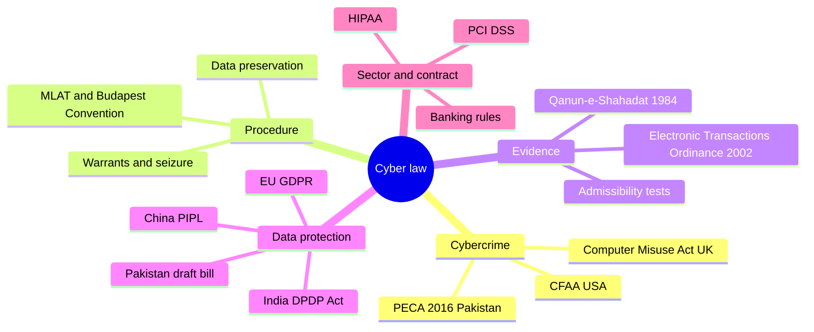
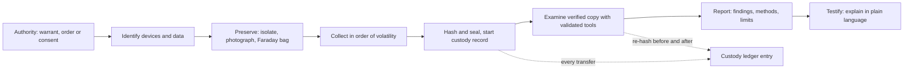
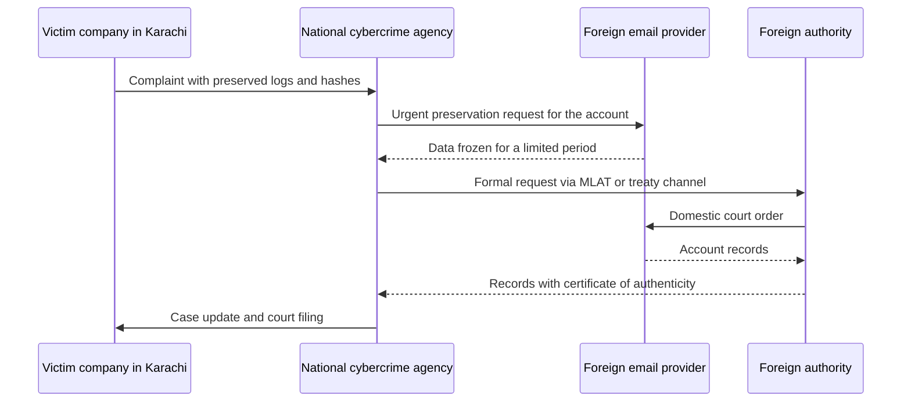
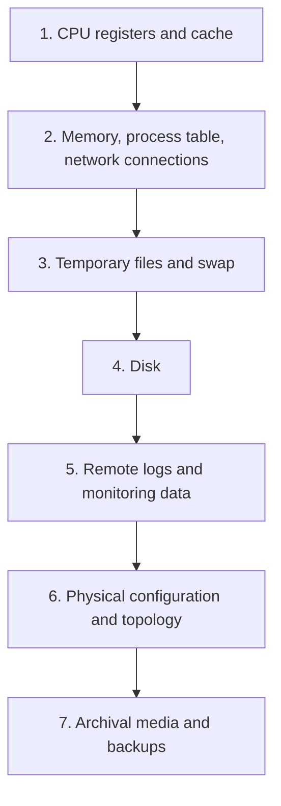
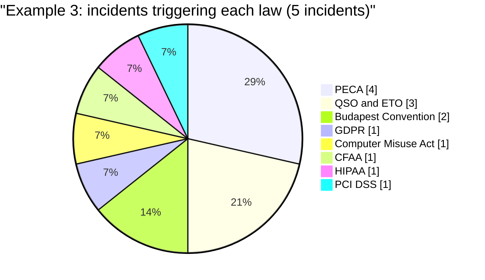

# Session 3: Cyber Laws, Data Protection and Digital Evidence

> [Cybersecurity and Digital Forensics](../../README.md) › [Term 1](../README.md) › [Module 5: Introduction to Cyber Security Frameworks](README.md) › **Session 3**

| ⏱ Estimated time | 📋 Prerequisites |
|---|---|
| 6 hours (three 2-hour classes: cyber-law foundations and data-protection laws · digital evidence, standards and forensic tools · Try It Yourself lab) | Session 1 (GDPR principles, breaches) and Session 2 (cybercrime types, hashing evidence, incident response) |

| ⬅ [Previous: Session 2](session-02-cybercrimes-and-investigation-tools.md) | [Next: Session 4](session-04-ai-in-cybersecurity-policies.md) ➡ |
|:---|---:|

[](https://colab.research.google.com/github/Hamnakhan123/Cybersecurity-and-Digital-Forensics/blob/main/term-1/05-cyber-security-frameworks/code/session-03-cyber-laws-and-digital-evidence.ipynb) &nbsp;Run every Python example of this session in the notebook [`code/session-03-cyber-laws-and-digital-evidence.ipynb`](code/session-03-cyber-laws-and-digital-evidence.ipynb).

---

## 🎯 Learning objectives

- Explain the **core principles and legal foundations** of cyber laws: legality, authorisation, jurisdiction, due process and proportionality.
- Describe the main **international and country-specific data-protection laws** (EU GDPR, UK, USA, India, China) and Pakistan's legal framework (PECA 2016, ETO 2002, Qanun-e-Shahadat 1984).
- Explain what makes **digital evidence admissible** in court and how **chain of custody**, hashing and the **order of volatility** protect it.
- Recognise the main **forensic standards** (ISO/IEC 27037, NIST SP 800-86, RFC 3227, the four ACPO principles) and the legal rules for using **forensic tools**.
- Practise with code: a tamper-evident custody ledger, an evidence-collection planner and a law-applicability matrix.

> **Not legal advice.** This session teaches how laws are structured and how investigators stay within them. Laws are amended often (Pakistan's PECA was amended in 2025, and data-protection bills keep changing). In a real case, read the current text and involve a lawyer.

## 📖 Concepts

### 1. What is cyber law?

**Cyber law** (also called IT law or internet law) is the set of rules that govern behaviour involving computers, networks and data. It is not one statute but a family of laws:

| Branch | Question it answers | Examples |
|---|---|---|
| **Cybercrime law** | Which acts are criminal, and what is the punishment? | PECA 2016 (Pakistan), Computer Misuse Act 1990 (UK), CFAA (USA) |
| **Procedural / investigation law** | How may police search, seize and intercept? | Warrant and preservation powers in PECA, UK Investigatory Powers Act |
| **Evidence law** | Will a court accept this record, and how is it proved? | Qanun-e-Shahadat Order 1984, US Federal Rules of Evidence |
| **Data protection and privacy** | How must personal data be collected, used and protected? | EU GDPR, India DPDP Act 2023, China PIPL |
| **Electronic commerce** | Are electronic contracts and signatures valid? | Electronic Transactions Ordinance 2002 (Pakistan), UNCITRAL model laws |
| **Intellectual property** | Who owns software, content and domain names? | Copyright Ordinance 1962 (Pakistan), DMCA (USA) |
| **Sector and contract rules** | Extra duties for banks, health, cards | HIPAA (USA), central-bank cyber rules, PCI DSS (contractual standard) |

> **Analogy – road rules.** Cybercrime law is the list of traffic offences. Procedural law says when the police may stop and search a car. Evidence law decides whether the speed-camera photo counts in court. Data-protection law is like the rules for how the licensing office may use your personal file.

### 2. Core principles behind cyber laws

| Principle | Plain meaning | Why investigators care |
|---|---|---|
| **Legality** ("no crime without a law") | An act is a crime only if a law defined it before it happened | You must name the exact section that was broken |
| **Authorisation** | Most computer offences hinge on access "without authority" or "exceeding authority" | Your own testing is legal only with written permission (scope, dates, signatures) |
| **Jurisdiction** | Which country's courts can hear the case | Attacker, victim, server and data may sit in four different countries |
| **Due process** | Searches, seizures and interception need lawful authority (warrant, court order, consent) | Evidence taken unlawfully can be excluded and the case lost |
| **Proportionality and necessity** | Collect only what the investigation needs | Copying a whole mailbox "just in case" can breach privacy law |
| **Technology neutrality** | Laws describe acts, not specific technologies | The same section covers a USB stick and a cloud bucket |
| **Accountability** | Organisations must be able to prove they complied | Logs, policies and records are your proof |

**Jurisdiction rules** courts use:

- **Territorial**: the act or its effect happened on the country's territory (the server or the victim is there).
- **Nationality**: the offender is a citizen, wherever the act was done (PECA, for example, applies to acts by Pakistani citizens abroad and to acts affecting systems in Pakistan).
- **Effects / targeting**: a foreign company that offers goods to residents (GDPR applies to non-EU firms that target or monitor people in the EU).

### 3. International cooperation

Cybercrime crosses borders in milliseconds; legal requests can take months. The main tools:

- **Budapest Convention on Cybercrime (Council of Europe, 2001)**: the first international cybercrime treaty. Parties agree on common offences, procedural powers (preservation orders, production orders) and 24/7 contact points for urgent requests. Always check whether each country involved is a party.
- **UN Convention against Cybercrime (adopted 2024)**: a newer global treaty; its use depends on ratifications.
- **Mutual Legal Assistance Treaties (MLATs)**: formal government-to-government requests for evidence held abroad. Slow but court-proof.
- **Direct requests to providers**: large platforms have law-enforcement portals; many will **preserve** data quickly on request and **disclose** only with proper legal process.
- **Data localisation laws**: some countries require certain data to stay inside their borders, which affects where evidence can be found.

### 4. Data-protection laws around the world

| Law | Where | Key ideas | Breach notice | Enforcement |
|---|---|---|---|---|
| **GDPR** (2018) | EU/EEA, and non-EU firms targeting or monitoring EU residents | Seven principles, lawful bases, data-subject rights, DPO, DPIA | Authority within **72 hours**; individuals if high risk | Fines up to EUR 20 m or 4% of global turnover |
| **UK GDPR + Data Protection Act 2018** | United Kingdom | Mirrors GDPR after Brexit, plus law-enforcement processing rules | 72 hours to the ICO | ICO fines |
| **CCPA / CPRA** | California, USA | Right to know, delete, correct, opt out of "sale/sharing" | Separate state breach laws | California Privacy Protection Agency, lawsuits for breaches |
| **HIPAA** | USA, health providers, insurers and their business associates | Privacy and Security Rules for health data | Individuals within 60 days | HHS fines |
| **DPDP Act 2023** | India | Consent-centred, duties of "data fiduciaries", Data Protection Board | To the Board and individuals | Penalties set by the Act |
| **PIPL** (2021) | China | Strict consent, rules on cross-border transfers, data localisation for some firms | Required | Fines and business suspension |

**Pakistan.** There is no single, comprehensive data-protection act in force at the time of writing. Draft **Personal Data Protection Bills** have been published several times; check the current status before relying on one. Meanwhile personal data is protected in pieces: **PECA 2016** criminalises unauthorised access, copying and misuse of identity information; the **Constitution (Article 14)** protects privacy of the home; sector regulators (for example the State Bank for banks and the telecom regulator for operators) issue their own security and privacy rules; and a Karachi firm serving EU customers must follow the **GDPR** for that data.

### 5. Pakistan's cyber-law framework in brief

| Law | What it covers | Investigator's takeaway |
|---|---|---|
| **Prevention of Electronic Crimes Act (PECA) 2016**, amended 2025 | Offences such as unauthorised access (s3), unauthorised copying or transmission of data (s4), interference with a system or data (s5), critical-infrastructure offences (s6–s8), electronic forgery (s13), electronic fraud (s14), unauthorised use of identity information (s16), offences against dignity (s20), cyberstalking (s24). Also procedural powers: warrants for search and seizure, preservation and retention of traffic data by providers, and international cooperation | Name the section, get the warrant, preserve the data; the 2025 amendments made the **National Cyber Crime Investigation Agency (NCCIA)** the investigation agency under section 29 (it was first notified in 2024) and dissolved the FIA Cyber Crime Wing, whose cases and staff moved to the NCCIA |
| **Electronic Transactions Ordinance (ETO) 2002** | Legal recognition of electronic documents, records and signatures | An email or electronic record is not rejected just because it is electronic |
| **Qanun-e-Shahadat Order 1984** (law of evidence) | General rules of evidence, amended to recognise electronic documents and evidence from modern devices | Courts still ask: is it authentic, is it complete, who produced it? |
| **Constitution of Pakistan, Article 14** | Dignity of the person and privacy of the home | Searches must be lawful and proportionate |

> **Tip.** Remember the trio: **PECA** tells you *what the crime is*, **ETO + Qanun-e-Shahadat** tell you *whether the electronic proof counts*, and **data-protection rules** tell you *who must be told and how the data must be handled*.

### 6. Digital evidence and admissibility

**Digital evidence** is any information stored or transmitted in digital form that a party wants to use in court: files, emails, chats, logs, metadata, memory, location history, CCTV video.

Why it is special:

- **Latent**: invisible without tools (deleted files, metadata, memory).
- **Fragile**: one careless click changes timestamps; switching off erases RAM.
- **Easily copied**: copies can be bit-for-bit identical, so the court accepts a verified copy instead of the original disk.
- **Time-sensitive**: providers delete logs after weeks or months.
- **Borderless**: the email may sit on a server in another continent.

**The five tests of good evidence** (a common way to remember admissibility):

| Test | Question | How you satisfy it |
|---|---|---|
| **Admissible** | Was it obtained lawfully and is it relevant? | Warrant/consent, within scope, relevant to an issue |
| **Authentic** | Is it what you claim it is? | Hashes at seizure and at analysis, chain of custody, metadata |
| **Complete** | Does it tell the whole story, including evidence that helps the defence? | Full images, not cherry-picked screenshots; record exculpatory finds |
| **Reliable** | Were the tools and methods sound? | Validated tools, documented, repeatable methods |
| **Believable** | Will a judge understand and accept it? | Clear reports, timelines, plain language, a competent expert witness |

Other legal ideas you will meet:

- **Best evidence rule**: courts prefer originals; a forensic image with matching hash is treated as an accurate copy.
- **Hearsay and business records**: system logs produced automatically in the normal course of business are usually accepted when someone explains how the system works.
- **Expert evidence**: in the USA the *Daubert* test asks whether a method is tested, peer-reviewed, has a known error rate and is generally accepted. Other countries apply similar reliability checks.
- **Exclusion**: evidence gathered outside a warrant's scope, or after tampering, may be thrown out.

### 7. Standards and principles for handling evidence

| Standard / guide | What it gives you |
|---|---|
| **ACPO / NPCC Good Practice Guide (UK) – four principles** | (1) Do not change data that may be relied on in court. (2) If you must access original data (e.g. live system), be competent and able to explain your actions. (3) Keep an audit trail that a third party could repeat. (4) The officer in charge is responsible for following the law and these principles |
| **ISO/IEC 27037** | Identification, collection, acquisition and preservation of digital evidence |
| **ISO/IEC 27041 / 27042 / 27043** | Validating methods, analysing and interpreting evidence, investigation process models |
| **NIST SP 800-86** | Integrating forensic techniques into incident response (collection, examination, analysis, reporting) |
| **RFC 3227** | Guidelines for evidence collection, including the **order of volatility** |
| **NIST CFTT** | Computer Forensics Tool Testing results that help show a tool is reliable |

**Order of volatility (RFC 3227, simplified):** CPU registers and cache → routing/ARP tables, process table, kernel statistics, **memory** → temporary file systems and swap → **disk** → remote logging and monitoring data → physical configuration and network topology → archival media. Collect from the top (most fragile) downwards.

### 8. Chain of custody

The **chain of custody** is the documented, unbroken history of an evidence item from seizure to court: **who** had it, **when**, **where**, **why**, and its **hash** at each step. A break (an unexplained gap, a missing signature, a hash that changes) lets the defence argue the item may have been swapped or altered.

A good custody record has: case and exhibit number, description (make, model, serial), seizure location and authority, every transfer with date/time and time zone, purpose, signatures of both parties, seal numbers, storage location, and hash values. Example 1 turns this into a **hash-chained ledger** where any later edit is detectable.

### 9. Using forensic tools lawfully

- **Authority first**: a warrant, court order, written consent or (inside a company) a signed policy and management authorisation. Stay within its **scope** (devices, accounts, dates, offences).
- **Validated tools**: use tools whose results are tested (NIST CFTT, vendor validation, your own test images) and record the **version** used.
- **Write blockers** for disks; **Faraday bags** or airplane mode for phones to stop remote wiping.
- **Work on copies**: verify image hashes before and after analysis.
- **Log everything**: commands, times (with zone), screenshots of tool settings; tools such as FTK Imager and Autopsy produce reports you keep in the case file.
- **Privileged and private material**: lawyer–client emails, medical data and unrelated personal photos need special handling; filter by keywords and dates agreed with the legal team.
- **Licensing and ethics**: use licensed or open-source tools; never use cracked software on evidence (it could be challenged and it is itself illegal).
- **Live response** changes the system a little: be ready to explain each change in court (ACPO principle 2).

## 🧭 Diagrams

**The cyber-law landscape**



**Life of a digital exhibit, from scene to court**



**Getting evidence held by a provider in another country**



**Order of volatility: collect from the top down**



## 🪜 Step-by-step: handling digital evidence so it stands up in court

1. **Confirm authority and scope** in writing: which devices, accounts, dates and offences (warrant, court order, consent or signed management authorisation).
2. **Plan** the collection with the order of volatility and the time available (Example 2).
3. **Secure the scene**: keep people away from keyboards; photograph screens, cables and labels.
4. **Isolate, do not switch off** a running device (unplug the network or use airplane mode) unless destructive malware is wiping it.
5. **Collect volatile data first** (memory, network connections, logged-in sessions), recording each command and its time with the zone.
6. **Image storage** through a write blocker; calculate MD5 and SHA-256 of the original and the image.
7. **Bag, seal and label** each exhibit; open a **chain-of-custody** record and add an entry for every hand-over (Example 1).
8. **Send preservation requests** for remote logs and cloud accounts before they are deleted.
9. **Check the law** for every place and data type involved (Example 3): offence, evidence rules, breach-notice duties.
10. **Analyse copies only**, with validated tools; re-hash before and after.
11. **Report** findings, method, tool versions, limitations and anything that helps the other side.
12. **Store and dispose** of evidence according to the court's and the law's retention rules.

## 💻 Worked examples

### Example 1 – A tamper-evident chain-of-custody ledger

📄 **`code/session-03_custody_ledger.py`**

```python
"""Session 3 - A hash-chained chain-of-custody ledger.

Courts accept digital evidence only if the prosecution can show who held it, when,
why, and that it never changed. A paper custody form can be rewritten quietly; this
ledger cannot. Each entry stores the SHA-256 hash of the previous entry, so editing
any old line breaks every link after it (the same idea a blockchain uses).

All people, cases and evidence below are fictional. The script uses fixed times so
the output is the same on every run.
Run:  python session-03_custody_ledger.py
"""
import hashlib
import json

GENESIS = "0" * 64


def sha256(data):
    return hashlib.sha256(data).hexdigest()


def entry_hash(entry):
    """Hash every field except the entry's own hash, in a fixed key order."""
    body = {k: v for k, v in entry.items() if k != "hash"}
    return sha256(json.dumps(body, sort_keys=True).encode())


class CustodyLedger:
    def __init__(self, case_id):
        self.case_id = case_id
        self.entries = []

    def add(self, time, item, action, from_person, to_person, purpose, item_sha256):
        prev = self.entries[-1]["hash"] if self.entries else GENESIS
        entry = {
            "seq": len(self.entries) + 1, "case": self.case_id, "time": time,
            "item": item, "action": action, "from": from_person, "to": to_person,
            "purpose": purpose, "item_sha256": item_sha256, "prev": prev,
        }
        entry["hash"] = entry_hash(entry)
        self.entries.append(entry)
        return entry

    def verify(self, current_item_hashes):
        """Return a list of problems; an empty list means the ledger is intact."""
        problems, prev = [], GENESIS
        first_hash = {}
        for e in self.entries:
            if e["prev"] != prev:
                problems.append(f"entry {e['seq']}: link to previous entry is broken")
            if entry_hash(e) != e["hash"]:
                problems.append(f"entry {e['seq']}: contents were edited after signing")
            first_hash.setdefault(e["item"], e["item_sha256"])
            if e["item_sha256"] != first_hash[e["item"]]:
                problems.append(f"entry {e['seq']}: {e['item']} hash differs from acquisition")
            prev = e["hash"]
        for item, h in current_item_hashes.items():
            if h != first_hash.get(item):
                problems.append(f"{item}: evidence today does not match the acquisition hash")
        return problems


# --- fictional evidence (bytes stand in for real disk/phone images) ---
laptop_img = b"EXHIBIT HZ-01 laptop image: invoices.xlsx, mail.pst, browser history"
phone_img = b"EXHIBIT HZ-02 phone extraction: chats, call log, photos"
H1, H2 = sha256(laptop_img), sha256(phone_img)

ledger = CustodyLedger("KHI-CC-2026-0147")
ledger.add("2026-10-20 09:40 PKT", "HZ-01 laptop", "SEIZED", "suspect desk, Office 3", "Insp. Rabia", "Search under warrant", H1)
ledger.add("2026-10-20 09:55 PKT", "HZ-02 phone", "SEIZED", "suspect pocket", "Insp. Rabia", "Search under warrant", H2)
ledger.add("2026-10-20 13:10 PKT", "HZ-01 laptop", "TRANSFER", "Insp. Rabia", "Evidence room (Clerk Danish)", "Secure storage, bag seal 55871", H1)
ledger.add("2026-10-21 10:05 PKT", "HZ-01 laptop", "TRANSFER", "Clerk Danish", "Analyst Omer (forensic lab)", "Imaging with write blocker", H1)
ledger.add("2026-10-21 16:30 PKT", "HZ-01 laptop", "RETURN", "Analyst Omer", "Clerk Danish", "Imaging complete, seal 55902", H1)

print(f"Chain of custody for case {ledger.case_id}\n")
print(f"{'#':>2}  {'time':<20} {'item':<13} {'action':<9} {'from -> to':<52} hash")
for e in ledger.entries:
    who = f"{e['from']} -> {e['to']}"
    print(f"{e['seq']:>2}  {e['time']:<20} {e['item']:<13} {e['action']:<9} {who[:52]:<52} {e['hash'][:12]}..")
print(f"\nItem hashes at acquisition: HZ-01 {H1[:16]}..  HZ-02 {H2[:16]}..")

today = {"HZ-01 laptop": sha256(laptop_img), "HZ-02 phone": sha256(phone_img)}
problems = ledger.verify(today)
print("\n[1] Verify untouched ledger:", "INTACT" if not problems else problems)

# --- Scenario 2: someone quietly rewrites who held the laptop on 21 Oct ---
ledger.entries[3]["to"] = "Unknown contractor"
print("\n[2] Entry 4 edited to hide an unrecorded hand-over:")
for p in ledger.verify(today):
    print("   !", p)
ledger.entries[3]["to"] = "Analyst Omer (forensic lab)"      # undo for the next test

# --- Scenario 3: the forger also recomputes entry 4's own hash ---
ledger.entries[3]["to"] = "Unknown contractor"
ledger.entries[3]["hash"] = entry_hash(ledger.entries[3])
print("\n[3] Entry 4 edited AND its own hash recomputed:")
for p in ledger.verify(today):
    print("   !", p)
print("   -> the next entry still points at the old hash, so the chain exposes it.")
ledger.entries[3]["to"] = "Analyst Omer (forensic lab)"
ledger.entries[3]["hash"] = entry_hash(ledger.entries[3])

# --- Scenario 4: the evidence file itself changes in storage ---
tampered = laptop_img.replace(b"invoices", b"invoicez")
print("\n[4] One byte of the laptop image changed in storage:")
for p in ledger.verify({"HZ-01 laptop": sha256(tampered), "HZ-02 phone": H2}):
    print("   !", p)
print("\nTip: print the last entry hash on the paper form and in the case file;")
print("anyone can later recompute the chain and compare it with that number.")
print("Last entry hash:", ledger.entries[-1]["hash"])
```

**Output**

```text
Chain of custody for case KHI-CC-2026-0147

 #  time                 item          action    from -> to                                           hash
 1  2026-10-20 09:40 PKT HZ-01 laptop  SEIZED    suspect desk, Office 3 -> Insp. Rabia                bbb93f39328a..
 2  2026-10-20 09:55 PKT HZ-02 phone   SEIZED    suspect pocket -> Insp. Rabia                        2fcf194f72a4..
 3  2026-10-20 13:10 PKT HZ-01 laptop  TRANSFER  Insp. Rabia -> Evidence room (Clerk Danish)          f94fbe297094..
 4  2026-10-21 10:05 PKT HZ-01 laptop  TRANSFER  Clerk Danish -> Analyst Omer (forensic lab)          4fa7f6ac0c4f..
 5  2026-10-21 16:30 PKT HZ-01 laptop  RETURN    Analyst Omer -> Clerk Danish                         1bf550628951..

Item hashes at acquisition: HZ-01 dfed868a09e81fa6..  HZ-02 cdd47f69d1a8ae1a..

[1] Verify untouched ledger: INTACT

[2] Entry 4 edited to hide an unrecorded hand-over:
   ! entry 4: contents were edited after signing

[3] Entry 4 edited AND its own hash recomputed:
   ! entry 5: link to previous entry is broken
   -> the next entry still points at the old hash, so the chain exposes it.

[4] One byte of the laptop image changed in storage:
   ! HZ-01 laptop: evidence today does not match the acquisition hash

Tip: print the last entry hash on the paper form and in the case file;
anyone can later recompute the chain and compare it with that number.
Last entry hash: 1bf55062895173feddef0e580fca3445fa1869c3c2e1567b767ab3656da4dc1a
```
**Observe:**
- Each entry stores the **hash of the previous entry** (`prev`). Editing entry 4 changes its own hash, so check [2] catches it immediately.
- In [3] the forger also recalculated entry 4's hash, but **entry 5 still points to the old value**, so the chain breaks there. To hide the edit, every later entry would have to be rewritten.
- In [4] the ledger is fine but the **evidence itself** changed: the item hash no longer matches the acquisition hash.
- Printing the **last entry hash** on the signed paper form anchors the whole chain: nobody can rewrite the ledger without that number changing.

### Example 2 – Planning collection by order of volatility

📄 **`code/session-03_volatility_planner.py`**

```python
"""Session 3 - Plan evidence collection in the order of volatility.

Some evidence disappears in seconds (CPU state, RAM, network connections); some lasts
for years (backups, printouts). RFC 3227 and NIST SP 800-86 say: collect the most
volatile evidence first. This planner takes the artefacts on a fictional live machine,
sorts them by volatility, skips what is impossible in the device's state, warns about
traps (full-disk encryption, cloud sessions), and checks the plan fits the time on site.

Run:  python session-03_volatility_planner.py
"""

# rank: 1 = disappears fastest.  minutes = rough collection time.  needs_power: lost at shutdown
ARTEFACTS = [
    # name,                                   rank, minutes, needs_power
    ("Archival media (offsite backups)",          8, 0,  False),
    ("Disk image (with write blocker)",           6, 90, False),
    ("RAM (full memory capture)",                 2, 12, True),
    ("Network connections and ARP/route cache",   3, 2,  True),
    ("Running processes and open files",          4, 3,  True),
    ("Logged-in users and cloud sessions",        4, 2,  True),
    ("Temporary files and swap/pagefile",         5, 10, False),
    ("CPU registers and cache",                   1, 0,  True),
    ("Remote logs (firewall, SIEM, email)",       7, 20, False),
    ("Screen photo (what is visible now)",        1, 1,  True),
]

TOOLS = {
    "RAM": "memory imager (e.g. WinPmem/LiME) to external drive",
    "Network": "netstat/ss + arp -a output saved and hashed",
    "Running": "process list with command lines (e.g. tasklist /v, ps aux)",
    "Logged-in": "query user / who; note cloud tabs before they time out",
    "Disk": "imager + hardware write blocker, MD5+SHA-256",
    "Temporary": "collected inside the disk image; note pagefile/swap",
    "Remote": "preservation request to the log owner, export + hash",
    "Archival": "request through the organisation's backup custodian",
    "Screen": "photograph the screen with time visible",
    "CPU": "not practical to capture; noted for completeness",
}


def plan(device_on, disk_encrypted, minutes_on_site):
    print(f"\n=== Device {'ON' if device_on else 'OFF'} | full-disk encryption "
          f"{'YES' if disk_encrypted else 'no'} | {minutes_on_site} min on site ===")
    steps, used, skipped = [], 0, []
    for name, rank, mins, needs_power in sorted(ARTEFACTS, key=lambda a: (a[1], a[2])):
        if needs_power and not device_on:
            skipped.append(f"{name} (lost when the device powered off)")
            continue
        if mins == 0:
            skipped.append(f"{name} (not practical or done off site)")
            continue
        steps.append((rank, name, mins))
    for i, (rank, name, mins) in enumerate(steps, 1):
        used += mins
        flag = "" if used <= minutes_on_site else "  <- over time budget: hand to lab / preservation request"
        tool = TOOLS[name.split()[0]]
        print(f" {i:>2}. [vol {rank}] {name:<42} {mins:>3} min (t={used:>3})  {tool}{flag}")
    for s in skipped:
        print("     skip:", s)
    if device_on and disk_encrypted:
        print("  ! Encrypted disk is UNLOCKED now: capture RAM (keys) and consider a live logical")
        print("    copy of key folders BEFORE any shutdown, or the data may become unreadable.")
    if device_on:
        print("  ! Isolate from the network (unplug cable / airplane mode) rather than power off,")
        print("    unless destructive malware is actively wiping data.")
    else:
        print("  ! Device is off: do NOT switch it on. Bag, seal, label and image in the lab.")
    print("  ! Record every command you type, with the time, in your notes and custody form.")


# Case A: suspect laptop found running and unlocked, encrypted disk, 60 minutes on site
plan(device_on=True, disk_encrypted=True, minutes_on_site=60)
# Case B: same model found switched off
plan(device_on=False, disk_encrypted=True, minutes_on_site=60)
```

**Output**

```text

=== Device ON | full-disk encryption YES | 60 min on site ===
  1. [vol 1] Screen photo (what is visible now)           1 min (t=  1)  photograph the screen with time visible
  2. [vol 2] RAM (full memory capture)                   12 min (t= 13)  memory imager (e.g. WinPmem/LiME) to external drive
  3. [vol 3] Network connections and ARP/route cache      2 min (t= 15)  netstat/ss + arp -a output saved and hashed
  4. [vol 4] Logged-in users and cloud sessions           2 min (t= 17)  query user / who; note cloud tabs before they time out
  5. [vol 4] Running processes and open files             3 min (t= 20)  process list with command lines (e.g. tasklist /v, ps aux)
  6. [vol 5] Temporary files and swap/pagefile           10 min (t= 30)  collected inside the disk image; note pagefile/swap
  7. [vol 6] Disk image (with write blocker)             90 min (t=120)  imager + hardware write blocker, MD5+SHA-256  <- over time budget: hand to lab / preservation request
  8. [vol 7] Remote logs (firewall, SIEM, email)         20 min (t=140)  preservation request to the log owner, export + hash  <- over time budget: hand to lab / preservation request
     skip: CPU registers and cache (not practical or done off site)
     skip: Archival media (offsite backups) (not practical or done off site)
  ! Encrypted disk is UNLOCKED now: capture RAM (keys) and consider a live logical
    copy of key folders BEFORE any shutdown, or the data may become unreadable.
  ! Isolate from the network (unplug cable / airplane mode) rather than power off,
    unless destructive malware is actively wiping data.
  ! Record every command you type, with the time, in your notes and custody form.

=== Device OFF | full-disk encryption YES | 60 min on site ===
  1. [vol 5] Temporary files and swap/pagefile           10 min (t= 10)  collected inside the disk image; note pagefile/swap
  2. [vol 6] Disk image (with write blocker)             90 min (t=100)  imager + hardware write blocker, MD5+SHA-256  <- over time budget: hand to lab / preservation request
  3. [vol 7] Remote logs (firewall, SIEM, email)         20 min (t=120)  preservation request to the log owner, export + hash  <- over time budget: hand to lab / preservation request
     skip: CPU registers and cache (lost when the device powered off)
     skip: Screen photo (what is visible now) (lost when the device powered off)
     skip: RAM (full memory capture) (lost when the device powered off)
     skip: Network connections and ARP/route cache (lost when the device powered off)
     skip: Logged-in users and cloud sessions (lost when the device powered off)
     skip: Running processes and open files (lost when the device powered off)
     skip: Archival media (offsite backups) (not practical or done off site)
  ! Device is off: do NOT switch it on. Bag, seal, label and image in the lab.
  ! Record every command you type, with the time, in your notes and custody form.
```
**Observe:**
- Case A puts the **screen photo** and **RAM** first; RAM can hold encryption keys, running malware and chat fragments that never reach the disk.
- The full disk image does not fit in 60 minutes on site, so the planner flags it to be done in the lab, which is normal practice.
- In Case B every power-dependent artefact is already gone. The right action is **not to switch the device on** (booting changes hundreds of files and timestamps).
- The encryption warning matters: if an unlocked, fully encrypted laptop is switched off, the data may become unreadable without the key.

### Example 3 – Which laws apply? A law-applicability matrix

📄 **`code/session-03_law_matrix.py`**

```python
"""Session 3 - Which laws apply? A law-applicability matrix for fictional incidents.

Real incidents rarely involve one law. A breach at a Karachi company that serves
European customers can touch Pakistan's cybercrime law, its evidence law, the EU GDPR
and an industry standard all at once. This script describes each incident as a set of
facts ("tags"), keeps a small rule base of laws and the facts that trigger them, and
prints a matrix plus the reasons for every tick.

Teaching simplification only: the rule base is deliberately short and is NOT legal
advice. Laws are amended (Pakistan's PECA was amended in 2025, data-protection bills
change), so always check the current text and ask a lawyer.
Run:  python session-03_law_matrix.py
"""

# law code: (full name, kind, trigger tags (any one), what it gives the investigator)
# A cybercrime law only matters when a crime is suspected, so those laws also REQUIRE
# the tag "crime" (see REQUIRES). A purely accidental loss is a data-protection matter.
LAWS = {
    "PECA": ("Prevention of Electronic Crimes Act 2016 (Pakistan)", "cybercrime",
             {"offender_or_victim_pk", "system_in_pk"},
             "defines the offences (sections listed per incident below)"),
    "QSO+ETO": ("Qanun-e-Shahadat Order 1984 + Electronic Transactions Ordinance 2002 (Pakistan)",
                "evidence", {"court_in_pk"},
                "electronic documents and records are admissible; authenticity must be shown"),
    "GDPR": ("EU General Data Protection Regulation", "data protection",
             {"eu_personal_data"},
             "72-hour breach notice to the authority, data-subject rights, fines"),
    "CMA": ("Computer Misuse Act 1990 (UK)", "cybercrime", {"system_in_uk"},
            "unauthorised access and impairment offences"),
    "CFAA": ("Computer Fraud and Abuse Act (USA)", "cybercrime", {"system_in_us"},
             "unauthorised access to protected computers"),
    "HIPAA": ("Health Insurance Portability and Accountability Act (USA)", "sector privacy",
              {"us_health_data"}, "security and breach-notice duties for health data"),
    "PCI DSS": ("Payment Card Industry Data Security Standard", "contract standard",
                {"card_data"}, "not a law, but card brands and banks enforce it by contract"),
    "Budapest": ("Council of Europe Convention on Cybercrime (Budapest)", "treaty",
                 {"cross_border"},
                 "framework for cross-border evidence requests among parties; "
                 "check whether each country involved has joined"),
}

REQUIRES = {"PECA": {"crime"}, "CMA": {"crime"}, "CFAA": {"crime"}}

# Likely PECA sections per incident (teaching examples; a prosecutor decides the charge)
PECA_SECTIONS = {
    "A": "s3 unauthorised access, s4 unauthorised copying of data",
    "C": "s14 electronic fraud, s16 unauthorised use of identity information",
    "D": "s3 unauthorised access, s5 interference with data (the Pakistani firm's VPN was abused)",
    "E": "s16 identity misuse, s20 offences against dignity, s24 cyberstalking",
}

INCIDENTS = [
    ("A", "Ex-employee logs into a Karachi firm's ERP after leaving and copies the client list",
     {"crime", "offender_or_victim_pk", "system_in_pk", "court_in_pk"}),
    ("B", "Karachi call centre handling EU retail customers loses a laptop with their order history",
     {"system_in_pk", "eu_personal_data"}),
    ("C", "Phishing kit hosted in the UK steals card numbers from a Lahore online shop's customers",
     {"crime", "offender_or_victim_pk", "system_in_uk", "card_data", "cross_border", "court_in_pk"}),
    ("D", "Pakistani software house's US hospital client is hit by ransomware via a shared VPN",
     {"crime", "system_in_us", "us_health_data", "offender_or_victim_pk", "cross_border"}),
    ("E", "Student harasses a classmate with fake social-media profiles; case filed in Karachi",
     {"crime", "offender_or_victim_pk", "court_in_pk"}),
]


def applies(incident_tags, law_tags, code=None):
    if code and not REQUIRES.get(code, set()) <= incident_tags:
        return []
    return sorted(incident_tags & law_tags)


codes = list(LAWS)
print("Law applicability matrix (X = likely applies)\n")
print("Incident | " + " | ".join(f"{c:^8}" for c in codes))
print("-" * (11 + 11 * len(codes)))
for iid, _, tags in INCIDENTS:
    row = ["X" if applies(tags, LAWS[c][2], c) else "." for c in codes]
    print(f"   {iid}     | " + " | ".join(f"{r:^8}" for r in row))

print("\nWhy each tick:")
for iid, text, tags in INCIDENTS:
    print(f"\n{iid}. {text}")
    for c in codes:
        hit = applies(tags, LAWS[c][2], c)
        if hit:
            name, kind, _, gives = LAWS[c]
            if c == "PECA":
                gives = PECA_SECTIONS.get(iid, gives)
            print(f"   - {c} [{kind}] because {', '.join(hit)}: {gives}")

counts = {c: sum(1 for _, _, t in INCIDENTS if applies(t, LAWS[c][2], c)) for c in codes}
print("\nHow often each law was triggered:", ", ".join(f"{c}={n}" for c, n in counts.items()))
print("Lesson: one incident usually needs a cybercrime law (what is the offence?), an evidence")
print("law (will the court accept it?) and often a data-protection law (who must be told?).")
```

**Output**

```text
Law applicability matrix (X = likely applies)

Incident |   PECA   | QSO+ETO  |   GDPR   |   CMA    |   CFAA   |  HIPAA   | PCI DSS  | Budapest
---------------------------------------------------------------------------------------------------
   A     |    X     |    X     |    .     |    .     |    .     |    .     |    .     |    .    
   B     |    .     |    .     |    X     |    .     |    .     |    .     |    .     |    .    
   C     |    X     |    X     |    .     |    X     |    .     |    .     |    X     |    X    
   D     |    X     |    .     |    .     |    .     |    X     |    X     |    .     |    X    
   E     |    X     |    X     |    .     |    .     |    .     |    .     |    .     |    .    

Why each tick:

A. Ex-employee logs into a Karachi firm's ERP after leaving and copies the client list
   - PECA [cybercrime] because offender_or_victim_pk, system_in_pk: s3 unauthorised access, s4 unauthorised copying of data
   - QSO+ETO [evidence] because court_in_pk: electronic documents and records are admissible; authenticity must be shown

B. Karachi call centre handling EU retail customers loses a laptop with their order history
   - GDPR [data protection] because eu_personal_data: 72-hour breach notice to the authority, data-subject rights, fines

C. Phishing kit hosted in the UK steals card numbers from a Lahore online shop's customers
   - PECA [cybercrime] because offender_or_victim_pk: s14 electronic fraud, s16 unauthorised use of identity information
   - QSO+ETO [evidence] because court_in_pk: electronic documents and records are admissible; authenticity must be shown
   - CMA [cybercrime] because system_in_uk: unauthorised access and impairment offences
   - PCI DSS [contract standard] because card_data: not a law, but card brands and banks enforce it by contract
   - Budapest [treaty] because cross_border: framework for cross-border evidence requests among parties; check whether each country involved has joined

D. Pakistani software house's US hospital client is hit by ransomware via a shared VPN
   - PECA [cybercrime] because offender_or_victim_pk: s3 unauthorised access, s5 interference with data (the Pakistani firm's VPN was abused)
   - CFAA [cybercrime] because system_in_us: unauthorised access to protected computers
   - HIPAA [sector privacy] because us_health_data: security and breach-notice duties for health data
   - Budapest [treaty] because cross_border: framework for cross-border evidence requests among parties; check whether each country involved has joined

E. Student harasses a classmate with fake social-media profiles; case filed in Karachi
   - PECA [cybercrime] because offender_or_victim_pk: s16 identity misuse, s20 offences against dignity, s24 cyberstalking
   - QSO+ETO [evidence] because court_in_pk: electronic documents and records are admissible; authenticity must be shown

How often each law was triggered: PECA=4, QSO+ETO=3, GDPR=1, CMA=1, CFAA=1, HIPAA=1, PCI DSS=1, Budapest=2
Lesson: one incident usually needs a cybercrime law (what is the offence?), an evidence
law (will the court accept it?) and often a data-protection law (who must be told?).
```
**Observe:**
- Incident **B** (a lost laptop) triggers **no cybercrime law** because no crime is suspected, but it is still a **personal-data breach** under GDPR with a 72-hour notice duty.
- Incident **C** shows how one phishing case can involve a Pakistani offence, a UK offence, a card-industry contract standard and a treaty for cross-border evidence.
- **PCI DSS** is not a law; it is enforced through contracts with banks and card brands. Students often mix this up.
- The matrix is a starting checklist for the legal team, not a final legal opinion.

## 📊 Chart

How often each law was triggered across the five incidents in Example 3:



Quick legal checklist by question:

| The investigator asks… | Look at |
|---|---|
| "Is this act a crime here?" | Cybercrime law (PECA, CMA, CFAA): find the exact section |
| "May I search or seize this device?" | Warrant/consent; procedural powers; company policy for internal cases |
| "Will the court accept this email or log?" | Evidence law (Qanun-e-Shahadat, ETO), hashes, custody record, expert explanation |
| "Must we tell a regulator or the customers?" | Data-protection and sector rules (GDPR 72 h, HIPAA, banking rules) |
| "The data is abroad, how do we get it?" | Provider preservation request, MLAT, Budapest/UN treaty channels |
| "Is my tool reliable enough?" | Validation records, NIST CFTT, tool version and logs |

## 🏢 Real-life problem with full solution

**Scenario.** At *Clifton Institute of Technology*, a fictional private university in Karachi, the examinations office notices that final grades of six students in one course changed in the learning-management system (LMS) **after** results were approved. The change log shows the edits came from the account of a lab assistant, Mr. Kashif, at 23:40 on a Saturday. Kashif says he was at a wedding and never logged in. The LMS also holds names, CNIC numbers and phone numbers of 4,000 students, a few of whom are exchange students from the EU.

**Solution.**

1. **Authority and team.** The Registrar authorises an internal investigation in writing under the university's IT acceptable-use policy (which says university systems and accounts may be monitored). The legal adviser and the IT security lead are named; scope: LMS logs, Kashif's university laptop and account, VPN and Wi-Fi logs for the weekend. Kashif's personal phone is **out of scope** unless he consents or police obtain a warrant.
2. **Preserve quickly.** Export LMS audit logs, database change history, VPN, firewall and Wi-Fi controller logs for the whole weekend; hash every export (SHA-256); request the hosting provider to **preserve** server logs and backups. Do not rely on screenshots.
3. **Volatility plan.** Kashif's laptop is running in the lab: photograph the screen, capture RAM, record network connections and logged-in sessions, then image the disk through a write blocker (Example 2). Open a **custody ledger** entry for every item (Example 1); record times in PKT.
4. **Contain.** Reset Kashif's password, revoke active sessions, enforce MFA on all staff LMS accounts, lock the affected grade records and restore the approved grades from the signed result sheets (keeping the altered values as evidence).
5. **Analyse copies.** In the logs, the 23:40 session came from the campus Wi-Fi, from a device whose MAC address belongs to **a student's laptop** registered on the network, not Kashif's. Kashif's laptop memory shows a browser profile where his LMS password was **saved without a master password**, and the lab PC sign-in log shows the same student used that lab PC on Friday. Kashif's wedding photos (offered voluntarily) are timestamped elsewhere. The evidence points to **credential theft from a shared lab machine**.
6. **Legal check (Example 3 thinking).** Possible PECA offences: unauthorised access (s3), interference with data (s5), and unauthorised use of identity information (s16). Evidence will be electronic records under the ETO and Qanun-e-Shahadat, so hashes, custody records and an expert report are needed. Personal data of all students sat in the compromised system: because EU exchange students are included, the university assesses whether this is a personal-data breach needing notice (the account viewed grades only, so risk is limited; the decision and reasons are documented either way). Internal disciplinary rules also apply.
7. **Report and refer.** The university files a complaint with the national cybercrime agency, handing over hashed exports, the custody ledger and the forensic report. Students' academic misconduct is handled by the disciplinary committee in parallel, giving the accused student a fair hearing (due process).
8. **Lessons learned.** Disable password saving in browsers on lab PCs, auto-logout on shared machines, MFA for every staff role that can change grades, alerts for grade changes after approval, a second approver for post-approval changes, and annual staff training on account hygiene.

## ⚠️ Common mistakes

- Starting to examine a device **before** checking you have the authority, or going beyond the warrant's scope.
- Switching off a running, encrypted laptop and losing the keys in memory.
- Booting a seized, switched-off computer "to have a quick look".
- Keeping custody records with missing times, no time zones or no signatures for hand-overs.
- Presenting screenshots instead of original exports with headers and hashes.
- Assuming a breach-notice deadline does not apply because the company is not in the EU.
- Calling PCI DSS a law, or assuming one country's law covers a server in another country.
- Ignoring evidence that helps the accused (incomplete evidence damages credibility).

## ✅ Best practices

- Keep a **legal checklist** for each case: offence, authority, evidence rules, data-protection duties, cross-border needs.
- Follow **ISO/IEC 27037**, **RFC 3227** and the **four ACPO principles**; document anything that changes a live system.
- **Hash at every step** and keep a tamper-evident custody record; anchor its last hash on paper.
- Use **validated, licensed tools**, and record tool names and versions in reports.
- Send **preservation requests** early; logs vanish quickly.
- Write reports a non-technical judge can follow: timeline, plain language, clear limits.
- Respect privacy: collect only what is needed, protect privileged and sensitive material, and delete data when the law allows.

## 🧪 Lab / practice tasks (Try It Yourself)

1. **Easy –** Classify each as **cybercrime law**, **evidence law**, **data-protection law** or **contract standard**: (a) GDPR, (b) PECA 2016, (c) Qanun-e-Shahadat Order 1984, (d) PCI DSS, (e) Computer Misuse Act 1990, (f) India DPDP Act 2023.
2. **Easy –** Put these in order of volatility (most volatile first): disk image, offsite backup tapes, RAM, firewall logs on a remote server, swap file, ARP cache.
3. **Medium –** In `session-03_custody_ledger.py`, add an entry that transfers the **HZ-02 phone** from Insp. Rabia to Analyst Omer on 2026-10-22 at 11:00 PKT for "Logical extraction in Faraday box". Verify that the ledger is still INTACT.
4. **Medium –** In `session-03_volatility_planner.py`, add the artefact **"Clipboard and open chat windows"** (rank 3, 2 minutes, needs power) and run Case A with only **20 minutes** on site. Which steps now exceed the budget?
5. **Medium –** In `session-03_law_matrix.py`, add India's **DPDP Act 2023** (triggered by a new tag `india_personal_data`) and a new incident **F**: *"Karachi payroll outsourcer accidentally emails salary slips of an Indian client's staff to the wrong company."* Run it and explain the row.
6. **Challenge –** Deleting the **last** ledger entry is not detected by `verify()` (no later entry points to it). Add an `anchor` parameter (the last hash written on the paper form) and a check that sequence numbers have no gaps, so that both a deleted middle entry and a deleted last entry are reported.

<details>
<summary>💡 Hints</summary>

- Task 1: ask "does it define offences, decide proof, protect personal data, or bind by contract?"
- Task 2: what survives a power cut? What lives on another machine?
- Task 3: call `ledger.add(...)` with `H2` as the item hash before the verification lines run.
- Task 4: change `plan(device_on=True, disk_encrypted=True, minutes_on_site=60)` to 20 and add a `TOOLS["Clipboard"]` entry, because the planner looks tools up by the first word.
- Task 5: add an entry to `LAWS`; do not add it to `REQUIRES` (no crime is needed for a data-protection duty).
- Task 6: compare `e["seq"]` with its position, and compare `self.entries[-1]["hash"]` with the anchor.
</details>

<details>
<summary>✅ Solutions</summary>

**Task 1:** (a) data protection, (b) cybercrime law, (c) evidence law, (d) contract standard, (e) cybercrime law, (f) data protection.

**Task 2:** ARP cache → RAM → swap file → disk image → firewall logs on a remote server → offsite backup tapes. (ARP cache and RAM are both in the second tier of RFC 3227; collecting the quick ARP table just before or right after memory is acceptable as long as it is documented.)

**Task 3:**

```python
ledger.add("2026-10-22 11:00 PKT", "HZ-02 phone", "TRANSFER", "Insp. Rabia",
           "Analyst Omer (forensic lab)", "Logical extraction in Faraday box", H2)
```

Add it after the fifth `ledger.add(...)`. The table shows six entries and check [1] prints `INTACT`, because the new entry correctly links to entry 5's hash.

**Task 4:**

```python
ARTEFACTS.append(("Clipboard and open chat windows", 3, 2, True))
TOOLS["Clipboard"] = "screenshot plus export of clipboard/chat text, hashed"
plan(device_on=True, disk_encrypted=True, minutes_on_site=20)
```

Running total: screen 1, RAM 13, network 15, clipboard 17, sessions 19, processes 22. **Running processes** (t=22), temporary files, the disk image and remote logs are flagged over budget. A sensible analyst would capture the process list anyway (3 minutes) and hand the disk to the lab.

**Task 5:**

```python
LAWS["DPDP"] = ("Digital Personal Data Protection Act 2023 (India)", "data protection",
                {"india_personal_data"},
                "duties of data fiduciaries, notice to the Data Protection Board and individuals")
INCIDENTS.append(("F", "Karachi payroll outsourcer accidentally emails salary slips of an "
                  "Indian client's staff to the wrong company",
                  {"system_in_pk", "india_personal_data"}))
```

Row F shows only **DPDP** ticked: there is no crime (an accident), no Pakistani court case, but Indian personal data was disclosed, so the Indian client (the data fiduciary) has breach duties and the outsourcer must help under its contract.

**Task 6:**

```python
    def verify(self, current_item_hashes, anchor=None):
        problems, prev = [], GENESIS
        first_hash = {}
        for pos, e in enumerate(self.entries, 1):
            if e["seq"] != pos:
                problems.append(f"entry at position {pos} has seq {e['seq']}: an entry is missing")
            # ... existing checks unchanged ...
            prev = e["hash"]
        if anchor and (not self.entries or self.entries[-1]["hash"] != anchor):
            problems.append("last entry hash does not match the anchored value: entries removed or changed")
        # ... existing evidence-hash check unchanged ...
        return problems

anchor = ledger.entries[-1]["hash"]
ledger.entries.pop()                       # delete the last entry
print(ledger.verify(today, anchor=anchor)) # -> anchored-value problem reported
```

Deleting a middle entry is reported twice: by the broken `prev` link and by the sequence gap. Deleting the last entry is caught only by the anchor, which is why the last hash goes on the signed paper form.
</details>

## ✅ Quick quiz

1. "No act is a crime unless a law defined it beforehand" is the principle of: a) proportionality b) legality c) accountability d) technology neutrality
2. Under the GDPR, a personal-data breach must normally be reported to the supervisory authority within: a) 24 hours b) 72 hours c) 7 days d) 30 days
3. In Pakistan, the main law that defines offences such as unauthorised access and electronic fraud is: a) Electronic Transactions Ordinance 2002 b) Qanun-e-Shahadat Order 1984 c) Prevention of Electronic Crimes Act 2016 d) Copyright Ordinance 1962
4. According to the order of volatility, which should be collected first from a running computer? a) disk image b) remote logs c) RAM d) backup tapes
5. The main purpose of a chain-of-custody record is to: a) speed up analysis b) prove who handled the evidence and that it did not change c) encrypt the evidence d) replace the forensic report

<details>
<summary>Show answers</summary>

1 – b · 2 – b · 3 – c · 4 – c · 5 – b
</details>

## 📝 Summary / cheat-sheet

- Cyber law = cybercrime + procedure + evidence + data protection + e-commerce + IP + sector/contract rules.
- Principles: legality, authorisation, jurisdiction (territorial, nationality, effects), due process, proportionality, technology neutrality, accountability.
- Cross-border: Budapest Convention, UN cybercrime convention, MLATs, provider preservation requests.
- Data protection: GDPR (72 h, up to 4%), UK GDPR, CCPA/CPRA, HIPAA, India DPDP 2023, China PIPL; Pakistan relies on PECA, sector rules and a draft bill.
- Pakistan trio: **PECA 2016** (offences and powers; NCCIA investigates under the 2025 amendments), **ETO 2002** (electronic records valid), **Qanun-e-Shahadat 1984** (evidence).
- Good evidence: admissible, authentic, complete, reliable, believable.
- Standards: ISO/IEC 27037, NIST SP 800-86, RFC 3227, four ACPO principles, NIST CFTT.
- Handle evidence: authority → plan → isolate (do not switch off) → volatile first → image with write blocker → hash → seal → custody record → analyse copies → report.

**Interview / viva questions**

1. Why is "authorisation" the key word in most computer-misuse offences, and how does it affect penetration testers?
2. A Karachi company stores EU customers' data. Explain why GDPR applies and what it must do after a breach.
3. Name three PECA 2016 offences and give a real-world example of each.
4. What five qualities make digital evidence acceptable in court?
5. Explain the order of volatility and what you would do with a running laptop that has full-disk encryption.
6. How does a hash-chained custody ledger detect tampering, and why do we still anchor its last hash on paper?

---

| ⬅ [Previous: Session 2](session-02-cybercrimes-and-investigation-tools.md) | [Next: Session 4](session-04-ai-in-cybersecurity-policies.md) ➡ |
|:---|---:|

<sub>Prepared by **Hamna Zahid Khan**, Junior Lecturer · Cybersecurity and Digital Forensics</sub>
