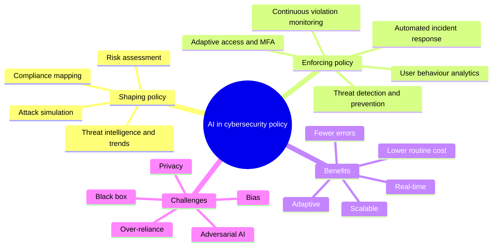
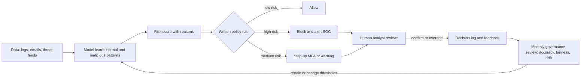
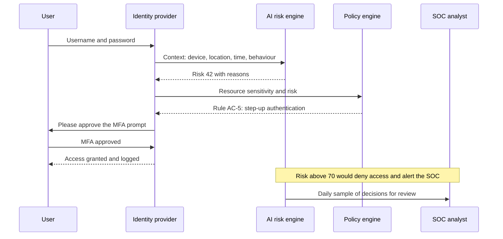
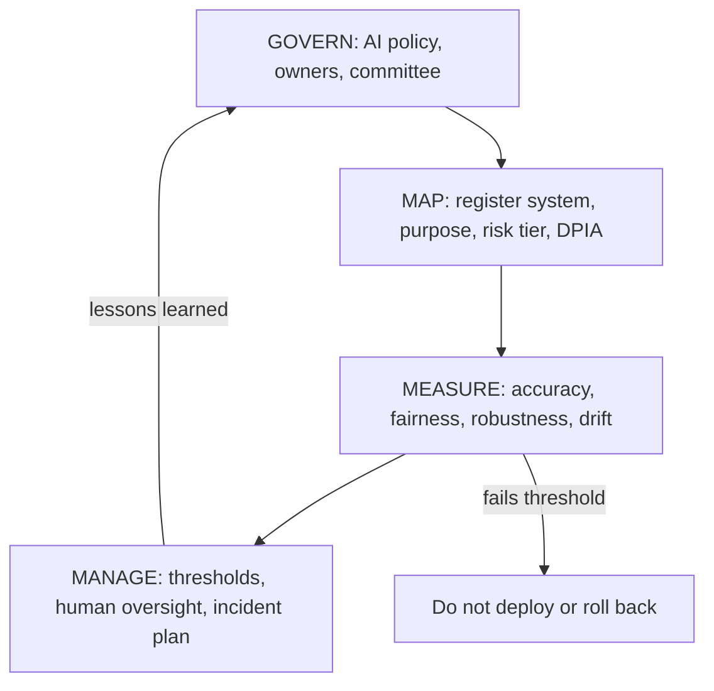
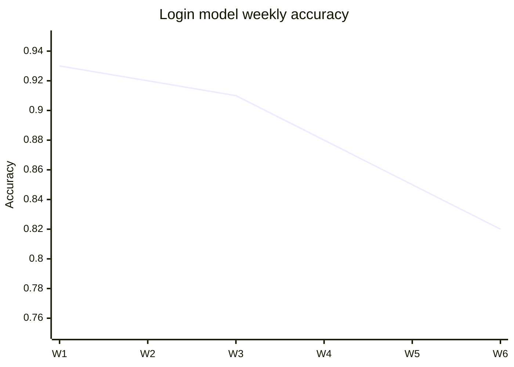
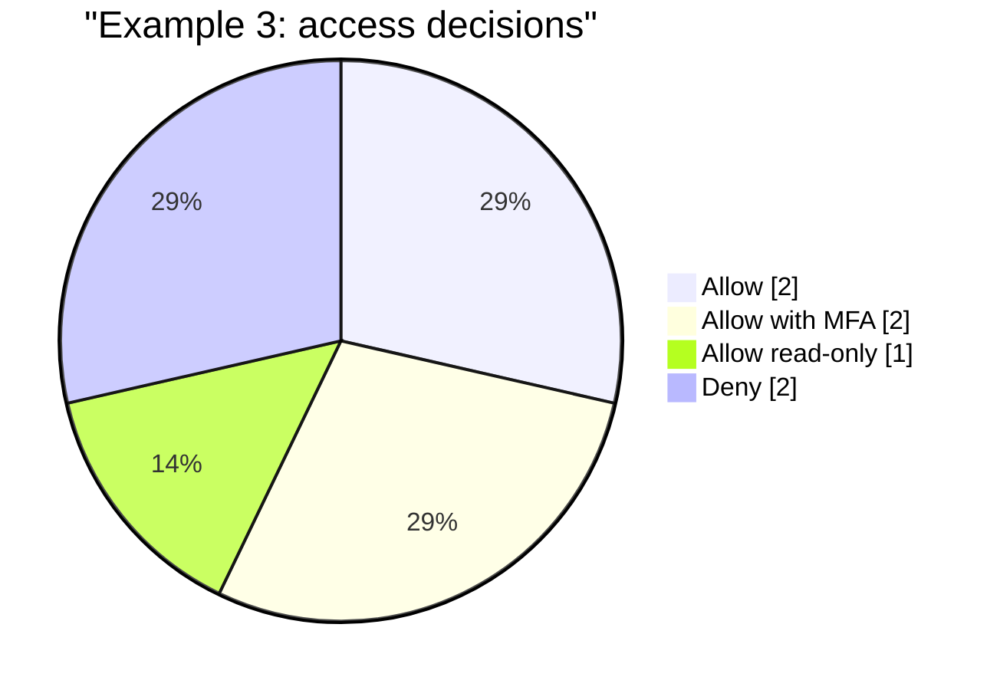

# Session 4: AI in Cybersecurity Policies

> [Cybersecurity and Digital Forensics](../../README.md) › [Term 1](../README.md) › [Module 5: Introduction to Cyber Security Frameworks](README.md) › **Session 4**

| ⏱ Estimated time | 📋 Prerequisites |
|---|---|
| 4 hours (two 2-hour classes: AI in shaping and enforcing policies, benefits, applications, challenges and ethics · Try It Yourself lab) | Sessions 1–3 (GDPR principles and rights, cybercrime and incident response, cyber laws and digital evidence); basic Python (lists, dictionaries, functions) |

| ⬅ [Previous: Session 3](session-03-cyber-laws-and-digital-evidence.md) | [Module practice test](practice-test.md) ➡ |
|:---|---:|

[](https://colab.research.google.com/github/Hamnakhan123/Cybersecurity-and-Digital-Forensics/blob/main/term-1/05-cyber-security-frameworks/code/session-04-ai-in-cybersecurity-policies.ipynb) &nbsp;Run every Python example of this session in the notebook [`code/session-04-ai-in-cybersecurity-policies.ipynb`](code/session-04-ai-in-cybersecurity-policies.ipynb).

---

## 🎯 Learning objectives

- Explain how **artificial intelligence (AI)** helps organisations **shape** cybersecurity policies (threat intelligence, risk assessment, compliance mapping, simulation).
- Describe how AI **enforces** policies in practice: automated detection and prevention, user behaviour analytics, adaptive access control, automated incident response and continuous monitoring.
- Discuss the **benefits** and **real-world applications** of AI in cybersecurity, with honest limits.
- Analyse the **challenges and ethical issues** of AI-driven security: bias, the black-box problem, adversarial AI, over-reliance on automation, privacy and accountability.
- **Measure** an AI security model with accuracy, precision, recall, fairness and drift metrics, and apply **AI governance frameworks** (NIST AI RMF, ISO/IEC 42001, EU AI Act, GDPR Article 22).
- Practise with code: a login-anomaly detector, a phishing classifier, an adaptive access engine, a model-governance scorecard and an AI compliance toolkit (mini project).

> **Defensive and lab-safe.** Every dataset, email and user in this session is fictional. The code shows how defenders build and check AI tools; it contains no attack code. Laws and frameworks about AI are changing quickly, so always check the current text before relying on a date or rule.

## 📖 Concepts

### 1. Why security teams turned to AI

A medium-sized university network can produce **millions of log lines a day**: logins, firewall events, emails, DNS lookups, file access. A security operations centre (SOC) with five analysts cannot read them all. Attackers, meanwhile, automate their work. AI is used to **sort the haystack** so humans spend time on the few events that matter.

| Term | Plain meaning | Security example |
|---|---|---|
| **Artificial intelligence (AI)** | Computer systems that perform tasks that normally need human judgement | Deciding whether a login looks risky |
| **Machine learning (ML)** | AI that **learns patterns from data** instead of following hand-written rules | A spam filter trained on thousands of labelled emails |
| **Supervised learning** | Learns from examples with known answers (labels) | Phishing vs legitimate email classifier (Example 2) |
| **Unsupervised learning** | Finds structure or outliers without labels | Baseline of "normal" behaviour, anomaly detection (Example 1) |
| **Deep learning** | ML with many-layered neural networks | Malware detection from file structure, image-based deepfake detection |
| **Generative AI / large language models (LLMs)** | Models that produce text, code or images | SOC assistant that summarises an incident or drafts a policy |
| **Model** | The learned rule set that turns inputs into a score or decision | "Risk score = 72" |
| **Feature** | One measurable input to the model | Login hour, country, device, MB downloaded |

> **Analogy – the experienced security guard.** A new guard checks every badge against a list (rules). An experienced guard also *notices* that the cleaner who always comes at 8 pm is here at 3 am carrying a laptop (behaviour). ML gives software that experience. But the guard still calls a supervisor before arresting anyone: that is **human oversight**.

### 2. AI's role in **shaping** cybersecurity policies

Policies should be written from evidence, not guesswork. AI helps the people who write them.

| Role | What AI does | How it changes the policy | Example |
|---|---|---|---|
| **Threat intelligence and trend analysis** | Reads huge volumes of threat reports, logs and indicators; clusters attack patterns and attacker behaviour | Policies target the threats actually rising, not last year's | A spike in invoice-fraud emails leads to a new "verify payment changes by phone" rule |
| **Comprehensive risk assessment** | Combines vulnerability data, asset value and threat likelihood into a ranked risk list | Controls and budget go to the riskiest assets first | Exam servers ranked above the cafeteria menu site |
| **Regulatory and compliance alignment** | Maps internal controls to frameworks (GDPR, HIPAA, PCI DSS, ISO/IEC 27001) and finds gaps | Policy text is updated where a requirement is missing | "No retention period for CCTV footage" flagged as a GDPR gap |
| **Simulation, modelling and policy testing** | Runs attack simulations (breach-and-attack simulation, digital twins) against current controls | Weak policies are found before attackers find them | Simulated phishing shows MFA is not enforced for contractors |

The output is always a **recommendation**. A human policy owner approves the change, records why, and communicates it.

### 3. AI's role in **enforcing** cybersecurity policies

A policy that says "block risky logins" needs something to decide what "risky" means, thousands of times a minute. AI-powered tools do that.

| Enforcement area | What the AI does | Tool category |
|---|---|---|
| **Automated threat detection and prevention** | Learns normal network and endpoint behaviour; blocks malicious files and traffic, isolates infected machines, prioritises patches | EDR / XDR, next-generation antivirus, network detection and response (NDR) |
| **User (and entity) behaviour analytics – UBA/UEBA** | Builds a baseline for each user and device, flags unusual hours, locations, data volumes, privilege use | SIEM analytics modules (Example 1) |
| **Identity and access management (IAM)** | Grants, limits or denies access based on risk: device health, location, behaviour; triggers **step-up MFA** | Adaptive / risk-based access, Zero Trust gateways (Example 3) |
| **Incident response and digital forensics** | Groups related alerts into one incident, runs playbooks (isolate host, reset password), drafts timelines and reports | SOAR platforms, AI SOC assistants |
| **Continuous policy-violation monitoring** | Detects actions that break policy (sensitive files emailed out, public cloud buckets) and starts remediation | DLP, cloud security posture management (CSPM) |
| **Email and web protection** | Classifies phishing, impersonation and malicious links | Secure email gateways (Example 2) |

**Policy-as-code.** Modern tools let you write policy rules in a machine-readable form ("restricted data needs a compliant device and low risk"). The AI supplies the *risk score*; the written rule decides the *action*; every decision is logged with the rule ID. Example 3 works exactly this way.

### 4. Benefits of AI in cybersecurity policy management

| Benefit | What it means | Honest limit |
|---|---|---|
| **Real-time enforcement** | Detects and responds in seconds, before damage spreads | A wrong automatic block also happens in seconds |
| **Scalability** | Watches every endpoint and log without fatigue | Needs good, complete data from all of them |
| **Adaptability** | Learns new patterns as threats and users change | Can also "learn" bad patterns if data is poisoned or drifts |
| **Accuracy** | Fewer missed attacks and fewer false alarms than fixed rules, when well trained | Accuracy must be measured, not assumed (Section 7) |
| **Cost efficiency** | Automates routine triage so analysts do investigation and improvement | Tools, data engineering and governance also cost money |

**Worked number – why triage automation matters.** A SOC receives 12,000 alerts a day. At 3 minutes each, that is 12,000 × 3 = 36,000 minutes = **600 analyst-hours a day**, about 75 full-time analysts on 8-hour shifts. If an AI triage layer correctly closes 85% of alerts as benign duplicates or known-good, 1,800 alerts remain: 1,800 × 3 = 5,400 minutes = **90 hours**, about 11–12 analysts. The remaining risk: if the AI wrongly closes even 0.1% of real attacks, someone must sample closed alerts to catch it.

### 5. Real-world applications

| Example | What it showed |
|---|---|
| **IBM Watson for Cyber Security** | IBM trained its Watson AI on large amounts of security research and threat reports and offered it to SOCs through its QRadar SIEM (QRadar Advisor with Watson). Analysts got context on indicators of compromise, related threats and suggested next steps much faster than manual research: a *force multiplier* for the team |
| **CylancePROTECT** (built by Cylance, owned by BlackBerry 2019–2025, sold to Arctic Wolf in February 2025) | ML-based endpoint protection that scores files **before they execute**, without relying only on signature updates, works with little system load and can run offline; policies auto-quarantine threats and support custom rules |
| **AI in email security** | Gateways and cloud mail providers use ML to score phishing, impersonation of executives and malicious attachments; policies decide quarantine vs warning banner (Example 2) |
| **UEBA in SIEMs** | Most modern SIEMs include behaviour baselines to spot compromised accounts and insider misuse (Example 1) |
| **Risk-based authentication** | Identity providers request extra verification when a sign-in looks unusual (new country, unfamiliar device), and block sign-ins with very high risk (Example 3) |
| **Generative-AI SOC assistants** | LLM assistants summarise incidents, explain scripts found on a host, and draft reports; output must be checked because LLMs can be confidently wrong |

### 6. Challenges and ethical considerations

| Challenge | What goes wrong | Example | Mitigation |
|---|---|---|---|
| **Bias and inaccuracy** | Unrepresentative training data gives unfair or wrong results; enforcement becomes inconsistent across users | A login model trained in a month with no evening classes flags night-time students 4× more than staff (Example 4) | Balanced data, per-group testing, fairness thresholds in policy |
| **Lack of transparency (black box)** | Nobody can explain why the model decided; auditors and courts cannot check it | A staff member is locked out and the SOC cannot say why | Explainable features and reason codes, model documentation, decision logs |
| **Adversarial AI** | Attackers use AI to write convincing phishing, deepfake voices, evasive malware; or they **trick the model**: evasion (inputs crafted to look benign), **data poisoning** (corrupting training data), **prompt injection** (hidden instructions to an LLM) | Phishing text rewritten to avoid "trigger" words | Adversarial testing (MITRE ATLAS, OWASP Top 10 for LLM Applications), layered controls, retraining with new samples |
| **Over-reliance on automation** | "Automation bias": people stop questioning the tool; AI lacks context and ethical judgement | An exam-proctoring AI flags a student who looked away to calm a crying child; the flag is treated as proof | Human review of high-impact decisions, appeal process, sampling of auto-closed alerts |
| **Privacy and surveillance** | Behaviour analytics collects detailed data about employees and students | Keystroke and webcam monitoring beyond what security needs | Data minimisation, DPIA, transparency notices, retention limits (Session 1) |
| **Accountability** | When AI makes a wrong decision, who is responsible? | Vendor blames configuration, customer blames vendor | Named model owner, contracts, governance committee sign-off |
| **Model drift** | The world changes, the model does not; accuracy decays silently | New timetable shifts logins to evenings | Drift monitoring (PSI), scheduled re-validation, retraining |

**GDPR Article 22** gives people the right not to be subject to a decision based **solely** on automated processing that has legal or similarly significant effects, with limited exceptions and safeguards such as the right to obtain **human intervention** and to contest the decision. Blocking a login for a few minutes is usually low-impact; failing a student or rejecting a job applicant is high-impact.

### 7. Measuring an AI security model

Every AI-driven policy should say **how good is good enough**. The starting point is the **confusion matrix**:

| | Model says **malicious** | Model says **benign** |
|---|---|---|
| **Actually malicious** | True positive (TP) | False negative (FN) – missed attack |
| **Actually benign** | False positive (FP) – false alarm | True negative (TN) |

| Metric | Formula | Question it answers |
|---|---|---|
| **Accuracy** | (TP + TN) / all | How often is the model right overall? |
| **Precision** | TP / (TP + FP) | When it raises an alert, how often is it real? |
| **Recall (detection rate)** | TP / (TP + FN) | Of all real attacks, how many did it catch? |
| **False-positive rate (FPR)** | FP / (FP + TN) | How often are innocent events flagged? |
| **FPR gap** (fairness) | FPR(group A) − FPR(group B) | Are innocent people in one group flagged more? |
| **Flag-rate ratio** (fairness) | lowest group flag rate / highest | Are groups selected at similar rates? (below 0.80 is a common warning sign) |
| **Population Stability Index (PSI)** (drift) | Σ (actual% − expected%) × ln(actual% / expected%) | Has the input data changed since training? (<0.10 stable, 0.10–0.25 monitor, >0.25 significant) |

**The accuracy trap.** Suppose 1,000 logins contain 10 attacks. A useless model that says "benign" every time is **99% accurate** but has **0% recall**. For rare events, look at precision and recall, not accuracy alone.

### 8. Ethics principles and AI governance frameworks

Common ethical principles for AI in security: **fairness**, **transparency and explainability**, **accountability**, **privacy**, **safety, security and robustness**, and **human oversight**.

| Framework / law | What it gives a security team |
|---|---|
| **NIST AI Risk Management Framework (AI RMF 1.0, 2023)** | Voluntary US framework with four functions: **GOVERN** (culture, roles, policies), **MAP** (context and risks), **MEASURE** (test and track), **MANAGE** (treat risks, respond, improve) |
| **ISO/IEC 42001:2023** | Certifiable **AI management system** standard (the AI counterpart of ISO/IEC 27001): AI policy, roles, risk and impact assessment, life-cycle controls, monitoring |
| **EU AI Act (Regulation (EU) 2024/1689)** | Risk-based EU law that entered into force in 2024 and applies in phases. Some practices are **prohibited**; **high-risk** uses (for example in education and exam monitoring, employment, critical infrastructure, access to essential services) need risk management, data governance, logging, human oversight, accuracy and cybersecurity; **limited-risk** systems such as chatbots must tell people they are dealing with AI. Check the current application dates, which have been subject to change |
| **GDPR** | Lawful basis, data minimisation, DPIA for high-risk processing (Art 35), safeguards for solely automated decisions (Art 22) |
| **OECD AI Principles** | International principles on trustworthy AI adopted by many countries |
| **MITRE ATLAS** and **OWASP Top 10 for LLM Applications** | Catalogues of attacks against AI systems (evasion, poisoning, prompt injection, data leakage) used to plan adversarial testing |
| **Pakistan** | The **National Artificial Intelligence Policy 2025** (approved by the Federal Cabinet in July 2025) sets national goals for AI skills, innovation and responsible use; it is a policy, not a statute. AI-enabled offences still fall under **PECA 2016** (as amended in 2025), and a comprehensive personal-data law is still a **draft bill**, so organisations serving EU users also follow the GDPR |

### 9. Writing AI into an organisation's security policy

A practical AI section in a cybersecurity policy usually covers:

1. **Scope and inventory**: every AI system in use (bought, built or a public chatbot) is registered with an owner and purpose.
2. **Risk tiering**: high-impact uses (decisions about students, staff, customers) get stricter controls.
3. **Data rules**: what data may train or be sent to AI tools; **no confidential or personal data in public AI chatbots** unless an approved enterprise version is used.
4. **Testing before release**: accuracy, fairness and adversarial testing with written thresholds.
5. **Human oversight**: which decisions the AI may take alone (block a malicious file) and which need a person (disciplinary action, failing an exam).
6. **Transparency**: users are told when AI monitors or decides; appeal route published.
7. **Logging and explainability**: reason codes and rule IDs kept for audit.
8. **Monitoring**: drift and performance reviewed monthly; retraining triggers defined.
9. **Incident handling**: AI failures (bias complaint, model evasion, data leak via a chatbot) are security incidents with a rollback plan.
10. **Review**: the governance committee reviews the register at least yearly.

## 🧭 Diagrams

**Where AI fits in cybersecurity policy**



**The AI-driven policy loop: humans stay in charge**



**Adaptive sign-in: what happens behind the login page**



**Governance with the NIST AI RMF functions**



## 🪜 Step-by-step: introducing an AI security tool under policy

1. **Define the problem and the policy goal** in one sentence: "Detect compromised staff accounts within 15 minutes."
2. **Register the system**: owner, vendor, purpose, data used, who is affected (Mini project).
3. **Assess risk and impact**: risk tier, DPIA if personal data is processed, which decisions are high-impact.
4. **Check the training data**: is it representative of all user groups and recent activity?
5. **Set written thresholds** for accuracy, recall, precision, fairness and drift **before** testing.
6. **Test** on labelled, held-out data; break results down by group; run adversarial tests.
7. **Decide the automation level** for each outcome: auto-block, step-up MFA, human review.
8. **Explain and log** every decision with reason codes and rule IDs.
9. **Tell people**: privacy notice, staff and student communication, appeal route.
10. **Pilot** in "monitor only" mode, compare with analyst decisions, then enforce.
11. **Monitor monthly**: accuracy trend, fairness, PSI drift, overrides and complaints (Example 4).
12. **Review and improve**: retrain, change thresholds or retire the system; record every change.

## 💻 Worked examples

### Example 1 – User behaviour analytics: unusual logins and policy enforcement

📄 **`code/session-04_login_anomaly.py`**

```python
"""Session 4 - User Behaviour Analytics: spotting unusual logins and enforcing policy.

An AI-driven security tool does not start with a list of "bad" events. It first LEARNS
what is normal for each user (a baseline), then scores how far a new event is from that
normal, and finally applies the organisation's POLICY to the score. This script shows
the three steps with plain statistics, so every alert can be explained:

  1. Baseline  - per user: usual login hours (mean and spread), cities, devices, data volume.
  2. Score     - add points for each unusual feature; keep the reason for each point.
  3. Enforce   - the policy turns the score into ALLOW, STEP-UP MFA or BLOCK + ALERT.

All users, cities and devices are fictional (Clifton Institute of Technology, Karachi).
Run:  python session-04_login_anomaly.py
"""
import random
from statistics import mean, pstdev

rng = random.Random(42)  # fixed seed: the same "history" every run

# ---------- 1. Fictional 30-day login history -> baseline ----------
PROFILES = {  # user: (usual hour, hour spread, cities, devices, usual MB downloaded)
    "sana.faculty":  (9, 1.0, ["Karachi"], ["LAPTOP-SANA"], 40),
    "omer.registrar": (10, 1.5, ["Karachi"], ["PC-REG-02"], 25),
    "bilal.student": (21, 2.0, ["Karachi", "Hyderabad"], ["PHONE-BILAL", "LAB-WS-14"], 60),
}

history = []
for user, (hour, spread, cities, devices, mb) in PROFILES.items():
    for day in range(30):
        h = max(0, min(23, round(rng.gauss(hour, spread))))
        history.append({"user": user, "hour": h, "city": rng.choice(cities),
                        "device": rng.choice(devices), "mb": max(1, round(rng.gauss(mb, mb * 0.25)))})


def baseline(user):
    rows = [r for r in history if r["user"] == user]
    hours, mbs = [r["hour"] for r in rows], [r["mb"] for r in rows]
    return {"h_mean": mean(hours), "h_sd": max(pstdev(hours), 0.5),
            "mb_mean": mean(mbs), "mb_sd": max(pstdev(mbs), 1.0),
            "cities": {r["city"] for r in rows}, "devices": {r["device"] for r in rows}}


BASE = {u: baseline(u) for u in PROFILES}

# ---------- 2. Score new events (explainable points) ----------
POLICY = {"step_up_at": 30, "block_at": 60}   # thresholds set by the security policy


def score(event):
    b, pts, why = BASE[event["user"]], 0, []
    z_hour = abs(event["hour"] - b["h_mean"]) / b["h_sd"]
    if z_hour > 3:
        pts += 25; why.append(f"login hour {event['hour']:02d}:00 is {z_hour:.1f} SD from usual")
    if event["city"] not in b["cities"]:
        pts += 30; why.append(f"new location {event['city']}")
    if event["device"] not in b["devices"]:
        pts += 20; why.append(f"unknown device {event['device']}")
    z_mb = (event["mb"] - b["mb_mean"]) / b["mb_sd"]
    if z_mb > 3:
        pts += 25; why.append(f"downloaded {event['mb']} MB ({z_mb:.1f} SD above usual)")
    if event.get("failed_before", 0) >= 5:
        pts += 15; why.append(f"{event['failed_before']} failed attempts just before")
    return min(pts, 100), why


def enforce(pts):
    if pts >= POLICY["block_at"]:
        return "BLOCK + ALERT SOC"
    if pts >= POLICY["step_up_at"]:
        return "STEP-UP MFA"
    return "ALLOW"


NEW_EVENTS = [
    {"id": "E1", "user": "sana.faculty", "hour": 9, "city": "Karachi", "device": "LAPTOP-SANA", "mb": 45},
    {"id": "E2", "user": "omer.registrar", "hour": 23, "city": "Karachi", "device": "PC-REG-02", "mb": 30},
    {"id": "E3", "user": "bilal.student", "hour": 22, "city": "Lahore", "device": "PHONE-BILAL", "mb": 70},
    {"id": "E4", "user": "omer.registrar", "hour": 3, "city": "Frankfurt", "device": "UNKNOWN-VM",
     "mb": 900, "failed_before": 7},
    {"id": "E5", "user": "sana.faculty", "hour": 14, "city": "Karachi", "device": "TABLET-NEW", "mb": 38},
]

print("[1] Learned baselines (30 days of fictional history)")
for u, b in BASE.items():
    print(f"  {u:<15} usual hour {b['h_mean']:4.1f} +/- {b['h_sd']:.1f} | "
          f"~{b['mb_mean']:.0f} MB | cities {sorted(b['cities'])}")

print(f"\n[2] Scoring new logins (policy: step-up at {POLICY['step_up_at']}, block at {POLICY['block_at']})")
counts = {}
for e in NEW_EVENTS:
    pts, why = score(e)
    action = enforce(pts)
    counts[action] = counts.get(action, 0) + 1
    print(f"  {e['id']} {e['user']:<15} score {pts:3d} -> {action}")
    for w in why:
        print(f"       - {w}")

print("\n[3] Decision summary:", ", ".join(f"{k}: {v}" for k, v in counts.items()))
print("Note: a human analyst reviews every BLOCK; the score only recommends.")
```

**Output**

```text
[1] Learned baselines (30 days of fictional history)
  sana.faculty    usual hour  9.2 +/- 1.0 | ~39 MB | cities ['Karachi']
  omer.registrar  usual hour 10.0 +/- 1.3 | ~23 MB | cities ['Karachi']
  bilal.student   usual hour 21.0 +/- 1.8 | ~59 MB | cities ['Hyderabad', 'Karachi']

[2] Scoring new logins (policy: step-up at 30, block at 60)
  E1 sana.faculty    score   0 -> ALLOW
  E2 omer.registrar  score  25 -> ALLOW
       - login hour 23:00 is 9.7 SD from usual
  E3 bilal.student   score  30 -> STEP-UP MFA
       - new location Lahore
  E4 omer.registrar  score 100 -> BLOCK + ALERT SOC
       - login hour 03:00 is 5.2 SD from usual
       - new location Frankfurt
       - unknown device UNKNOWN-VM
       - downloaded 900 MB (153.6 SD above usual)
       - 7 failed attempts just before
  E5 sana.faculty    score  45 -> STEP-UP MFA
       - login hour 14:00 is 4.8 SD from usual
       - unknown device TABLET-NEW

[3] Decision summary: ALLOW: 2, STEP-UP MFA: 2, BLOCK + ALERT SOC: 1
Note: a human analyst reviews every BLOCK; the score only recommends.
```
**Observe:**
- The model first **learns** each user's normal (hour, spread, cities, devices, data volume) from 30 days of history; no list of "bad" events is needed.
- Each point added comes with a **reason**, so an analyst can explain E4's block (new country, unknown device, 900 MB, seven failed attempts) to management or in an investigation report.
- E2 (registrar at 23:00) is 9.7 standard deviations from normal but is still **allowed**, because one unusual feature is worth only 25 points. Whether that is acceptable is a **policy decision**, not a technical one (Lab task 3).
- E5 shows a cost of AI enforcement: a lecturer with a new tablet in the afternoon gets an MFA prompt. Mild friction is the price of catching E4.

### Example 2 – An explainable phishing classifier with an email policy

📄 **`code/session-04_phishing_classifier.py`**

```python
"""Session 4 - A tiny, explainable phishing classifier (Naive Bayes from scratch).

Email security gateways use machine learning to decide whether a message is phishing.
This script trains a very small Naive Bayes model on 16 fictional, harmless emails,
tests it on 6 unseen ones, and then applies an EMAIL POLICY:

  probability >= 0.90  -> QUARANTINE (user never sees it, admin can release)
  0.50 to 0.90         -> DELIVER WITH WARNING BANNER
  below 0.50           -> DELIVER

It also prints the words that pushed each decision, because a policy that cannot be
explained cannot be audited. No real brands, links or payloads are used.
Run:  python session-04_phishing_classifier.py
"""
import math
import re
from collections import Counter

TRAIN = [  # (label, text)  1 = phishing, 0 = legitimate
    (1, "urgent verify your account password now or it will be suspended"),
    (1, "your mailbox is full click here to verify login immediately"),
    (1, "congratulations you won a prize claim your reward by entering bank details"),
    (1, "security alert unusual sign in confirm your password at this link"),
    (1, "invoice overdue pay now using the attached link to avoid penalty"),
    (1, "hr update confirm your salary account details today urgent"),
    (1, "your parcel is held pay a small fee click the link now"),
    (1, "final warning account locked verify identity within 24 hours"),
    (0, "reminder the data structures lab moves to room 204 on monday"),
    (0, "please find the agenda for the faculty meeting on thursday"),
    (0, "the library will close early on friday for maintenance"),
    (0, "assignment two marks are uploaded to the course portal"),
    (0, "thank you for attending the workshop slides are attached"),
    (0, "the exam timetable for the midterm week has been published"),
    (0, "lunch for the department seminar will be served at one"),
    (0, "please review the draft syllabus and send comments by friday"),
]
TEST = [
    (1, "urgent your password expires today click here to verify"),
    (1, "claim your bonus reward enter your bank account details"),
    (0, "the programming lab quiz is on wednesday in room 204"),
    (0, "seminar slides and agenda are attached for review"),
    (1, "account suspended confirm login details at the link"),
    (0, "please verify the attendance sheet before friday"),  # tricky: has "verify"
]
STOP = {"the", "a", "to", "your", "is", "on", "for", "at", "by", "or", "it", "in", "and", "of", "be", "will", "has", "been", "are", "this", "using", "now"}


def words(text):
    return [w for w in re.findall(r"[a-z0-9]+", text.lower()) if w not in STOP]


class NaiveBayes:
    def fit(self, data):
        self.counts = {0: Counter(), 1: Counter()}
        self.docs = Counter(label for label, _ in data)
        for label, text in data:
            self.counts[label].update(words(text))
        self.vocab = set(self.counts[0]) | set(self.counts[1])
        self.total = {c: sum(self.counts[c].values()) for c in (0, 1)}
        return self

    def word_logratio(self, w):  # > 0 means the word points to phishing
        p = [(self.counts[c][w] + 1) / (self.total[c] + len(self.vocab)) for c in (0, 1)]
        return math.log(p[1] / p[0])

    def predict_proba(self, text):
        log_odds = math.log(self.docs[1] / self.docs[0])
        log_odds += sum(self.word_logratio(w) for w in words(text) if w in self.vocab)
        return 1 / (1 + math.exp(-log_odds))


def policy(p):
    return "QUARANTINE" if p >= 0.90 else "WARN BANNER" if p >= 0.50 else "DELIVER"


model = NaiveBayes().fit(TRAIN)
print(f"[1] Trained on {len(TRAIN)} emails, vocabulary {len(model.vocab)} words")
top = sorted(model.vocab, key=lambda w: (-model.word_logratio(w), w))[:6]
print("    strongest phishing words:", ", ".join(top))

print("\n[2] Test emails -> probability -> policy action")
tp = fp = tn = fn = 0
for label, text in TEST:
    p = model.predict_proba(text)
    pred = 1 if p >= 0.50 else 0
    tp += pred == 1 and label == 1; fp += pred == 1 and label == 0
    tn += pred == 0 and label == 0; fn += pred == 0 and label == 1
    clues = sorted({w for w in words(text) if w in model.vocab},
                   key=lambda w: (-model.word_logratio(w), w))[:2]
    mark = "ok " if pred == label else "ERR"
    print(f"  {mark} p={p:.2f} {policy(p):<11} | {text[:46]:<46} | clues: {', '.join(clues)}")

acc = (tp + tn) / len(TEST)
prec = tp / (tp + fp) if tp + fp else 0
rec = tp / (tp + fn) if tp + fn else 0
print(f"\n[3] Confusion: TP={tp} FP={fp} TN={tn} FN={fn}")
print(f"    accuracy {acc:.2f} | precision {prec:.2f} | recall {rec:.2f}")
print("    A false positive delays real mail; a false negative lets phishing in.")
print("    Policy owners choose thresholds knowing which mistake costs more.")
```

**Output**

```text
[1] Trained on 16 emails, vocabulary 91 words
    strongest phishing words: account, link, verify, click, confirm, details

[2] Test emails -> probability -> policy action
  ok  p=1.00 QUARANTINE  | urgent your password expires today click here  | clues: verify, click
  ok  p=0.98 QUARANTINE  | claim your bonus reward enter your bank accoun | clues: account, details
  ok  p=0.09 DELIVER     | the programming lab quiz is on wednesday in ro | clues: 204, lab
  ok  p=0.04 DELIVER     | seminar slides and agenda are attached for rev | clues: attached, agenda
  ok  p=1.00 QUARANTINE  | account suspended confirm login details at the | clues: account, link
  ok  p=0.26 DELIVER     | please verify the attendance sheet before frid | clues: verify, friday

[3] Confusion: TP=3 FP=0 TN=3 FN=0
    accuracy 1.00 | precision 1.00 | recall 1.00
    A false positive delays real mail; a false negative lets phishing in.
    Policy owners choose thresholds knowing which mistake costs more.
```
**Observe:**
- Naive Bayes learns which words are more common in phishing (account, link, verify, click, confirm) from only 16 labelled emails.
- The **policy** turns probabilities into three actions: quarantine, warning banner, deliver. Thresholds are chosen by people based on which mistake costs more.
- "please verify the attendance sheet" contains a phishing-like word yet is delivered (p = 0.26): context words such as "attendance" and "friday" pull it back.
- A perfect score on 6 test emails proves very little. Real evaluations use thousands of recent emails, and attackers deliberately avoid trigger words (adversarial AI), so models must be retrained.

### Example 3 – Adaptive access control as policy-as-code

📄 **`code/session-04_adaptive_access.py`**

```python
"""Session 4 - Adaptive (risk-based) access control written as policy-as-code.

Traditional access control asks one question: "Is the password right?" Adaptive access,
used in Zero Trust and modern IAM products, asks: "Given everything we know right now,
how risky is this request, and how sensitive is what is being requested?"

The script combines:
  - signals: device compliance, network, location, time, and a behaviour (UBA) risk score
  - resource sensitivity: public, internal, confidential, restricted
  - rules from a written policy (each rule has an ID so auditors can trace decisions)
and returns ALLOW, ALLOW WITH MFA, ALLOW READ-ONLY or DENY, with an audit line per request.
All people and systems are fictional.
Run:  python session-04_adaptive_access.py
"""

SENSITIVITY = {"public": 0, "internal": 1, "confidential": 2, "restricted": 3}
RESOURCES = {"Course portal": "internal", "Grades database": "restricted",
             "Library catalogue": "public", "HR payroll": "confidential"}


def risk(sig):
    """Return (risk 0-100, reasons). Weights come from the written access policy."""
    r, why = 0, []
    if not sig["device_compliant"]:
        r += 30; why.append("device not compliant (no disk encryption or old patches)")
    if sig["network"] == "public_wifi":
        r += 15; why.append("public Wi-Fi")
    if sig["country"] != "PK":
        r += 20; why.append(f"outside usual country ({sig['country']})")
    if not 7 <= sig["hour"] <= 22:
        r += 10; why.append(f"outside working hours ({sig['hour']:02d}:00 PKT)")
    r += sig["uba_score"] // 2
    if sig["uba_score"] >= 40:
        why.append(f"behaviour analytics score {sig['uba_score']}")
    return min(r, 100), why


def decide(sig, resource):
    level = SENSITIVITY[RESOURCES[resource]]
    r, why = risk(sig)
    # Rules are checked in order; the first match wins (like a firewall).
    if sig["role"] not in sig["allowed_roles"]:
        return "DENY", "AC-1 role not authorised for resource", r, why
    if r >= 70:
        return "DENY", "AC-2 risk too high for any access", r, why
    if level == 3 and (r >= 30 or not sig["device_compliant"]):
        return "DENY", "AC-3 restricted data needs compliant device and low risk", r, why
    if level >= 2 and r >= 40:
        return "ALLOW READ-ONLY", "AC-4 medium risk: no edits or downloads", r, why
    if level >= 1 and (r >= 20 or level >= 2):
        return "ALLOW WITH MFA", "AC-5 step-up authentication", r, why
    return "ALLOW", "AC-6 public data or low risk", r, why


BASE = {"device_compliant": True, "network": "campus", "country": "PK", "hour": 10, "uba_score": 5}
REQUESTS = [
    ("REQ-01", "Ms. Sana (faculty)", "Grades database", dict(BASE, role="faculty", allowed_roles={"faculty", "registrar"})),
    ("REQ-02", "Ms. Sana (faculty)", "Grades database", dict(BASE, role="faculty", allowed_roles={"faculty", "registrar"},
                                                             network="public_wifi", hour=23)),
    ("REQ-03", "Bilal (student)", "Course portal", dict(BASE, role="student", allowed_roles={"student", "faculty"},
                                                        network="public_wifi")),
    ("REQ-04", "Bilal (student)", "Grades database", dict(BASE, role="student", allowed_roles={"faculty", "registrar"})),
    ("REQ-05", "Mr. Omer (HR)", "HR payroll", dict(BASE, role="hr", allowed_roles={"hr"}, country="AE", uba_score=50)),
    ("REQ-06", "Mr. Omer (HR)", "HR payroll", dict(BASE, role="hr", allowed_roles={"hr"}, device_compliant=False,
                                                   country="DE", hour=3, uba_score=80)),
    ("REQ-07", "Visitor", "Library catalogue", dict(BASE, role="guest", allowed_roles={"guest", "student", "faculty"},
                                                   device_compliant=False, network="public_wifi")),
]

print(f"{'Req':<7}{'User':<20}{'Resource':<18}{'Risk':>5}  Decision")
audit = []
for rid, user, res, sig in REQUESTS:
    decision, rule, r, why = decide(sig, res)
    print(f"{rid:<7}{user:<20}{res:<18}{r:>5}  {decision}")
    audit.append(f"{rid} | {rule} | factors: {'; '.join(why) if why else 'none'}")

print("\nAudit log (kept for compliance review):")
for line in audit:
    print("  " + line)
print("\nHuman oversight: users who are denied can raise a ticket; an analyst can override,")
print("and every override is logged with the analyst's name and reason.")
```

**Output**

```text
Req    User                Resource           Risk  Decision
REQ-01 Ms. Sana (faculty)  Grades database       2  ALLOW WITH MFA
REQ-02 Ms. Sana (faculty)  Grades database      27  ALLOW WITH MFA
REQ-03 Bilal (student)     Course portal        17  ALLOW
REQ-04 Bilal (student)     Grades database       2  DENY
REQ-05 Mr. Omer (HR)       HR payroll           45  ALLOW READ-ONLY
REQ-06 Mr. Omer (HR)       HR payroll          100  DENY
REQ-07 Visitor             Library catalogue    47  ALLOW

Audit log (kept for compliance review):
  REQ-01 | AC-5 step-up authentication | factors: none
  REQ-02 | AC-5 step-up authentication | factors: public Wi-Fi; outside working hours (23:00 PKT)
  REQ-03 | AC-6 public data or low risk | factors: public Wi-Fi
  REQ-04 | AC-1 role not authorised for resource | factors: none
  REQ-05 | AC-4 medium risk: no edits or downloads | factors: outside usual country (AE); behaviour analytics score 50
  REQ-06 | AC-2 risk too high for any access | factors: device not compliant (no disk encryption or old patches); outside usual country (DE); outside working hours (03:00 PKT); behaviour analytics score 80
  REQ-07 | AC-6 public data or low risk | factors: device not compliant (no disk encryption or old patches); public Wi-Fi

Human oversight: users who are denied can raise a ticket; an analyst can override,
and every override is logged with the analyst's name and reason.
```
**Observe:**
- The same person gets different answers in different contexts: Ms. Sana always needs MFA for the **restricted** grades database, but REQ-02 (public Wi-Fi at 23:00) adds risk factors to the audit trail.
- **Role comes first** (rule AC-1): no AI score can give a student access to grades. AI adds context; it does not replace authorisation.
- REQ-05 is **allowed read-only**: a sensible middle option between "allow" and "deny" for medium risk.
- REQ-07 shows that risk only matters relative to **sensitivity**: an unmanaged phone on public Wi-Fi may still read the public library catalogue.
- Every line in the audit log names the **rule ID**, which is what an auditor or investigator needs.

### Example 4 – Governing the model: accuracy, fairness and drift

📄 **`code/session-04_ai_governance_metrics.py`**

```python
"""Session 4 - Governing an AI security model: accuracy, fairness and drift.

A security policy that relies on AI must say how the AI itself is checked. This script
plays the role of the monthly "model review" for a fictional login-anomaly model at
Clifton Institute of Technology (Karachi) and reports against written thresholds:

  1. Accuracy  - accuracy, precision, recall and false-positive rate (FPR)
  2. Fairness  - do two user groups (staff, students) get the same treatment?
                 FPR gap and flag-rate ratio (the "four-fifths" or 80% rule of thumb)
  3. Drift     - has the data changed since training? Population Stability Index (PSI)
                 plus the weekly accuracy trend
  4. Scorecard - PASS / FAIL against the AI governance policy, with actions

All numbers are fictional and chosen for teaching.
Run:  python session-04_ai_governance_metrics.py
"""
import math

# ---------- Fictional evaluation set: 200 labelled login events ----------
# Built from confusion counts so the result is fully reproducible.
COUNTS = {  # group: (TP, FN, FP, TN)   positive = "malicious login"
    "staff":   (18, 2, 3, 77),
    "student": (17, 3, 12, 68),
}
records = []  # (group, actual, predicted)
for g, (tp, fn, fp, tn) in COUNTS.items():
    records += [(g, 1, 1)] * tp + [(g, 1, 0)] * fn + [(g, 0, 1)] * fp + [(g, 0, 0)] * tn


def metrics(rows):
    tp = sum(1 for _, a, p in rows if a == 1 and p == 1)
    fn = sum(1 for _, a, p in rows if a == 1 and p == 0)
    fp = sum(1 for _, a, p in rows if a == 0 and p == 1)
    tn = sum(1 for _, a, p in rows if a == 0 and p == 0)
    n = len(rows)
    return {"n": n, "accuracy": (tp + tn) / n, "precision": tp / (tp + fp),
            "recall": tp / (tp + fn), "fpr": fp / (fp + tn), "flag_rate": (tp + fp) / n}


overall = metrics(records)
by_group = {g: metrics([r for r in records if r[0] == g]) for g in COUNTS}

print("[1] Accuracy on 200 labelled events")
print(f"  {'group':<8}{'n':>4}{'acc':>7}{'prec':>7}{'recall':>8}{'FPR':>7}{'flagged':>9}")
for name, m in [("ALL", overall)] + list(by_group.items()):
    print(f"  {name:<8}{m['n']:>4}{m['accuracy']:>7.2f}{m['precision']:>7.2f}"
          f"{m['recall']:>8.2f}{m['fpr']:>7.2f}{m['flag_rate']:>9.2f}")

# ---------- 2. Fairness ----------
fpr_gap = abs(by_group["student"]["fpr"] - by_group["staff"]["fpr"])
rates = [by_group[g]["flag_rate"] for g in COUNTS]
flag_ratio = min(rates) / max(rates)
print("\n[2] Fairness")
print(f"  FPR gap (student - staff): {fpr_gap:.3f}  -> innocent students are flagged "
      f"{by_group['student']['fpr'] / by_group['staff']['fpr']:.1f}x as often")
print(f"  Flag-rate ratio: {flag_ratio:.2f}  (below 0.80 suggests unequal treatment)")

# ---------- 3. Drift ----------
BINS = ["00-06", "06-12", "12-18", "18-24"]
train_share = [0.05, 0.45, 0.35, 0.15]   # login hours when the model was trained
now_share = [0.08, 0.30, 0.32, 0.30]     # this month: evening classes added


def psi(expected, actual):
    return sum((a - e) * math.log(a / e) for e, a in zip(expected, actual))


drift = psi(train_share, now_share)
print("\n[3] Drift in login-hour distribution")
for b, e, a in zip(BINS, train_share, now_share):
    print(f"  {b}  train {e:4.0%}  now {a:4.0%}  {'#' * round(a * 40)}")
print(f"  PSI = {drift:.3f}  (<0.10 stable, 0.10-0.25 monitor, >0.25 retrain)")

WEEKLY = [(186, 200), (184, 200), (182, 200), (176, 200), (170, 200), (164, 200)]
trend = [c / t for c, t in WEEKLY]
print("  Weekly accuracy:", " ".join(f"W{i + 1}={a:.2f}" for i, a in enumerate(trend)))

# ---------- 4. Scorecard against the governance policy ----------
POLICY = [  # (check, value, passes?, action if it fails)
    ("Accuracy >= 0.85", overall["accuracy"], overall["accuracy"] >= 0.85, "retrain / tune"),
    ("Recall >= 0.80", overall["recall"], overall["recall"] >= 0.80, "lower alert threshold"),
    ("Precision >= 0.70", overall["precision"], overall["precision"] >= 0.70, "reduce false alarms"),
    ("FPR gap <= 0.05", fpr_gap, fpr_gap <= 0.05, "add group-aware baselines, review features"),
    ("Flag-rate ratio >= 0.80", flag_ratio, flag_ratio >= 0.80, "bias review before next release"),
    ("PSI < 0.10", drift, drift < 0.10, "monitor weekly; retrain if PSI > 0.25"),
    ("Latest weekly accuracy >= 0.85", trend[-1], trend[-1] >= 0.85, "retrain on recent data"),
]
print("\n[4] Governance scorecard")
fails = 0
for check, value, ok, action in POLICY:
    fails += not ok
    print(f"  {'PASS' if ok else 'FAIL'}  {check:<31} value {value:.3f}" + ("" if ok else f"  -> {action}"))
verdict = "APPROVED" if fails == 0 else "APPROVED WITH CONDITIONS" if fails <= 2 else "NOT APPROVED"
print(f"\n  {fails} of {len(POLICY)} checks failed -> model status: {verdict}")
print("  Decision owner: CISO with the AI governance committee (human sign-off).")
```

**Output**

```text
[1] Accuracy on 200 labelled events
  group      n    acc   prec  recall    FPR  flagged
  ALL      200   0.90   0.70    0.88   0.09     0.25
  staff    100   0.95   0.86    0.90   0.04     0.21
  student  100   0.85   0.59    0.85   0.15     0.29

[2] Fairness
  FPR gap (student - staff): 0.112  -> innocent students are flagged 4.0x as often
  Flag-rate ratio: 0.72  (below 0.80 suggests unequal treatment)

[3] Drift in login-hour distribution
  00-06  train   5%  now   8%  ###
  06-12  train  45%  now  30%  ############
  12-18  train  35%  now  32%  #############
  18-24  train  15%  now  30%  ############
  PSI = 0.182  (<0.10 stable, 0.10-0.25 monitor, >0.25 retrain)
  Weekly accuracy: W1=0.93 W2=0.92 W3=0.91 W4=0.88 W5=0.85 W6=0.82

[4] Governance scorecard
  PASS  Accuracy >= 0.85                value 0.900
  PASS  Recall >= 0.80                  value 0.875
  PASS  Precision >= 0.70               value 0.700
  FAIL  FPR gap <= 0.05                 value 0.112  -> add group-aware baselines, review features
  FAIL  Flag-rate ratio >= 0.80         value 0.724  -> bias review before next release
  FAIL  PSI < 0.10                      value 0.182  -> monitor weekly; retrain if PSI > 0.25
  FAIL  Latest weekly accuracy >= 0.85  value 0.820  -> retrain on recent data

  4 of 7 checks failed -> model status: NOT APPROVED
  Decision owner: CISO with the AI governance committee (human sign-off).
```
**Observe:**
- Overall accuracy (0.90) and recall (0.88) look fine, yet **innocent students are flagged 4 times as often as staff** (FPR 0.15 vs 0.04). An average can hide unfairness; always break metrics down by group.
- Precision is exactly at the 0.70 threshold: 3 out of 10 alerts are false alarms that still cost analyst time and annoy users.
- PSI = 0.18 shows **drift**: evening logins doubled after evening classes started, and weekly accuracy fell from 0.93 to 0.82. The model is judging new behaviour against an old normal, which also explains the student bias.
- The verdict is made by **people** (CISO and committee) using written thresholds; the script only prepares the evidence.

### Example 5 – Mini project: AI security compliance toolkit

📄 **`code/mini_project_ai_compliance_toolkit.py`**

```python
"""Module 5 mini project - AI security compliance toolkit.

Before an organisation lets AI enforce its security policies, it should keep a
REGISTER of every AI system and check each one against a set of controls. This toolkit:

  1. assigns a risk tier to each system (simplified from the EU AI Act idea of
     minimal / limited / high risk; education and employment uses are high risk),
  2. scores each system against 11 controls mapped to the NIST AI RMF functions
     (GOVERN, MAP, MEASURE, MANAGE) and to GDPR / EU AI Act / ISO/IEC 42001 ideas,
  3. prints a compliance percentage, a RAG rating and a prioritised action plan.

Status codes: Y = done, P = partly done, N = not done, - = not applicable.
High-risk systems must have every weight-3 control at Y to be "READY".
Teaching simplification, not legal advice. All systems are fictional.
Run:  python mini_project_ai_compliance_toolkit.py
"""

CONTROLS = [  # (id, control, NIST AI RMF function, reference, weight 1-3)
    ("C01", "Owner, purpose and scope documented", "GOVERN", "ISO/IEC 42001 roles and AI policy", 2),
    ("C02", "Impact assessment / DPIA completed", "MAP", "GDPR Art 35; AI Act risk management", 3),
    ("C03", "Training data checked for quality and bias", "MAP", "AI Act Art 10 data governance", 3),
    ("C04", "Accuracy and fairness tested before release", "MEASURE", "AI Act Art 15; NIST MEASURE", 3),
    ("C05", "Drift monitored in production", "MEASURE", "NIST MEASURE; ISO/IEC 42001 monitoring", 2),
    ("C06", "Human review of high-impact decisions", "MANAGE", "GDPR Art 22; AI Act Art 14", 3),
    ("C07", "Decisions explainable and logged", "MANAGE", "AI Act Art 12; GDPR accountability", 2),
    ("C08", "Adversarial / prompt-injection testing", "MEASURE", "AI Act Art 15; MITRE ATLAS; OWASP LLM Top 10", 2),
    ("C09", "People told when AI is used", "GOVERN", "AI Act Art 50; GDPR Art 13-14", 1),
    ("C10", "Data minimised, retention period set", "MAP", "GDPR Art 5", 2),
    ("C11", "AI incident response and rollback plan", "MANAGE", "ISO/IEC 42001; NIST MANAGE", 2),
]

SYSTEMS = {  # name: (use, interacts with public?, decides about people in education/jobs?, statuses C01..C11)
    "UBA login model": ("flags risky logins, forces MFA", False, False,
                        "Y Y P P P Y Y N P Y P"),
    "Email phishing filter": ("quarantines suspicious email", False, False,
                              "Y P Y Y Y P Y P - Y Y"),
    "Exam proctoring AI": ("flags possible cheating in online exams", True, True,
                           "Y N N P N P P N Y P N"),
    "IT helpdesk chatbot": ("answers password and VPN questions", True, False,
                            "Y Y P Y P - P P N Y Y"),
}
VALUE = {"Y": 1.0, "P": 0.5, "N": 0.0}


def tier(public, high_impact):
    if high_impact:
        return "HIGH"
    return "LIMITED (transparency duties)" if public else "MINIMAL"


def assess(statuses, risk_tier):
    got = possible = 0
    gaps = []
    for (cid, name, fn, ref, w), s in zip(CONTROLS, statuses.split()):
        if s == "-":
            continue
        possible += w
        got += w * VALUE[s]
        if s != "Y":
            priority = w + (2 if risk_tier == "HIGH" else 0) + (1 if s == "N" else 0)
            gaps.append((priority, cid, name, fn, ref, s))
    pct = 100 * got / possible
    weight3 = {c[0] for c in CONTROLS if c[4] == 3}
    blocked = risk_tier == "HIGH" and any(g[1] in weight3 for g in gaps)
    rag = "GREEN" if pct >= 85 else "AMBER" if pct >= 60 else "RED"
    return pct, rag, blocked, sorted(gaps, reverse=True)


print("AI SYSTEM REGISTER - Clifton Institute of Technology (fictional)\n")
print(f"{'System':<23}{'Tier':<31}{'Score':>6}  Rating")
results = {}
for name, (use, public, high, statuses) in SYSTEMS.items():
    t = tier(public, high)
    pct, rag, blocked, gaps = assess(statuses, t)
    results[name] = (t, gaps, blocked)
    status = "NOT READY" if blocked else rag
    print(f"{name:<23}{t:<31}{pct:5.0f}%  {status}")

print("\nCoverage by NIST AI RMF function (share of controls fully done, all systems):")
for fn in ("GOVERN", "MAP", "MEASURE", "MANAGE"):
    idx = [i for i, c in enumerate(CONTROLS) if c[2] == fn]
    cells = [SYSTEMS[s][3].split()[i] for s in SYSTEMS for i in idx]
    applicable = [c for c in cells if c != "-"]
    done = sum(c == "Y" for c in applicable)
    print(f"  {fn:<8} {done:>2}/{len(applicable):<2} {'#' * done}")

print("\nTop actions (highest priority first):")
plan = [(p, name, cid, ctl, ref, s) for name, (t, gaps, _) in results.items()
        for p, cid, ctl, fn, ref, s in gaps]
for p, name, cid, ctl, ref, s in sorted(plan, reverse=True)[:8]:
    print(f"  P{p} {name:<22} {cid} {ctl} [{s}] ({ref})")

print("\nRule: a HIGH-risk system marked NOT READY must not make decisions on its own;")
print("its flags go to a trained human reviewer until every weight-3 control is done.")
```

**Output**

```text
AI SYSTEM REGISTER - Clifton Institute of Technology (fictional)

System                 Tier                            Score  Rating
UBA login model        MINIMAL                           70%  AMBER
Email phishing filter  MINIMAL                           83%  AMBER
Exam proctoring AI     HIGH                              32%  NOT READY
IT helpdesk chatbot    LIMITED (transparency duties)     75%  AMBER

Coverage by NIST AI RMF function (share of controls fully done, all systems):
  GOVERN    5/7  #####
  MAP       6/12 ######
  MEASURE   3/12 ###
  MANAGE    5/11 #####

Top actions (highest priority first):
  P6 Exam proctoring AI     C03 Training data checked for quality and bias [N] (AI Act Art 10 data governance)
  P6 Exam proctoring AI     C02 Impact assessment / DPIA completed [N] (GDPR Art 35; AI Act risk management)
  P5 Exam proctoring AI     C11 AI incident response and rollback plan [N] (ISO/IEC 42001; NIST MANAGE)
  P5 Exam proctoring AI     C08 Adversarial / prompt-injection testing [N] (AI Act Art 15; MITRE ATLAS; OWASP LLM Top 10)
  P5 Exam proctoring AI     C06 Human review of high-impact decisions [P] (GDPR Art 22; AI Act Art 14)
  P5 Exam proctoring AI     C05 Drift monitored in production [N] (NIST MEASURE; ISO/IEC 42001 monitoring)
  P5 Exam proctoring AI     C04 Accuracy and fairness tested before release [P] (AI Act Art 15; NIST MEASURE)
  P4 Exam proctoring AI     C10 Data minimised, retention period set [P] (GDPR Art 5)

Rule: a HIGH-risk system marked NOT READY must not make decisions on its own;
its flags go to a trained human reviewer until every weight-3 control is done.
```
**Observe:**
- The register gives each AI system a **risk tier**. The exam-proctoring AI decides about students, so it is **high risk** and is marked **NOT READY** until every weight-3 control (DPIA, data review, testing, human review) is done.
- The helpdesk chatbot is **limited risk**: its main extra duty is to tell users they are talking to an AI (control C09 is still "N").
- Coverage by NIST AI RMF function shows the organisation's weakest area is **MEASURE** (testing, drift, adversarial checks), which tells the CISO where to invest.
- The action plan is sorted by priority, so the governance committee can assign owners and deadlines in one meeting.

## 📊 Chart

Weekly accuracy of the login model in Example 4 (policy minimum 0.85):



Decisions taken by the adaptive access engine in Example 3 (7 requests):



Which automation level for which decision? A common policy pattern:

| Decision | Impact on a person | Typical automation level |
|---|---|---|
| Quarantine a known-malicious file | Low | Fully automatic |
| Ask for MFA on an unusual login | Low | Fully automatic |
| Block an account showing data theft signs | Medium | Automatic, analyst reviews within an hour |
| Quarantine an email with a warning | Low–medium | Automatic, user or admin can release |
| Flag a student for possible exam cheating | High | AI flags only; trained human decides; appeal allowed |
| Discipline an employee for policy violation | High | Human decision; AI evidence is one input |

## 🏢 Real-life problem with full solution

**Scenario.** *Clifton Institute of Technology*, a fictional university in Karachi, bought two AI tools last semester: a **behaviour-analytics login model** that forces MFA or blocks risky sign-ins, and an **online exam-proctoring AI** that watches webcam video and flags "suspicious behaviour". After midterms, the student council complains: many evening-programme students are being locked out at night, and 37 students received "cheating flags" that teachers treated as proof. Two flagged students say they were looking at the floor while reading the question aloud, which they do because of a reading difficulty. The Vice-Chancellor asks the IT security lead to fix this **without** switching off security.

**Solution.**

1. **Stop harm first.** Immediately change the proctoring policy so a flag is **not evidence of cheating**: every flag goes to a trained human reviewer, the student sees the clip and can respond, and no grade is changed on the AI flag alone (GDPR Article 22 thinking, EU AI Act high-risk thinking for education). Re-review the 37 cases.
2. **Register both systems** in the AI register with owners (Mini project). Result: proctoring AI is **high risk** and **NOT READY** (no DPIA, no bias review, no incident plan); the login model is minimal risk but **AMBER**.
3. **Measure the login model** by group (Example 4): FPR for students 0.15 vs staff 0.04; PSI 0.18 because evening classes started after training; weekly accuracy down to 0.82. Root cause: the baseline was trained in a month with no evening programme.
4. **Fix the login model.** Retrain on the last 60 days, add timetable-aware baselines per programme, and lower the weight of the "unusual hour" feature when the user is enrolled in evening classes. Re-test: student FPR falls to about 0.06, flag-rate ratio about 0.95 (Lab task 5 shows the effect). Keep monthly drift checks.
5. **Fix the proctoring AI.** Complete a **DPIA**; ask the vendor for accuracy and bias test results across groups (lighting, skin tone, disability, cheaper webcams); add **reasonable adjustments** (students with a registered learning difficulty are reviewed with that context); limit retention of video to the appeal period; publish a clear notice to students.
6. **Adaptive access instead of hard blocks.** For medium-risk night logins, use **step-up MFA or read-only access** (Example 3) rather than blocking; keep hard blocks for high-risk combinations (new country + unknown device + mass download).
7. **Adversarial check.** Test the phishing filter and login model with red-team samples (rewritten phishing text, logins through a VPN in a nearby city) and record results for MEASURE.
8. **Governance.** Create an AI governance committee (IT security, registrar, legal adviser, a faculty member and a student representative) that approves thresholds, reviews the scorecard monthly and owns the appeal process.
9. **Lessons learned.** Pilot AI tools in monitor-only mode first, test fairness by group before go-live, put the automation level for each decision in writing, and tell users how to appeal.

## ⚠️ Common mistakes

- Treating an AI score or flag as **proof** instead of evidence that needs human review.
- Judging a model by **overall accuracy** only, when attacks are rare and groups differ.
- Deploying a model and never checking **drift**; accuracy decays as behaviour changes.
- Letting the AI decide **authorisation** (who may see what) instead of only adding risk context.
- Buying a "black box" tool with no reason codes or logs, then failing an audit.
- Pasting confidential logs, student data or source code into a **public AI chatbot**.
- Forgetting that attackers use AI too (deepfake voice calls, fluent phishing), so awareness training must be updated.
- Monitoring more personal data than security needs (privacy and trust both suffer).

## ✅ Best practices

- Keep an **AI system register** with owners, purpose, risk tier and status.
- Write **thresholds** (accuracy, recall, precision, fairness, drift) into policy before testing.
- Break every metric down **by group** and by time; act on gaps.
- Use **explainable** features and reason codes; log decisions with rule IDs.
- Match **automation level to impact**: automatic for low-impact actions, human decision for high-impact ones, always with an appeal route.
- Run **adversarial tests** (MITRE ATLAS, OWASP LLM Top 10) and retrain with new samples.
- Align with **NIST AI RMF**, **ISO/IEC 42001**, the **GDPR** and, where relevant, the **EU AI Act** and Pakistan's AI policy.
- Pilot in **monitor-only** mode, then enforce; review the register at least yearly.

## 🧪 Lab / practice tasks (Try It Yourself)

1. **Easy –** Classify each as AI **shaping** policy or AI **enforcing** policy: (a) ranking assets by risk to decide this year's security budget, (b) quarantining a phishing email, (c) mapping controls to GDPR to find missing clauses, (d) forcing MFA for a login from a new country, (e) simulating ransomware against current backups, (f) isolating a laptop that starts encrypting files.
2. **Easy –** A malware detector was tested on 1,000 files: TP = 40, FN = 10, FP = 20, TN = 930. Calculate accuracy, precision, recall and false-positive rate. Why is accuracy misleading here?
3. **Medium –** In `session-04_login_anomaly.py`, add event **E6**: `bilal.student` at **03:00** from **Hyderabad** on **LAB-WS-14** downloading **400 MB**. Predict the score and action, then run it. Should a student downloading 400 MB at 3 am from a known lab PC be blocked? Argue both sides.
4. **Medium –** In `session-04_phishing_classifier.py`, add the legitimate test email `"it notice verify your new account on the course portal before the semester"`. What happens? Then add **two legitimate training emails** about the course portal and run again. What does this teach about training data?
5. **Medium –** In `session-04_ai_governance_metrics.py`, the model is retrained and the student confusion counts become `(17, 3, 5, 75)`. Run it. Which checks now pass, and what is the new status? What must still be done?
6. **Challenge –** In `session-04_adaptive_access.py`, add an **impossible travel** signal (+40 risk) and a request **REQ-08**: Ms. Sana (faculty) asks for the **Grades database** from a compliant device on campus, but her last login was from Dubai 20 minutes ago. Which rule fires, and why is that the right outcome?
7. **Challenge (mini project) –** In `mini_project_ai_compliance_toolkit.py`, register a **"CV screening assistant"** that ranks applicants for lab-engineer jobs, with statuses `Y P N N N Y P N N P N`. Which tier does it get, is it ready, and which actions now appear in the top list?

<details>
<summary>💡 Hints</summary>

- Task 1: shaping = deciding *what the policy should say*; enforcing = *applying* it to a live event.
- Task 2: use the formulas in Section 7; compare with a model that always says "benign".
- Task 3: hour z-score = |3 − 21| / about 1.8; Hyderabad and LAB-WS-14 are already in Bilal's baseline; 400 MB is far above ~59 MB.
- Task 4: add to the `TEST` list first; then add to `TRAIN` with label `0`.
- Task 5: change only the `"student"` entry in `COUNTS`.
- Task 6: add `if sig.get("impossible_travel"): ...` inside `risk()` before the UBA line, and use `impossible_travel=True` in the new request's `dict(...)`.
- Task 7: the third value in the tuple (`True`) means "decides about people in education or jobs".
</details>

<details>
<summary>✅ Solutions</summary>

**Task 1:** (a) shaping, (b) enforcing, (c) shaping, (d) enforcing, (e) shaping, (f) enforcing.

**Task 2:** accuracy = (40 + 930) / 1000 = **0.97**; precision = 40 / (40 + 20) = **0.67**; recall = 40 / (40 + 10) = **0.80**; FPR = 20 / (20 + 930) = 20 / 950 = **0.021**. Only 50 of 1,000 files are malicious, so a model that says "benign" every time would already be 95% accurate while catching nothing. Precision and recall show the real picture: 1 in 5 malware samples is missed and 1 in 3 alerts is a false alarm.

**Task 3:**

```python
    {"id": "E6", "user": "bilal.student", "hour": 3, "city": "Hyderabad", "device": "LAB-WS-14", "mb": 400},
```

Output line: `E6 bilal.student   score  50 -> STEP-UP MFA` with reasons "login hour 03:00 is 9.9 SD from usual" and "downloaded 400 MB (18.8 SD above usual)". Location and device are familiar, so no points there. *For blocking:* night-time bulk download is a classic data-theft sign. *Against:* the student may be downloading lecture videos before an exam; MFA confirms it is really Bilal without stopping legitimate study. Step-up MFA plus an analyst review the next morning is a proportionate choice.

**Task 4:** With only the new test email added, it is wrongly flagged: `ERR p=0.75 WARN BANNER` (accuracy 0.86, precision 0.75), because "verify" and "account" were seen only in phishing. After adding

```python
    (0, "it services your new course portal account is ready for the semester"),
    (0, "please verify your course registration on the portal this week"),
```

to `TRAIN`, the same email scores `p=0.05 DELIVER` and all 7 test emails are correct. Lesson: a model only knows what its training data shows; legitimate emails that use "security words" must be in the training set, or the policy will block real university notices.

**Task 5:** Output: student FPR 0.06, FPR gap **0.025 PASS**, flag-rate ratio **0.95 PASS**, precision rises to **0.81**, accuracy **0.935**. PSI (0.182) and latest weekly accuracy (0.82) still fail, so the status becomes **APPROVED WITH CONDITIONS**. Still to do: retrain on recent data (or confirm the new model fixes the weekly trend), then monitor PSI weekly and re-check next month.

**Task 6:**

```python
    if sig.get("impossible_travel"):
        r += 40; why.append("impossible travel: two cities too far apart for the time between logins")
```

```python
    ("REQ-08", "Ms. Sana (faculty)", "Grades database", dict(BASE, role="faculty", allowed_roles={"faculty", "registrar"},
                                                             impossible_travel=True)),
```

Result: `REQ-08 ... Grades database 42 DENY` with rule **AC-3** (restricted data needs compliant device and low risk). Karachi and Dubai cannot both be genuine within 20 minutes, so one of the sessions may be an attacker with her password. Denying restricted data, while the SOC checks the Dubai session and resets credentials if needed, is proportionate; she can still open lower-sensitivity systems with MFA.

**Task 7:**

```python
    "CV screening assistant": ("ranks applicants for lab engineer jobs", False, True,
                               "Y P N N N Y P N N P N"),
```

It is **HIGH** risk (employment decisions), scores **34%**, and is **NOT READY**. Two new P6 actions enter the top list: C04 *accuracy and fairness tested* and C03 *training data checked for bias*. Coverage numbers fall in every function. Until these are done, the tool may only suggest; a human panel must make every shortlisting decision.
</details>

## ✅ Quick quiz

1. Which is an example of AI **enforcing** (not shaping) a security policy? a) ranking risks for next year's budget b) forcing MFA on a login from a new country c) mapping controls to GDPR d) summarising threat reports for the policy committee
2. A model flags 50 events; 35 are real attacks, and it missed 5 other attacks. Its precision and recall are: a) 0.70 and 0.875 b) 0.875 and 0.70 c) 0.90 and 0.70 d) 0.70 and 0.70
3. "Attackers add hidden instructions to a document so that an AI assistant leaks data" is an example of: a) model drift b) prompt injection c) data minimisation d) false negative
4. The four functions of the NIST AI Risk Management Framework are: a) Identify, Protect, Detect, Respond b) Govern, Map, Measure, Manage c) Plan, Do, Check, Act d) Prevent, Detect, Correct, Recover
5. A PSI of 0.18 between training data and this month's data means: a) the model is perfectly stable b) moderate drift: monitor closely and plan retraining c) the model is unfair d) the model must be deleted

<details>
<summary>Show answers</summary>

1 – b · 2 – a · 3 – b · 4 – b · 5 – b
</details>

## 📝 Summary / cheat-sheet

- AI **shapes** policy (threat trends, risk ranking, compliance mapping, attack simulation) and **enforces** it (detection and prevention, UBA, adaptive IAM, automated response, continuous monitoring).
- Benefits: real-time, scalable, adaptive, more accurate, cheaper routine work, each with a limit.
- Examples: Watson for Cyber Security (analyst force multiplier), CylancePROTECT (pre-execution ML endpoint protection, now Arctic Wolf), email ML filters, UEBA, risk-based sign-in, LLM SOC assistants.
- Challenges: bias, black box, adversarial AI (evasion, poisoning, prompt injection, AI-written phishing), over-reliance, privacy, accountability, drift.
- Metrics: accuracy, precision = TP/(TP+FP), recall = TP/(TP+FN), FPR = FP/(FP+TN); fairness by group (FPR gap, flag-rate ratio ≥ 0.80); drift by PSI (<0.10 / 0.10–0.25 / >0.25).
- Governance: NIST AI RMF (Govern, Map, Measure, Manage), ISO/IEC 42001, EU AI Act risk tiers, GDPR Art 22 and Art 35, MITRE ATLAS, OWASP LLM Top 10; Pakistan: National AI Policy 2025, PECA, draft data-protection bill.
- Golden rule: **AI recommends, written policy decides the action, humans own high-impact decisions, logs prove it.**

**Interview / viva questions**

1. Give two ways AI helps *shape* security policy and two ways it helps *enforce* it.
2. Why can a 99%-accurate intrusion detector still be useless? Which metrics would you report instead?
3. What is model drift, how would you detect it, and what should a policy say about it?
4. Explain the black-box problem and how it affects audits and digital-evidence reports.
5. Name three adversarial attacks against AI systems and one defence for each.
6. An AI proctoring tool flags a student for cheating. What should the policy require before any action is taken, and why?

---

| ⬅ [Previous: Session 3](session-03-cyber-laws-and-digital-evidence.md) | [Module practice test](practice-test.md) ➡ |
|:---|---:|

<sub>Prepared by **Hamna Zahid Khan**, Junior Lecturer · Cybersecurity and Digital Forensics</sub>
